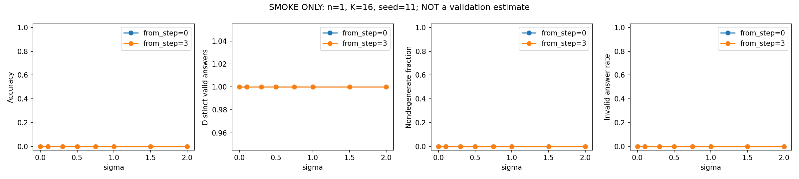
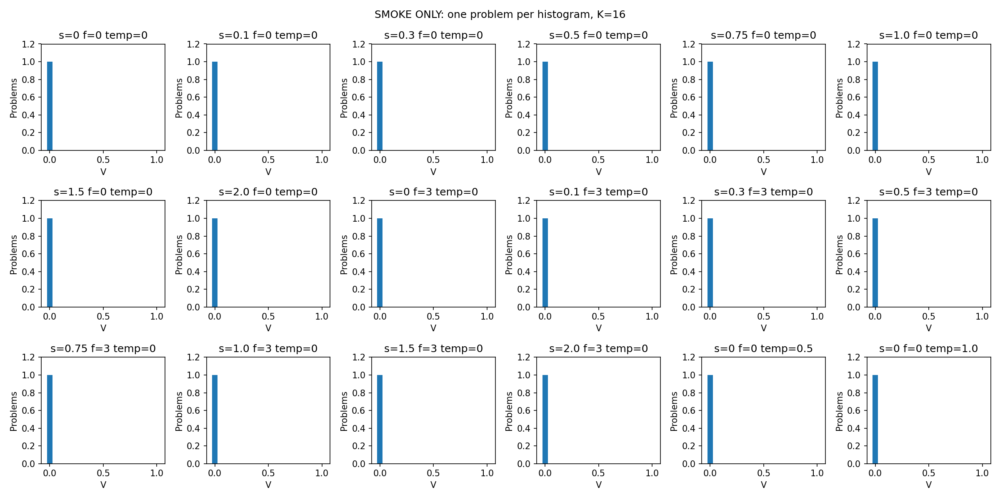

# M0.1 噪声曲线（v2，未完成）

**G-σ未验收。没有推荐sigma，也没有300题完整结果。** 清洁val面板已冻结300题，但fp32生产协议与原官方预测一致率95.299%，低于99%；不把bf16参考复放的高一致率代入生产协议。当前完整实验被显式协议门槛阻止，需先解决或由审查明确变更这一验收条件。

## 已完成smoke

运行 `runs/20261028T114344168937Z_d4e87644eae3_a5d51d`：1/300题（0.333%），K=16，seed11，18设置，183.71秒（低于15分钟），forward=4640，GPU wall=0.05103小时。完整设计seed=11/22/33，不把仅1seed smoke伪装为三个seed实验。烟测只检查代码执行和指标完整性。

| sigma | from_step | temperature | accuracy | distinct valid answers | nondegenerate | invalid rate |
|---|---|---|---|---|---|---|
| 0 | 0 | 0 | 0.000 | 1.0 | 0.000 | 0.000 |
| 0.1 | 0 | 0 | 0.000 | 1.0 | 0.000 | 0.000 |
| 0.3 | 0 | 0 | 0.000 | 1.0 | 0.000 | 0.000 |
| 0.5 | 0 | 0 | 0.000 | 1.0 | 0.000 | 0.000 |
| 0.75 | 0 | 0 | 0.000 | 1.0 | 0.000 | 0.000 |
| 1.0 | 0 | 0 | 0.000 | 1.0 | 0.000 | 0.000 |
| 1.5 | 0 | 0 | 0.000 | 1.0 | 0.000 | 0.000 |
| 2.0 | 0 | 0 | 0.000 | 1.0 | 0.000 | 0.000 |
| 0 | 3 | 0 | 0.000 | 1.0 | 0.000 | 0.000 |
| 0.1 | 3 | 0 | 0.000 | 1.0 | 0.000 | 0.000 |
| 0.3 | 3 | 0 | 0.000 | 1.0 | 0.000 | 0.000 |
| 0.5 | 3 | 0 | 0.000 | 1.0 | 0.000 | 0.000 |
| 0.75 | 3 | 0 | 0.000 | 1.0 | 0.000 | 0.000 |
| 1.0 | 3 | 0 | 0.000 | 1.0 | 0.000 | 0.000 |
| 1.5 | 3 | 0 | 0.000 | 1.0 | 0.000 | 0.000 |
| 2.0 | 3 | 0 | 0.000 | 1.0 | 0.000 | 0.000 |
| 0 | 0 | 0.5 | 0.000 | 6.0 | 0.000 | 0.000 |
| 0 | 0 | 1.0 | 0.000 | 15.0 | 0.000 | 0.000 |





## 固定完整方案与指标

`configs/M01_noise_full.yaml`：val300题，sigma=0/.1/.3/.5/.75/1/1.5/2，from_step=0/3（T=6），K=16，3个随机seed。对照为sigma0、temperature=.5/1；全词表采样，不启top-k/top-p。源协议只从 `configs/protocol_codi_v2.yaml` 读取，物理batch=1、fp32。随机数由实验seed、problem ID、rollout编号稳定哈希生成，与问题遍历顺序无关；不修改全局RNG。

V=每题16次正确次数/16。非退化比例按每个seed的0<V<1题目比例计算，再汇总seed；不把3seed池化成K48。无效答案为提取不到数值；distinct valid排除无效，同时另存including-invalid指标。所有统计先归约到问题，再做按题10k bootstrap，不能把rollout当独立题目。V直方图有17个离散bin。完整报告应另外给出3seed均值与95%区间，当前没有这样的完整结果。

推荐规则固定为：相对同协议sigma0下降严格<5pp、非退化比例≥30%的高斯设置中，非退化比例最大；并列按更小下降、更小sigma、更早from_step。无设置通过时返回selected=null、等待审查，不能自行挑一个。smoke无论多好都不能推荐。

按smoke实测线性外推约 **45.9 GPU wall小时**，不是承诺成本；单题长度、共享GPU竞争与高噪声长输出会改变吞吐。未偷偷减题、减K、挑seed或改batch。完整实验命令（当前会因协议门槛失败，不启动源前向）：

```bash
PYTHONPATH=. HF_HUB_OFFLINE=1 .venv/bin/python scripts/m01_noise.py configs/M01_noise_full.yaml smoke_run=runs/20261028T114344168937Z_d4e87644eae3_a5d51d
```

同一输入两次潜状态最大差0（smoke，fp32）。更全面的8题双精度确定性检查见协议报告。每条rollout文本、提取值、正确性、meta写events.jsonl，每个setting/seed的逐题向量写panel_*.json，V直方图与bootstrap写summary.json。
