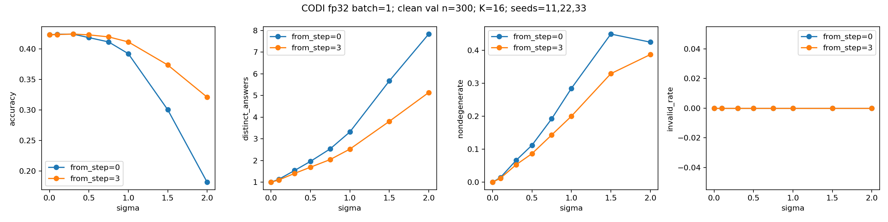
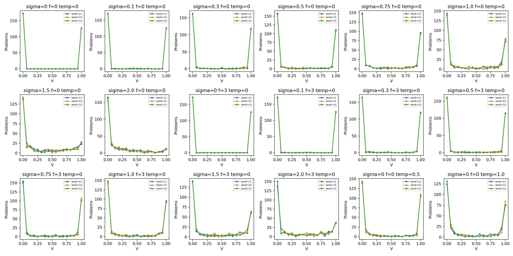

# M0.1 完整噪声实验 v2

运行：`/home/me/PaperField/CalReader/runs/20261028T131534016226Z_83bfd1aab8dd_d4e55b`。固定清洁val=300，K=16，随机seed=[11, 22, 33]，全部18设置完成。模型协议见run/protocol.json；原官方bf16一致性差异和用户接受决定保留，不改变测试边界。

| sigma | from_step | temp | accuracy | distinct valid | nondegenerate | invalid |
|---|---|---|---|---|---|---|
| 0 | 0 | 0 | 0.4233 [0.3667, 0.4800] | 1.0000 [1.0000, 1.0000] | 0.0000 [0.0000, 0.0000] | 0.0000 [0.0000, 0.0000] |
| 0.1 | 0 | 0 | 0.4244 [0.4230, 0.4257] | 1.1400 [1.1317, 1.1483] | 0.0144 [0.0049, 0.0240] | 0.0000 [0.0000, 0.0000] |
| 0.3 | 0 | 0 | 0.4245 [0.4232, 0.4258] | 1.5444 [1.5110, 1.5779] | 0.0667 [0.0667, 0.0667] | 0.0000 [0.0000, 0.0000] |
| 0.5 | 0 | 0 | 0.4188 [0.4159, 0.4218] | 1.9611 [1.9155, 2.0067] | 0.1122 [0.0914, 0.1331] | 0.0000 [0.0000, 0.0000] |
| 0.75 | 0 | 0 | 0.4117 [0.4098, 0.4137] | 2.5378 [2.3969, 2.6786] | 0.1922 [0.1714, 0.2131] | 0.0000 [0.0000, 0.0000] |
| 1.0 | 0 | 0 | 0.3924 [0.3880, 0.3969] | 3.3178 [3.1610, 3.4745] | 0.2844 [0.2636, 0.3053] | 0.0000 [0.0000, 0.0000] |
| 1.5 | 0 | 0 | 0.3004 [0.2892, 0.3116] | 5.6678 [5.5747, 5.7608] | 0.4489 [0.4281, 0.4697] | 0.0000 [0.0000, 0.0000] |
| 2.0 | 0 | 0 | 0.1813 [0.1668, 0.1959] | 7.8311 [7.7082, 7.9540] | 0.4244 [0.3681, 0.4808] | 0.0000 [0.0000, 0.0000] |
| 0 | 3 | 0 | 0.4233 [0.3667, 0.4800] | 1.0000 [1.0000, 1.0000] | 0.0000 [0.0000, 0.0000] | 0.0000 [0.0000, 0.0000] |
| 0.1 | 3 | 0 | 0.4239 [0.4231, 0.4247] | 1.1078 [1.0905, 1.1250] | 0.0122 [0.0074, 0.0170] | 0.0000 [0.0000, 0.0000] |
| 0.3 | 3 | 0 | 0.4247 [0.4222, 0.4271] | 1.4089 [1.3836, 1.4342] | 0.0533 [0.0533, 0.0533] | 0.0000 [0.0000, 0.0000] |
| 0.5 | 3 | 0 | 0.4233 [0.4199, 0.4267] | 1.6933 [1.6685, 1.7182] | 0.0867 [0.0580, 0.1154] | 0.0000 [0.0000, 0.0000] |
| 0.75 | 3 | 0 | 0.4200 [0.4177, 0.4223] | 2.0456 [1.9791, 2.1120] | 0.1433 [0.1054, 0.1813] | 0.0000 [0.0000, 0.0000] |
| 1.0 | 3 | 0 | 0.4117 [0.4102, 0.4132] | 2.5278 [2.4223, 2.6333] | 0.2000 [0.1701, 0.2299] | 0.0000 [0.0000, 0.0000] |
| 1.5 | 3 | 0 | 0.3739 [0.3712, 0.3765] | 3.8056 [3.5579, 4.0532] | 0.3289 [0.3081, 0.3497] | 0.0000 [0.0000, 0.0000] |
| 2.0 | 3 | 0 | 0.3210 [0.3175, 0.3246] | 5.1356 [4.9853, 5.2858] | 0.3867 [0.3220, 0.4513] | 0.0000 [0.0000, 0.0000] |
| 0 | 0 | 0.5 | 0.4223 [0.4187, 0.4259] | 3.6556 [3.4947, 3.8164] | 0.1711 [0.1294, 0.2128] | 0.0000 [0.0000, 0.0000] |
| 0 | 0 | 1.0 | 0.4010 [0.3959, 0.4060] | 5.8322 [5.7334, 5.9310] | 0.3178 [0.2804, 0.3551] | 0.0001 [-0.0005, 0.0007] |


值为均值[95% CI]。sigma0且greedy的确定性项按题bootstrap 10k；随机项为3seed均值的Student-t区间，各seed按题bootstrap另存summary.json。非退化比例先在每seed的K16上计算，未池化为K48。无效提取值不计入distinct valid，含无效的distinct另存JSON。温度对照为完整词表采样，无top-k/top-p。





推荐规则与输出（不得因结果不好修改阈值）：

```json
{
  "selected": {
    "sigma": 1.5,
    "from_step": 3,
    "temperature": 0,
    "accuracy_drop": 0.04944444444444446,
    "nondegenerate": 0.3288888888888889
  },
  "tie_break": "nondegenerate descending, drop ascending, sigma ascending, from_step ascending"
}
```

未通过双门槛则不推荐sigma、等待审查。通过时只报告候选，M1仍须用户审查M0.1第1–4项后进入。

计算成本：35.3689 GPU wall小时，3428312次源forward；GPU型号/环境详见run/environment.json，CUDA设备及权重revision见run/protocol.json。完整命令见run/config.yaml。所有rollout保存在events.jsonl，逐题K16向量在panel_*.json。
