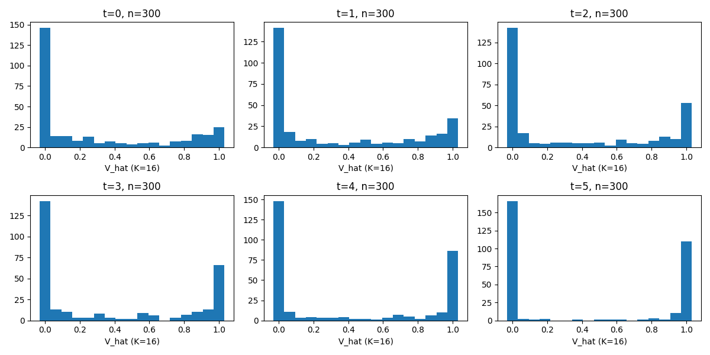
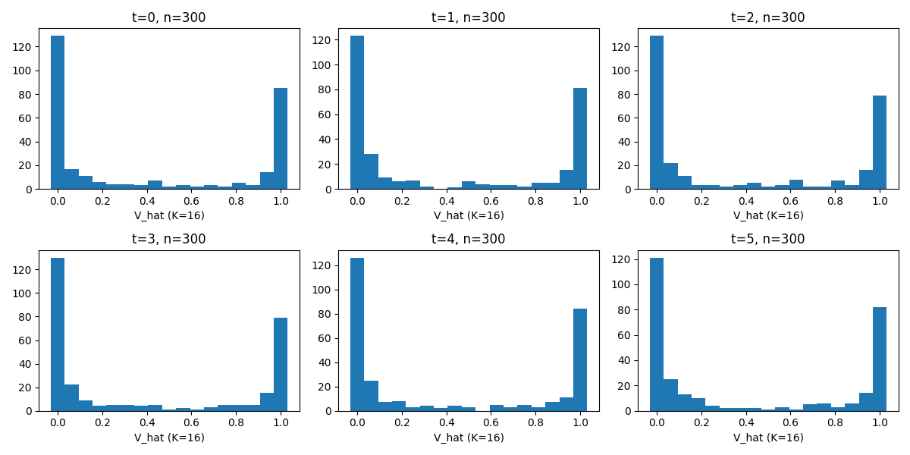
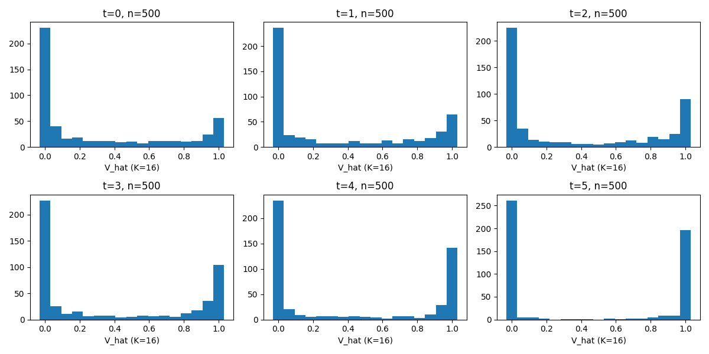
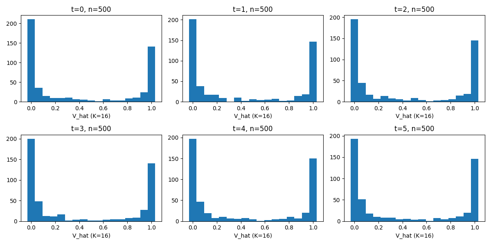
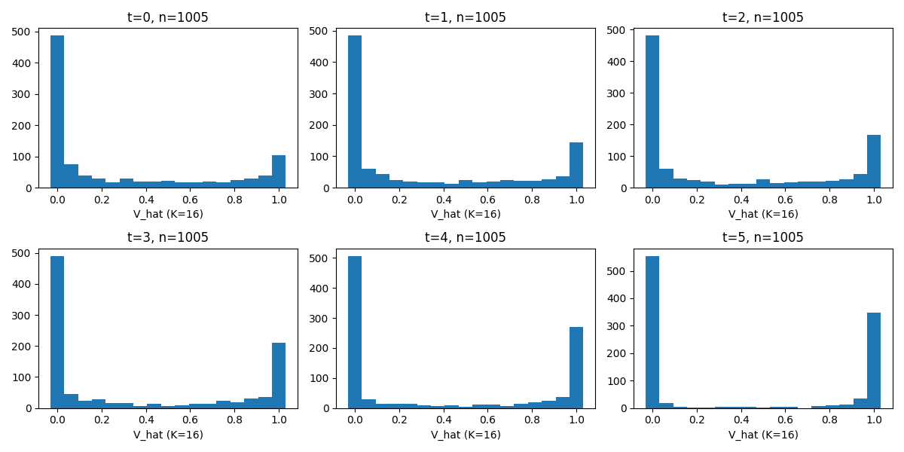
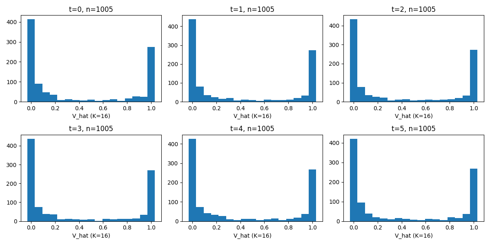

# M1 数据报告：generation_completed

# M1 实测结果与验收状态

## smoke_run
运行：`runs/20261030T013639323603Z_13ad784ef5d6_518bf2`。
```json
{
  "status": "completed",
  "run_id": "20261030T013639323603Z_13ad784ef5d6_518bf2",
  "config_sha256": "13ad784ef5d69b4d31a4ce846eb97e9433e2752072617f96c197b68289bdd4d4",
  "completed_questions": 200,
  "stage_seconds": {
    "prepare": 57.59205275261775,
    "early": 447.2822740653064,
    "traj": 189.22691973787732,
    "mc": 80.61964126490057
  },
  "wall_seconds": 898.6714338141028,
  "source_forward_calls": 22388,
  "questions": 200,
  "stage_questions": {
    "prepare": 200,
    "early": 200,
    "traj": 100,
    "mc": 100
  },
  "storage": {
    "reader_train": {
      "rows": 5147,
      "shards": 5,
      "bytes": 15867184,
      "fp16_max_abs": 0.060455322265625,
      "fp16_max_relative_l2": 0.0004394162097014487,
      "fp16_rmse": 0.0005960849807409876
    },
    "val": {
      "rows": 700,
      "shards": 5,
      "bytes": 2189950,
      "fp16_max_abs": 0.03075408935546875,
      "fp16_max_relative_l2": 0.00036905272281728685,
      "fp16_rmse": 0.00036182447006976963
    }
  },
  "protocol_sha256": "8d7f7700d145a1b120c5d64baa60802797658b1ef6fbfd8e1212e5a45a0f0d2c",
  "candidate_sha256": "343a4aaedb9837c5fe4cff2d8a962a29893f5f198139212c8515632c574877d9",
  "scope": "200 clean/all early exits;100train K8 trajectories;100val two K16 policies at one balanced step;all-layer first10;not full MC",
  "gpu_hours": 0.24963095383725079
}
```

## gate_run
运行：`runs/20261030T015147548907Z_f9aeb43dc9b2_daa0ae`。
```json
{
  "status": "completed",
  "run_id": "20261030T015147548907Z_f9aeb43dc9b2_daa0ae",
  "config_sha256": "f9aeb43dc9b24391a6eb14abd1487e91500cec1feaec40befd1e882dc807ef4a",
  "completed_questions": 300,
  "zero_noise_disagreements": 0,
  "wall_seconds": 1996.418895313982,
  "source_forward_calls": 51367,
  "gate_passed": true,
  "questions": 300,
  "early_T_agreement": 1.0,
  "noise_comparison": [
    {
      "seed": 11,
      "batched": {
        "accuracy": 0.37416666666666665,
        "nondegenerate": 0.32
      },
      "batch1": {
        "accuracy": 0.37416666666666665,
        "nondegenerate": 0.32
      },
      "abs_delta": {
        "accuracy": 0.0,
        "nondegenerate": 0.0
      },
      "passed": true
    },
    {
      "seed": 22,
      "batched": {
        "accuracy": 0.3727083333333333,
        "nondegenerate": 0.33
      },
      "batch1": {
        "accuracy": 0.3727083333333333,
        "nondegenerate": 0.33
      },
      "abs_delta": {
        "accuracy": 0.0,
        "nondegenerate": 0.0
      },
      "passed": true
    },
    {
      "seed": 33,
      "batched": {
        "accuracy": 0.3747916666666667,
        "nondegenerate": 0.33666666666666667
      },
      "batch1": {
        "accuracy": 0.3747916666666667,
        "nondegenerate": 0.33666666666666667
      },
      "abs_delta": {
        "accuracy": 0.0,
        "nondegenerate": 0.0
      },
      "passed": true
    }
  ],
  "tolerances": {
    "accuracy": 0.0020833333333333814,
    "nondegenerate": 0.016666666666666663
  },
  "native_next_state_max_abs": 6.103515625e-05,
  "native_next_state_max_relative_l2": 2.186926622016472e-06,
  "saved_next_state_max_abs": 0.03127288818359375,
  "saved_next_state_max_relative_l2": 0.0006894657271914184,
  "gpu_hours": 0.5545608042538839
}
```

## budget_run
运行：`runs/20261030T022507631329Z_ae2889e005b8_1fe957`。
```json
{
  "status": "completed",
  "run_id": "20261030T022507631329Z_ae2889e005b8_1fe957",
  "config_sha256": "ae2889e005b8abc88fe4c206506631471a3b4b4fab3b31a29c11e5e0d87ff935",
  "preflight_gpu_hours": 1.0541918415947455,
  "preflight_runs": {
    "runs/20261030T012044635539Z_49d2f4edb21f_0553af": 0,
    "runs/20261030T013639323603Z_13ad784ef5d6_518bf2": 0.24963095383725079,
    "runs/20261030T012126501342Z_c7c7a651e47e_6eef7a": 0.25000008350361086,
    "runs/20261030T015147548907Z_f9aeb43dc9b2_daa0ae": 0.5545608042538839
  },
  "reader_train": 20000,
  "reader_train_requested": 20000,
  "reduced": false,
  "estimated_gpu_hours_including_gate_smoke": 39.462155564981884,
  "estimated_disk_gib": 6.816039006225765,
  "throughput_margin": 1.25,
  "storage_margin": 2.0,
  "per_problem_seconds": {
    "clean_and_early": 2.5243716340896207,
    "K8_trajectory": 1.8922691973787733,
    "two_K16_MC_one_step": 0.8061964126490057
  },
  "split_sha256": "8bcc4b136015177c7a35f392d6b0207412d2597d55f2aeaa4f7d9686106e8115",
  "counts": {
    "reader_train": 20000,
    "reader_val": 2000,
    "val": 300,
    "cal": 500,
    "test": 1005
  },
  "gpu_hours": 0,
  "source_forward_calls": 0
}
```

## generation_run
运行：`runs/20261102T031137055963Z_24b03138a255_a2c9f2`。
```json
{
  "status": "completed",
  "run_id": "20261102T031137055963Z_24b03138a255_a2c9f2",
  "config_sha256": "24b03138a25510521d8dcdbc000007d235034ff4a3c4e2e059b81fd1a39de64e",
  "completed_splits": {
    "reader_train": 20000,
    "reader_val": 2000,
    "val": 300,
    "cal": 500,
    "test": 1005
  },
  "storage": {
    "reader_train": {
      "rows": 927428,
      "shards": 313,
      "bytes": 2882429062,
      "fp16_max_abs": 0.062469482421875,
      "fp16_max_relative_l2": 0.000453750864835456,
      "fp16_rmse": 0.00049857153626239,
      "quantization_scope": "newly_generated_states_only; interrupted_run had no durable quantization aggregates",
      "recovered_rows": 469806
    },
    "reader_val": {
      "rows": 102862,
      "shards": 32,
      "bytes": 318744224,
      "fp16_max_abs": 0.062469482421875,
      "fp16_max_relative_l2": 0.0004494989407248795,
      "fp16_rmse": 0.0005936881192122071
    },
    "val": {
      "rows": 2100,
      "shards": 5,
      "bytes": 6697947,
      "fp16_max_abs": 0.03075408935546875,
      "fp16_max_relative_l2": 0.00036905272281728685,
      "fp16_rmse": 0.0003489758997494122
    },
    "cal": {
      "rows": 3500,
      "shards": 8,
      "bytes": 11170233,
      "fp16_max_abs": 0.031158447265625,
      "fp16_max_relative_l2": 0.00039241736521944404,
      "fp16_rmse": 0.00035500994365728457
    },
    "test": {
      "rows": 7035,
      "shards": 16,
      "bytes": 22444416,
      "fp16_max_abs": 0.029754638671875,
      "fp16_max_relative_l2": 0.00039972804370336235,
      "fp16_rmse": 0.00035705463499154734,
      "quantization_scope": "newly_generated_states_only; interrupted_run had no durable quantization aggregates",
      "recovered_rows": 5376
    }
  },
  "completed_questions": 23805,
  "progress": {
    "split": "test",
    "completed": 1005,
    "total": 1005
  },
  "gpu_hours": 0.5231912202019444,
  "source_forward_calls": 45362,
  "counts": {
    "reader_train": 20000,
    "reader_val": 2000,
    "val": 300,
    "cal": 500,
    "test": 1005
  },
  "all_layers_questions": 1000,
  "variance_pairs": 50,
  "output_bytes": 3248059671,
  "prior_generation_gpu_hours": 22.092181869612283,
  "prior_source_forward_calls": 2712354,
  "total_generation_gpu_hours": 22.615372757036727,
  "wall_seconds": 1883.4883927269998
}
```

## 早退标签（按题bootstrap10k）
|split|t|accuracy [95% CI]|
|---|---|---|
|reader_train|0|0.4929 [0.48605, 0.49985]|
|reader_train|1|0.5896 [0.58285, 0.5963]|
|reader_train|2|0.5799 [0.57295, 0.58675]|
|reader_train|3|0.7736 [0.7678487500000001, 0.77945]|
|reader_train|4|0.7673 [0.76145, 0.77325]|
|reader_train|5|0.8198 [0.8145, 0.82515]|
|reader_train|6|0.8190 [0.8137, 0.82435]|
|reader_val|0|0.4725 [0.451, 0.4945]|
|reader_val|1|0.5840 [0.5625, 0.6055]|
|reader_val|2|0.5690 [0.5475, 0.59]|
|reader_val|3|0.7595 [0.7405, 0.778]|
|reader_val|4|0.7620 [0.743, 0.7805]|
|reader_val|5|0.8170 [0.8, 0.834]|
|reader_val|6|0.8160 [0.7989875000000001, 0.833]|
|val|0|0.1967 [0.15333333333333332, 0.24333333333333335]|
|val|1|0.2800 [0.23, 0.33]|
|val|2|0.2400 [0.19333333333333333, 0.29]|
|val|3|0.3933 [0.33666666666666667, 0.45]|
|val|4|0.3833 [0.32666666666666666, 0.44]|
|val|5|0.4300 [0.37333333333333335, 0.4866666666666667]|
|val|6|0.4233 [0.36666666666666664, 0.48]|
|cal|0|0.2540 [0.216, 0.292]|
|cal|1|0.2480 [0.21, 0.286]|
|cal|2|0.2320 [0.196, 0.27]|
|cal|3|0.3780 [0.336, 0.422]|
|cal|4|0.3780 [0.336, 0.422]|
|cal|5|0.4500 [0.406, 0.494]|
|cal|6|0.4520 [0.408, 0.496]|
|test|0|0.2328 [0.20696517412935322, 0.25970149253731345]|
|test|1|0.2468 [0.2208955223880597, 0.2746268656716418]|
|test|2|0.2269 [0.20196517412935328, 0.2527363184079602]|
|test|3|0.3642 [0.3353233830845771, 0.3940298507462687]|
|test|4|0.3672 [0.3383084577114428, 0.3970149253731343]|
|test|5|0.4159 [0.38606965174129354, 0.44676616915422884]|
|test|6|0.4199 [0.3890547263681592, 0.4507462686567164]|






## 按题bootstrap10k标签统计
|split|policy|t|V mean [95% CI]|nondegenerate [95% CI]|
|---|---|---|---|---|
|val|pi|0|0.2950 [0.25145833333333334, 0.3383333333333333]|0.4300 [0.37666666666666665, 0.4866666666666667]|
|val|pi|1|0.3290 [0.28291666666666665, 0.3747916666666667]|0.4167 [0.36, 0.47333333333333333]|
|val|pi|2|0.3544 [0.30541666666666667, 0.40208333333333335]|0.3500 [0.2966666666666667, 0.4066666666666667]|
|val|pi|3|0.3752 [0.3247864583333333, 0.42521354166666664]|0.3067 [0.25666666666666665, 0.36]|
|val|pi|4|0.4004 [0.3475, 0.4535416666666667]|0.2200 [0.17333333333333334, 0.26666666666666666]|
|val|pi|5|0.4204 [0.3647916666666667, 0.476875]|0.0800 [0.05, 0.11333333333333333]|
|val|pi_T|0|0.4077 [0.3564583333333333, 0.46020833333333333]|0.2867 [0.23666666666666666, 0.34]|
|val|pi_T|1|0.4033 [0.3516666666666667, 0.4556302083333333]|0.3200 [0.26666666666666666, 0.37333333333333335]|
|val|pi_T|2|0.4029 [0.35186979166666665, 0.4545885416666666]|0.3067 [0.25666666666666665, 0.36]|
|val|pi_T|3|0.3977 [0.34686979166666665, 0.4504166666666667]|0.3033 [0.25333333333333335, 0.3566666666666667]|
|val|pi_T|4|0.4058 [0.354375, 0.4583385416666666]|0.3000 [0.24666666666666667, 0.35333333333333333]|
|val|pi_T|5|0.4062 [0.355, 0.4583333333333333]|0.3233 [0.27, 0.38]|
|cal|pi|0|0.3038 [0.269996875, 0.337625]|0.4280 [0.386, 0.472]|
|cal|pi|1|0.3355 [0.3, 0.371375]|0.4000 [0.358, 0.442]|
|cal|pi|2|0.3650 [0.3275, 0.40262812499999995]|0.3720 [0.33, 0.414]|
|cal|pi|3|0.3880 [0.349871875, 0.426625]|0.3380 [0.296, 0.38]|
|cal|pi|4|0.4125 [0.37275, 0.452875]|0.2460 [0.21, 0.284]|
|cal|pi|5|0.4450 [0.402875, 0.48775]|0.0860 [0.062, 0.112]|
|cal|pi_T|0|0.4113 [0.37174687500000003, 0.45125]|0.2980 [0.258, 0.338]|
|cal|pi_T|1|0.4156 [0.3765, 0.45575]|0.3040 [0.264, 0.346]|
|cal|pi_T|2|0.4163 [0.377625, 0.456375]|0.3200 [0.28, 0.362]|
|cal|pi_T|3|0.4128 [0.373125, 0.453]|0.3200 [0.28, 0.362]|
|cal|pi_T|4|0.4179 [0.37825, 0.45875]|0.3060 [0.266, 0.348]|
|cal|pi_T|5|0.4155 [0.376496875, 0.455625]|0.3220 [0.282, 0.364]|
|test|pi|0|0.2866 [0.2634950248756219, 0.310634328358209]|0.4129 [0.38308457711442784, 0.4437810945273632]|
|test|pi|1|0.3146 [0.28998756218905475, 0.33973880597014927]|0.3761 [0.34626865671641793, 0.4059701492537313]|
|test|pi|2|0.3370 [0.31200248756218907, 0.36306125621890545]|0.3552 [0.3263681592039801, 0.3850746268656716]|
|test|pi|3|0.3583 [0.3319636194029851, 0.38507618159203977]|0.3025 [0.2746268656716418, 0.33134328358208953]|
|test|pi|4|0.3901 [0.3624378109452736, 0.4184110696517413]|0.2279 [0.20298507462686566, 0.2537313432835821]|
|test|pi|5|0.4118 [0.3825870646766169, 0.44166666666666665]|0.1015 [0.08358208955223881, 0.12039800995024875]|
|test|pi_T|0|0.3872 [0.3602596393034826, 0.41492537313432837]|0.3164 [0.28756218905472636, 0.345273631840796]|
|test|pi_T|1|0.3840 [0.3572139303482587, 0.4116915422885572]|0.2925 [0.2646766169154229, 0.32139303482587067]|
|test|pi_T|2|0.3871 [0.3600124378109453, 0.41480254975124375]|0.2985 [0.2706218905472637, 0.32736318407960197]|
|test|pi_T|3|0.3836 [0.35690298507462687, 0.41119402985074627]|0.2955 [0.26666666666666666, 0.32338308457711445]|
|test|pi_T|4|0.3869 [0.3601974502487562, 0.41455223880597014]|0.3104 [0.28258706467661693, 0.33930348258706466]|
|test|pi_T|5|0.3859 [0.3587049129353234, 0.413681592039801]|0.3144 [0.2855721393034826, 0.34228855721393037]|

K64方差结果：
```json
[
  {
    "policy": "pi",
    "pairs": 50,
    "K16_sampling_variance_from_four_K16_blocks": {
      "mean": 0.0025846354166666665,
      "ci95": [
        0.0011393229166666665,
        0.0043816731770833315
      ],
      "n_questions": 50,
      "bootstrap_resamples": 10000,
      "bootstrap_rng_seed": 20261028
    },
    "limitations": "Only4 blocks per pair; noisy variance estimates; distinct seeds from main K16 labels"
  },
  {
    "policy": "pi_T",
    "pairs": 50,
    "K16_sampling_variance_from_four_K16_blocks": {
      "mean": 0.003424479166666667,
      "ci95": [
        0.00189453125,
        0.005293131510416665
      ],
      "n_questions": 50,
      "bootstrap_resamples": 10000,
      "bootstrap_rng_seed": 20261028
    },
    "limitations": "Only4 blocks per pair; noisy variance estimates; distinct seeds from main K16 labels"
  }
]
```


# 协议定义和运行历史

# 当前状态：服务器重启后M1 v3续跑（2026-11-02）


## 2026-11-02 — 服务器重启后 v3 恢复

用户确认服务器重启并要求续跑。原v2进程已消失，metrics残留running是重启前快照，不代表仍在执行。重启前test798/1005、v2成本12.800449GPU小时/1606828次forward；原失败生成9.291732GPU小时也计入预算。四个已完成split复用，不重跑。test已持久化768题/5376状态行、9216条MC记录和44条K64记录，通过冻结前缀、cohort、完整步骤和行为日志核验；第769题起重算，共剩237题。

新代码与配置v3、新输出 `data/dumps/codi_gpt2_v3`，原v1/v2不覆盖。已完成文件用硬链接复用，生成器不修改复用文件；本次记录SHA和祖先run成本。重启恢复与policy/data测试8项通过。物理GPU2当前空闲，显式继续使用；release20GiB成功且自动填充保持暂停。自动配重调用已使用整数参数。

命令：`PYTHONPATH=. PYTHONUTF8=1 OMP_NUM_THREADS=2 HF_HUB_OFFLINE=1 .venv/bin/python scripts/m1_finish_job_v3.py configs/M1_data_v3.yaml device=cuda:2`。tmux `clr-m1-reboot-v3`，状态 `reports/evidence_M1/full_job_v3.json`。保持原协议、划分、seed及全部实验设置；中断test段的量化误差聚合未持久化，恢复后的test误差统计仅覆盖新生成部分，限制与reader_train一致，不能称为全量统计。

# 当前状态：M1 v2 断点续跑中（2026-11-01）


2026-11-01 北京时间21:54启动v2续跑，run `20261101T135435455123Z_ed305481698c_e92e9a`，物理GPU2；命令 `PYTHONPATH=. PYTHONUTF8=1 OMP_NUM_THREADS=2 HF_HUB_OFFLINE=1 .venv/bin/python scripts/m1_finish_job_v2.py configs/M1_data_v2.yaml device=cuda:2`。恢复核验316个文件/469806行/10112题通过，审计见 `reports/evidence_M1/recovery_audit_v2.json`。自动完成链将继续生成剩余split，计算标签统计和图，更新报告及冻结清单。当前仍在运行，不是完成结果。

以下保留此前运行历史。

# M1 数据报告：generation_failed

# M1 实测结果与验收状态

## smoke_run
运行：`runs/20261030T013639323603Z_13ad784ef5d6_518bf2`。
```json
{
  "status": "completed",
  "run_id": "20261030T013639323603Z_13ad784ef5d6_518bf2",
  "config_sha256": "13ad784ef5d69b4d31a4ce846eb97e9433e2752072617f96c197b68289bdd4d4",
  "completed_questions": 200,
  "stage_seconds": {
    "prepare": 57.59205275261775,
    "early": 447.2822740653064,
    "traj": 189.22691973787732,
    "mc": 80.61964126490057
  },
  "wall_seconds": 898.6714338141028,
  "source_forward_calls": 22388,
  "questions": 200,
  "stage_questions": {
    "prepare": 200,
    "early": 200,
    "traj": 100,
    "mc": 100
  },
  "storage": {
    "reader_train": {
      "rows": 5147,
      "shards": 5,
      "bytes": 15867184,
      "fp16_max_abs": 0.060455322265625,
      "fp16_max_relative_l2": 0.0004394162097014487,
      "fp16_rmse": 0.0005960849807409876
    },
    "val": {
      "rows": 700,
      "shards": 5,
      "bytes": 2189950,
      "fp16_max_abs": 0.03075408935546875,
      "fp16_max_relative_l2": 0.00036905272281728685,
      "fp16_rmse": 0.00036182447006976963
    }
  },
  "protocol_sha256": "8d7f7700d145a1b120c5d64baa60802797658b1ef6fbfd8e1212e5a45a0f0d2c",
  "candidate_sha256": "343a4aaedb9837c5fe4cff2d8a962a29893f5f198139212c8515632c574877d9",
  "scope": "200 clean/all early exits;100train K8 trajectories;100val two K16 policies at one balanced step;all-layer first10;not full MC",
  "gpu_hours": 0.24963095383725079
}
```

## gate_run
运行：`runs/20261030T015147548907Z_f9aeb43dc9b2_daa0ae`。
```json
{
  "status": "completed",
  "run_id": "20261030T015147548907Z_f9aeb43dc9b2_daa0ae",
  "config_sha256": "f9aeb43dc9b24391a6eb14abd1487e91500cec1feaec40befd1e882dc807ef4a",
  "completed_questions": 300,
  "zero_noise_disagreements": 0,
  "wall_seconds": 1996.418895313982,
  "source_forward_calls": 51367,
  "gate_passed": true,
  "questions": 300,
  "early_T_agreement": 1.0,
  "noise_comparison": [
    {
      "seed": 11,
      "batched": {
        "accuracy": 0.37416666666666665,
        "nondegenerate": 0.32
      },
      "batch1": {
        "accuracy": 0.37416666666666665,
        "nondegenerate": 0.32
      },
      "abs_delta": {
        "accuracy": 0.0,
        "nondegenerate": 0.0
      },
      "passed": true
    },
    {
      "seed": 22,
      "batched": {
        "accuracy": 0.3727083333333333,
        "nondegenerate": 0.33
      },
      "batch1": {
        "accuracy": 0.3727083333333333,
        "nondegenerate": 0.33
      },
      "abs_delta": {
        "accuracy": 0.0,
        "nondegenerate": 0.0
      },
      "passed": true
    },
    {
      "seed": 33,
      "batched": {
        "accuracy": 0.3747916666666667,
        "nondegenerate": 0.33666666666666667
      },
      "batch1": {
        "accuracy": 0.3747916666666667,
        "nondegenerate": 0.33666666666666667
      },
      "abs_delta": {
        "accuracy": 0.0,
        "nondegenerate": 0.0
      },
      "passed": true
    }
  ],
  "tolerances": {
    "accuracy": 0.0020833333333333814,
    "nondegenerate": 0.016666666666666663
  },
  "native_next_state_max_abs": 6.103515625e-05,
  "native_next_state_max_relative_l2": 2.186926622016472e-06,
  "saved_next_state_max_abs": 0.03127288818359375,
  "saved_next_state_max_relative_l2": 0.0006894657271914184,
  "gpu_hours": 0.5545608042538839
}
```

## budget_run
运行：`runs/20261030T022507631329Z_ae2889e005b8_1fe957`。
```json
{
  "status": "completed",
  "run_id": "20261030T022507631329Z_ae2889e005b8_1fe957",
  "config_sha256": "ae2889e005b8abc88fe4c206506631471a3b4b4fab3b31a29c11e5e0d87ff935",
  "preflight_gpu_hours": 1.0541918415947455,
  "preflight_runs": {
    "runs/20261030T012044635539Z_49d2f4edb21f_0553af": 0,
    "runs/20261030T013639323603Z_13ad784ef5d6_518bf2": 0.24963095383725079,
    "runs/20261030T012126501342Z_c7c7a651e47e_6eef7a": 0.25000008350361086,
    "runs/20261030T015147548907Z_f9aeb43dc9b2_daa0ae": 0.5545608042538839
  },
  "reader_train": 20000,
  "reader_train_requested": 20000,
  "reduced": false,
  "estimated_gpu_hours_including_gate_smoke": 39.462155564981884,
  "estimated_disk_gib": 6.816039006225765,
  "throughput_margin": 1.25,
  "storage_margin": 2.0,
  "per_problem_seconds": {
    "clean_and_early": 2.5243716340896207,
    "K8_trajectory": 1.8922691973787733,
    "two_K16_MC_one_step": 0.8061964126490057
  },
  "split_sha256": "8bcc4b136015177c7a35f392d6b0207412d2597d55f2aeaa4f7d9686106e8115",
  "counts": {
    "reader_train": 20000,
    "reader_val": 2000,
    "val": 300,
    "cal": 500,
    "test": 1005
  },
  "gpu_hours": 0,
  "source_forward_calls": 0
}
```

## generation_run
运行：`runs/20261031T170800331382Z_39c11741d8fb_ec36b0`。
```json
{
  "status": "failed",
  "run_id": "20261031T170800331382Z_39c11741d8fb_ec36b0",
  "config_sha256": "39c11741d8fb4ac082fae8f402caeb94944e35f80c85dca9eff9d52371d81c50",
  "completed_questions": 10147,
  "progress": {
    "split": "reader_train",
    "completed": 10147,
    "total": 20000
  },
  "gpu_hours": 9.291732421955288,
  "source_forward_calls": 1105526,
  "wall_seconds": 33450.236719039036,
  "error_type": "RuntimeError",
  "error": "Disk reserve below1GiB; stopped, no data deletion"
}
```

**M1全量尚未完成；不存在完整MC直方图或K64方差结论。**


# 协议定义和运行历史

# 当前状态（2026-11-01）：全量已恢复运行，尚未完成

确认重启已进入真实源模型计算：新run `20261031T170800331382Z_39c11741d8fb_ec36b0`（北京时间2026-11-01），config SHA与旧失败尝试完全一致。检查时已完成4题、417次forward；当前磁盘约29GiB，物理GPU2。此前失败run与所有验收结果均保留。

以下保留先前失败及验收记录。

# M1 数据报告：generation_failed

# M1 实测结果与验收状态

## smoke_run
运行：`runs/20261030T013639323603Z_13ad784ef5d6_518bf2`。
```json
{
  "status": "completed",
  "run_id": "20261030T013639323603Z_13ad784ef5d6_518bf2",
  "config_sha256": "13ad784ef5d69b4d31a4ce846eb97e9433e2752072617f96c197b68289bdd4d4",
  "completed_questions": 200,
  "stage_seconds": {
    "prepare": 57.59205275261775,
    "early": 447.2822740653064,
    "traj": 189.22691973787732,
    "mc": 80.61964126490057
  },
  "wall_seconds": 898.6714338141028,
  "source_forward_calls": 22388,
  "questions": 200,
  "stage_questions": {
    "prepare": 200,
    "early": 200,
    "traj": 100,
    "mc": 100
  },
  "storage": {
    "reader_train": {
      "rows": 5147,
      "shards": 5,
      "bytes": 15867184,
      "fp16_max_abs": 0.060455322265625,
      "fp16_max_relative_l2": 0.0004394162097014487,
      "fp16_rmse": 0.0005960849807409876
    },
    "val": {
      "rows": 700,
      "shards": 5,
      "bytes": 2189950,
      "fp16_max_abs": 0.03075408935546875,
      "fp16_max_relative_l2": 0.00036905272281728685,
      "fp16_rmse": 0.00036182447006976963
    }
  },
  "protocol_sha256": "8d7f7700d145a1b120c5d64baa60802797658b1ef6fbfd8e1212e5a45a0f0d2c",
  "candidate_sha256": "343a4aaedb9837c5fe4cff2d8a962a29893f5f198139212c8515632c574877d9",
  "scope": "200 clean/all early exits;100train K8 trajectories;100val two K16 policies at one balanced step;all-layer first10;not full MC",
  "gpu_hours": 0.24963095383725079
}
```

## gate_run
运行：`runs/20261030T015147548907Z_f9aeb43dc9b2_daa0ae`。
```json
{
  "status": "completed",
  "run_id": "20261030T015147548907Z_f9aeb43dc9b2_daa0ae",
  "config_sha256": "f9aeb43dc9b24391a6eb14abd1487e91500cec1feaec40befd1e882dc807ef4a",
  "completed_questions": 300,
  "zero_noise_disagreements": 0,
  "wall_seconds": 1996.418895313982,
  "source_forward_calls": 51367,
  "gate_passed": true,
  "questions": 300,
  "early_T_agreement": 1.0,
  "noise_comparison": [
    {
      "seed": 11,
      "batched": {
        "accuracy": 0.37416666666666665,
        "nondegenerate": 0.32
      },
      "batch1": {
        "accuracy": 0.37416666666666665,
        "nondegenerate": 0.32
      },
      "abs_delta": {
        "accuracy": 0.0,
        "nondegenerate": 0.0
      },
      "passed": true
    },
    {
      "seed": 22,
      "batched": {
        "accuracy": 0.3727083333333333,
        "nondegenerate": 0.33
      },
      "batch1": {
        "accuracy": 0.3727083333333333,
        "nondegenerate": 0.33
      },
      "abs_delta": {
        "accuracy": 0.0,
        "nondegenerate": 0.0
      },
      "passed": true
    },
    {
      "seed": 33,
      "batched": {
        "accuracy": 0.3747916666666667,
        "nondegenerate": 0.33666666666666667
      },
      "batch1": {
        "accuracy": 0.3747916666666667,
        "nondegenerate": 0.33666666666666667
      },
      "abs_delta": {
        "accuracy": 0.0,
        "nondegenerate": 0.0
      },
      "passed": true
    }
  ],
  "tolerances": {
    "accuracy": 0.0020833333333333814,
    "nondegenerate": 0.016666666666666663
  },
  "native_next_state_max_abs": 6.103515625e-05,
  "native_next_state_max_relative_l2": 2.186926622016472e-06,
  "saved_next_state_max_abs": 0.03127288818359375,
  "saved_next_state_max_relative_l2": 0.0006894657271914184,
  "gpu_hours": 0.5545608042538839
}
```

## budget_run
运行：`runs/20261030T022507631329Z_ae2889e005b8_1fe957`。
```json
{
  "status": "completed",
  "run_id": "20261030T022507631329Z_ae2889e005b8_1fe957",
  "config_sha256": "ae2889e005b8abc88fe4c206506631471a3b4b4fab3b31a29c11e5e0d87ff935",
  "preflight_gpu_hours": 1.0541918415947455,
  "preflight_runs": {
    "runs/20261030T012044635539Z_49d2f4edb21f_0553af": 0,
    "runs/20261030T013639323603Z_13ad784ef5d6_518bf2": 0.24963095383725079,
    "runs/20261030T012126501342Z_c7c7a651e47e_6eef7a": 0.25000008350361086,
    "runs/20261030T015147548907Z_f9aeb43dc9b2_daa0ae": 0.5545608042538839
  },
  "reader_train": 20000,
  "reader_train_requested": 20000,
  "reduced": false,
  "estimated_gpu_hours_including_gate_smoke": 39.462155564981884,
  "estimated_disk_gib": 6.816039006225765,
  "throughput_margin": 1.25,
  "storage_margin": 2.0,
  "per_problem_seconds": {
    "clean_and_early": 2.5243716340896207,
    "K8_trajectory": 1.8922691973787733,
    "two_K16_MC_one_step": 0.8061964126490057
  },
  "split_sha256": "8bcc4b136015177c7a35f392d6b0207412d2597d55f2aeaa4f7d9686106e8115",
  "counts": {
    "reader_train": 20000,
    "reader_val": 2000,
    "val": 300,
    "cal": 500,
    "test": 1005
  },
  "gpu_hours": 0,
  "source_forward_calls": 0
}
```

## generation_run
运行：`runs/20261030T022518234836Z_39c11741d8fb_f9026e`。
```json
{
  "status": "failed",
  "run_id": "20261030T022518234836Z_39c11741d8fb_f9026e",
  "config_sha256": "39c11741d8fb4ac082fae8f402caeb94944e35f80c85dca9eff9d52371d81c50",
  "wall_seconds": 0.7256925730034709,
  "gpu_hours": 0,
  "source_forward_calls": 0,
  "error_type": "RuntimeError",
  "error": "Insufficient disk for measured budget plus 2GiB reserve"
}
```

**M1全量尚未完成；不存在完整MC直方图或K64方差结论。**


# 协议定义和运行历史

# M1：CODI-GPT2 单源数据生成（进行中）

本里程碑采用用户 2026-10-30 给出的新任务书，替代总规划原 M1 并提前完成 M2 的源模型调用部分。M0.1 已审查通过；CODI-LLaMA 现状获接受、噪声延至 M6 前；Huginn 暂停。没有训练 reader 或 probe。

## 当前交付状态

已实现候选划分、gold 方程式中间量解析、共享 `clr/policy.py::rollout`、早退、fp16 safetensors/Parquet 存储和 loader；200题 smoke 正在进行（第一版因工作量超过15分钟失败，按正式split分工修正后重跑）。v3 仅有候选池，**尚未最终冻结，也未生成全量数据**。候选生成 run：`20261030T011913127306Z_cb2983bfb3ec_109195`。smoke：`20261030T012126501342Z_c7c7a651e47e_6eef7a`。批处理关卡将在 smoke 成功后运行；未通过时不会启动全量。

| 候选 split | 题数 | gold CoT 解析失败（保留题目） |
|---|---:|---:|
| reader_train |20000|40|
| reader_val |2000|3|
| val |300|3|
| cal |500|9|
| test |1005|12|

reader_train/reader_val 属于源模型 GSM8k-Aug 训练分布，不称为源模型未见题。从按 M0.1 清洁 heldout 边界核验的训练ID登记中，再对题目文本归一化去重：91条重复，发现1条答案冲突，固定保留原文件首条并保留冲突证据。随后对problem ID排序、seed11 shuffle抽样。此处题数仍待smoke预算确认，若超60GPU小时或8GiB只缩reader_train。

val300 保留原顺序、ID和cohort上下文，来自官方 Internalize_CoT_Step_by_Step 固定commit的500题valid.txt（M0.1保守13-gram去重后剩493题，分val300/cal193）。v3将cal193与clean test1312合并，以seed11对ID排序后的池shuffle为500/1005；没有任何reader结果参与重分配。gold CoT来自相同commit的valid.txt/test.txt，URL和SHA在候选生成run/resources.json。原v2不修改。全层面板在预算确认后按固定hash选择至多800个reader_train，其余来自reader_val，合计1000题，以支持后续层探针的训练/验证分离。候选准备中的reader_val-only占位面板不会用于最终冻结；选择不依赖模型结果。

## 状态和策略语义

设固定cohort宽度为w：z0位于BOT位置w；zt（1..6）位于第t个连续输入位置w+t，保存该位置最后一层输出。共有7个观测状态；层0是embedding输出，层12是最终归一化层。

一次动作使用 `prj(z_t + sigma*||z_t||*epsilon/sqrt(d))`，其前向输出是z_(t+1)。故从zt出发，from_step=t 对应扰动之后t+1..T的转换。trajectory保存观测状态和实际加噪反馈两种张量；t0起点自身仍是干净观测，不把加噪输入与后继输出混为一谈。最终zT不再经过潜在步扰动。

共享策略接收包含batch1精确KV和前缀状态的PrefixStates。同题K路复制此KV，无额外padding；使用原协议的左padding、隐式绝对position、prefill mask、后续无mask。manifest记录cohort_id、left_padding、pad_to和protocol hash。M5必须调用同一rollout函数并保留同一上下文。

标签生成使用生产fp32状态；磁盘特征保存fp16，另设相对L2往返误差阈值0.001并报告最大绝对误差/RMSE。批处理验收区分原始fp32状态续算和fp16已保存状态续算，在相同原始KV上量化答案差异与z_(t+1)误差，不能用容差掩盖答案不一致。

## 预注册验收与成本

200题smoke：固定前100个候选reader_train和前100个val；每题clean、7个早退、K8轨迹，以及两策略各K16在一个均衡轮换t上。它用于代表性吞吐估计；全量MC仍做所有6个t，不把smoke当作完整MC。smoke设900秒硬截止。前三题三个seed的共享策略与M0.1 from_step3比对；全部200题早退T与正常推理比较。

smoke后val300验收：早退T必须完全一致；sigma0的K16续算对每题每个t记录答案一致性和最大逐元素/相对L2误差，列出全部不一致。sigma1.5/from_step3，K16、seed11/22/33，与M0.1同上下文同seed的batch1面板比较。M0.1三个seed准确率范围为0.208333pp，非退化比例范围为1.666667pp；预注册为各seed绝对差均不超过相应范围。未通过关卡不使用该批处理路径生成全量。

测试已通过：`PYTHONPATH=. OMP_NUM_THREADS=2 .venv/bin/python -m pytest -q tests/test_m1_policy.py tests/test_m1_data.py`，5 passed（tiny模型测试，不替代真实300题关卡）。全量预算、标签直方图、K64方差和最终规模均待实际运行，不填写估计为实测。

## 偏离与限制

- 候选准备首次因输出目录未创建失败，修复目录创建后重新运行；失败run保留。
- GPU4实际CUDA初始化OOM（运行前空闲显存发生变化），0次源前向；显式改GPU2，物理GPU2临时禁用窗口已在10月29日18:06结束。数值配置仍fp32/batch1，原协议文件不改。
- z_t依赖cohort组成/padding宽度；这是用户接受的已知限制，不尝试消除。
- fp16特征不是无损fp32状态，更不是KV。任何续算差异都需报告；全量是否可采用batch16尚未确认。
- 随机生成按seed11/22/33为轨迹或rollout分配独立确定性种子；固定K8/K16不擅自扩成K24/K48。三seed重复验收单独进行；最终标签统计按题bootstrap，不将相关轨迹当作独立题。

## 2026-10-30 实测更新：首轮smoke超时，修正版已启动

首轮GPU2 smoke完成161/200题后触发900秒截止，标记failed，23655次源前向、0.2500001 GPU小时；未通过、未进入val300验收。失败run `20261030T012126501342Z_c7c7a651e47e_6eef7a` 完整保留。原因是smoke对所有200题同时做traj和MC，超出正式split分工，并非源模型加载或指标失败。

显式修正为 `scripts/m1_smoke_v2.py`：仍为同样200题、全部7个早退；仅100道reader_train生成K8轨迹，仅100道val生成两种K16 MC（每题一个均衡轮换t，完整MC仍覆盖六个t）。K、sigma、温度、精度、batch、输入上下文均未减少或更换。预算公式使用各阶段实际题数100/200，不能继续按200除以轨迹或MC耗时。新run `20261030T013639323603Z_13ad784ef5d6_518bf2`，device=cuda:2，仍设900秒截止。

回归run `20261030T012839060341Z_6e2e124eba99_eb1749`：28 passed、1 skipped。后续量化阈值加强到每个向量的相对L2最大值，相关5项测试再次通过。gold解析列表是显式方程RHS集合（包含最终计算结果）；没有推断隐状态中是否已算出这些数值。

后台流水线仅在200题smoke、val300关卡和预算全部通过时启动全量；所有失败尝试的GPU小时计入60小时预算。若失败，生成 `reports/M1_results.md` 证据并停止，不擅自换精度/源模型/划分。

## 最终冻结前的上下文核验

val300已逐题核对M0.1噪声面板的padding宽度。对于cal/test池中原test1312题，最终v3会从M0.1逐题协议审计恢复原1319题队列中的cohort和padding，不能因删除7题或重划分而重新组cohort。候选准备时产生的clean-test重新组队上下文未用于任何cal/test推理；修正由独立context_audit记录，原候选文件不覆盖。其余来自cal193的问题此前没有完整生产推理上下文，使用候选阶段冻结的cal193队列上下文。

## 2026-10-30 — M1 200题smoke通过，进入val300关卡

修正版run `20261030T013639323603Z_13ad784ef5d6_518bf2` 完成200/200，898.671秒，0.249631GPU小时，22388次源forward；全部200题早退T与正常推理一致，前三题×3seed的M0.1 from_step3反馈向量逐元素一致。前一版超时不改写为成功。

|存储子集|状态行数|字节|fp16最大绝对误差|最大逐向量相对L2|RMSE|
|---|---:|---:|---:|---:|---:|
|100 reader_train（含K8轨迹、前10全层）|5147|15867184|0.0604553|0.000439416|0.000596085|
|100 val（clean）|700|2189950|0.0307541|0.000369053|0.000361824|

真实smoke产物已检查800条轨迹、800个terminal状态、problem无跨split、fp16读取正确。数据完整性检查不是3seed重复性能实验，不制造重复seed的零方差CI；三seed批处理比较在下一个关卡进行。

独立上下文核验run `20261030T014942634492Z_d617fee4e7ef_fbf580`：val300 padding全部与M0.1噪声面板一致，原test1312恢复历史1319队列的cohort，其中284题候选重组宽度需要修正。尚未对cal/test做任何M1推理，v3最终冻结时应用该恢复映射，原候选不覆盖。

smoke后成本估算run `20261030T015310339508Z_f61e4a4d38d9_378f0f`：保留20000 reader_train的完整生成预计38.408 GPU小时（已加25%吞吐余量，不含最终关卡成本），预计6.816GiB（2倍存储余量）。最终预算还要加入所有失败smoke/关卡的实耗；仅预算最终通过后冻结v3并启动全量。

val300关卡正在run `20261030T015147548907Z_f9aeb43dc9b2_daa0ae` 执行，尚无最终通过结论。

## 2026-11-01 — M1 状态核查与恢复

val300验收已通过，run `20261030T015147548907Z_f9aeb43dc9b2_daa0ae`：早退T一致率100%，原fp32与fp16往返状态的零噪声批处理续算均无答案不一致；三seed噪声比较通过。v3已冻结：reader_train20000 / reader_val2000 / val300 / cal500 / test1005，预算39.462GPU小时（含预检）、6.816GiB，没有缩减规模。

此前全量run `20261030T022518234836Z_39c11741d8fb_f9026e` 在磁盘预检退出（0次源forward、0GPU小时），不是持续运行或数据生成完成。2026-11-01复查磁盘配重自动填充已恢复开启（谁恢复未核实），当前free18.628GiB。按用户已有授权release10GiB并持久暂停自动填充，恢复空间约28.6GiB；GPU2实测空闲14.35GiB。

原输出目录只有空目录，使用rmdir移除（非空会拒绝），未删除任何数据。旧失败状态和log复制为 `reports/evidence_M1/full_job_disk_failure_20261030.*`。使用相同已冻结配置显式重启，tmux `clr-m1-full-restart`，日志 `reports/evidence_M1/full_job_restart_20261101.log`。M1仍未完成，成功与否以新run/metrics.json为准。
