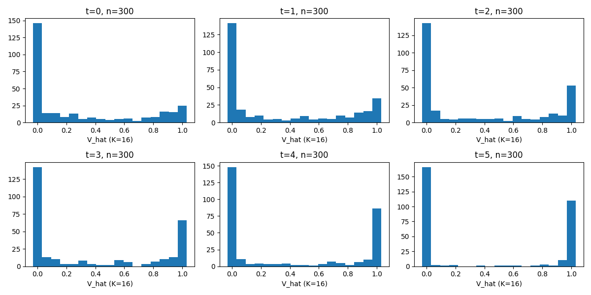
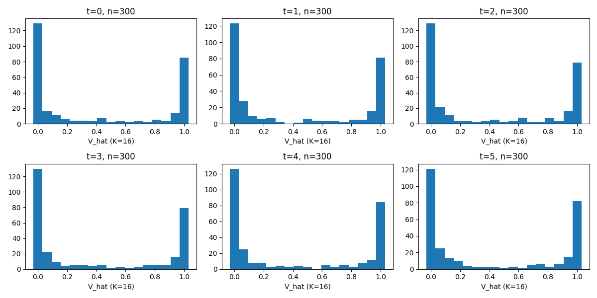
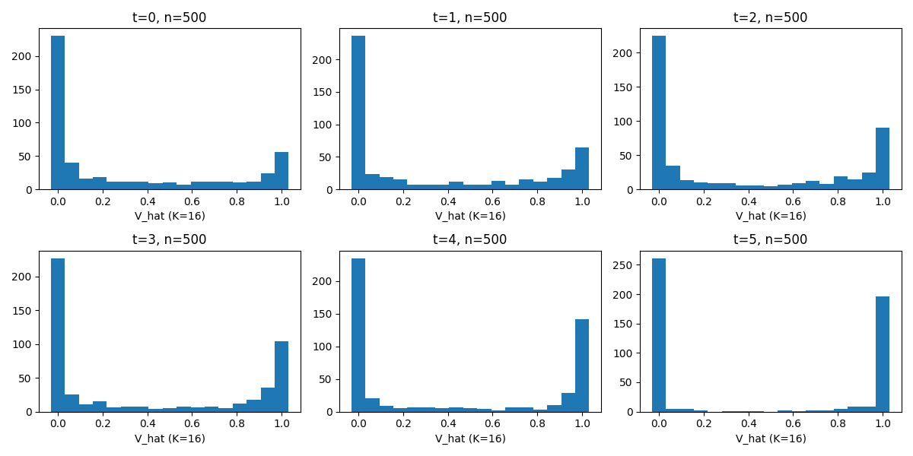
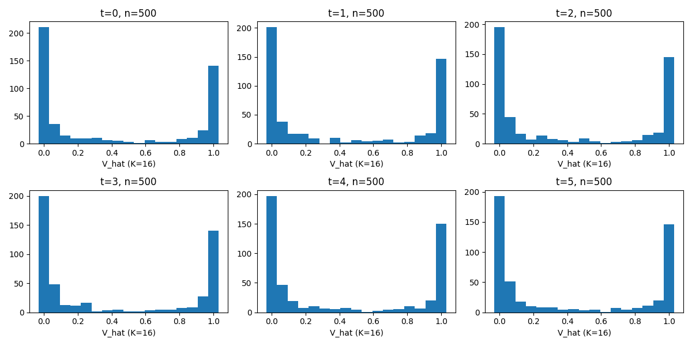
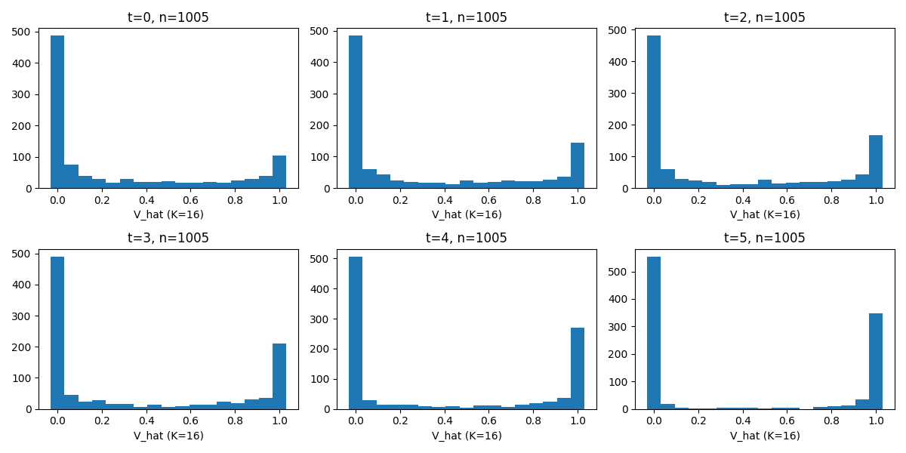
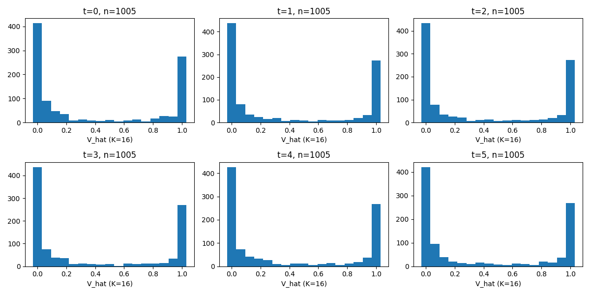

# M1 实测结果与验收状态

## smoke_run
运行：`runs/20261030T013639323603Z_13ad784ef5d6_518bf2`。
```json
{
  "status": "completed",
  "run_id": "20261030T013639323603Z_13ad784ef5d6_518bf2",
  "config_sha256": "13ad784ef5d69b4d31a4ce846eb97e9433e2752072617f96c197b68289bdd4d4",
  "completed_questions": 200,
  "stage_seconds": {
    "prepare": 57.59205275261775,
    "early": 447.2822740653064,
    "traj": 189.22691973787732,
    "mc": 80.61964126490057
  },
  "wall_seconds": 898.6714338141028,
  "source_forward_calls": 22388,
  "questions": 200,
  "stage_questions": {
    "prepare": 200,
    "early": 200,
    "traj": 100,
    "mc": 100
  },
  "storage": {
    "reader_train": {
      "rows": 5147,
      "shards": 5,
      "bytes": 15867184,
      "fp16_max_abs": 0.060455322265625,
      "fp16_max_relative_l2": 0.0004394162097014487,
      "fp16_rmse": 0.0005960849807409876
    },
    "val": {
      "rows": 700,
      "shards": 5,
      "bytes": 2189950,
      "fp16_max_abs": 0.03075408935546875,
      "fp16_max_relative_l2": 0.00036905272281728685,
      "fp16_rmse": 0.00036182447006976963
    }
  },
  "protocol_sha256": "8d7f7700d145a1b120c5d64baa60802797658b1ef6fbfd8e1212e5a45a0f0d2c",
  "candidate_sha256": "343a4aaedb9837c5fe4cff2d8a962a29893f5f198139212c8515632c574877d9",
  "scope": "200 clean/all early exits;100train K8 trajectories;100val two K16 policies at one balanced step;all-layer first10;not full MC",
  "gpu_hours": 0.24963095383725079
}
```

## gate_run
运行：`runs/20261030T015147548907Z_f9aeb43dc9b2_daa0ae`。
```json
{
  "status": "completed",
  "run_id": "20261030T015147548907Z_f9aeb43dc9b2_daa0ae",
  "config_sha256": "f9aeb43dc9b24391a6eb14abd1487e91500cec1feaec40befd1e882dc807ef4a",
  "completed_questions": 300,
  "zero_noise_disagreements": 0,
  "wall_seconds": 1996.418895313982,
  "source_forward_calls": 51367,
  "gate_passed": true,
  "questions": 300,
  "early_T_agreement": 1.0,
  "noise_comparison": [
    {
      "seed": 11,
      "batched": {
        "accuracy": 0.37416666666666665,
        "nondegenerate": 0.32
      },
      "batch1": {
        "accuracy": 0.37416666666666665,
        "nondegenerate": 0.32
      },
      "abs_delta": {
        "accuracy": 0.0,
        "nondegenerate": 0.0
      },
      "passed": true
    },
    {
      "seed": 22,
      "batched": {
        "accuracy": 0.3727083333333333,
        "nondegenerate": 0.33
      },
      "batch1": {
        "accuracy": 0.3727083333333333,
        "nondegenerate": 0.33
      },
      "abs_delta": {
        "accuracy": 0.0,
        "nondegenerate": 0.0
      },
      "passed": true
    },
    {
      "seed": 33,
      "batched": {
        "accuracy": 0.3747916666666667,
        "nondegenerate": 0.33666666666666667
      },
      "batch1": {
        "accuracy": 0.3747916666666667,
        "nondegenerate": 0.33666666666666667
      },
      "abs_delta": {
        "accuracy": 0.0,
        "nondegenerate": 0.0
      },
      "passed": true
    }
  ],
  "tolerances": {
    "accuracy": 0.0020833333333333814,
    "nondegenerate": 0.016666666666666663
  },
  "native_next_state_max_abs": 6.103515625e-05,
  "native_next_state_max_relative_l2": 2.186926622016472e-06,
  "saved_next_state_max_abs": 0.03127288818359375,
  "saved_next_state_max_relative_l2": 0.0006894657271914184,
  "gpu_hours": 0.5545608042538839
}
```

## budget_run
运行：`runs/20261030T022507631329Z_ae2889e005b8_1fe957`。
```json
{
  "status": "completed",
  "run_id": "20261030T022507631329Z_ae2889e005b8_1fe957",
  "config_sha256": "ae2889e005b8abc88fe4c206506631471a3b4b4fab3b31a29c11e5e0d87ff935",
  "preflight_gpu_hours": 1.0541918415947455,
  "preflight_runs": {
    "runs/20261030T012044635539Z_49d2f4edb21f_0553af": 0,
    "runs/20261030T013639323603Z_13ad784ef5d6_518bf2": 0.24963095383725079,
    "runs/20261030T012126501342Z_c7c7a651e47e_6eef7a": 0.25000008350361086,
    "runs/20261030T015147548907Z_f9aeb43dc9b2_daa0ae": 0.5545608042538839
  },
  "reader_train": 20000,
  "reader_train_requested": 20000,
  "reduced": false,
  "estimated_gpu_hours_including_gate_smoke": 39.462155564981884,
  "estimated_disk_gib": 6.816039006225765,
  "throughput_margin": 1.25,
  "storage_margin": 2.0,
  "per_problem_seconds": {
    "clean_and_early": 2.5243716340896207,
    "K8_trajectory": 1.8922691973787733,
    "two_K16_MC_one_step": 0.8061964126490057
  },
  "split_sha256": "8bcc4b136015177c7a35f392d6b0207412d2597d55f2aeaa4f7d9686106e8115",
  "counts": {
    "reader_train": 20000,
    "reader_val": 2000,
    "val": 300,
    "cal": 500,
    "test": 1005
  },
  "gpu_hours": 0,
  "source_forward_calls": 0
}
```

## generation_run
运行：`runs/20261102T031137055963Z_24b03138a255_a2c9f2`。
```json
{
  "status": "completed",
  "run_id": "20261102T031137055963Z_24b03138a255_a2c9f2",
  "config_sha256": "24b03138a25510521d8dcdbc000007d235034ff4a3c4e2e059b81fd1a39de64e",
  "completed_splits": {
    "reader_train": 20000,
    "reader_val": 2000,
    "val": 300,
    "cal": 500,
    "test": 1005
  },
  "storage": {
    "reader_train": {
      "rows": 927428,
      "shards": 313,
      "bytes": 2882429062,
      "fp16_max_abs": 0.062469482421875,
      "fp16_max_relative_l2": 0.000453750864835456,
      "fp16_rmse": 0.00049857153626239,
      "quantization_scope": "newly_generated_states_only; interrupted_run had no durable quantization aggregates",
      "recovered_rows": 469806
    },
    "reader_val": {
      "rows": 102862,
      "shards": 32,
      "bytes": 318744224,
      "fp16_max_abs": 0.062469482421875,
      "fp16_max_relative_l2": 0.0004494989407248795,
      "fp16_rmse": 0.0005936881192122071
    },
    "val": {
      "rows": 2100,
      "shards": 5,
      "bytes": 6697947,
      "fp16_max_abs": 0.03075408935546875,
      "fp16_max_relative_l2": 0.00036905272281728685,
      "fp16_rmse": 0.0003489758997494122
    },
    "cal": {
      "rows": 3500,
      "shards": 8,
      "bytes": 11170233,
      "fp16_max_abs": 0.031158447265625,
      "fp16_max_relative_l2": 0.00039241736521944404,
      "fp16_rmse": 0.00035500994365728457
    },
    "test": {
      "rows": 7035,
      "shards": 16,
      "bytes": 22444416,
      "fp16_max_abs": 0.029754638671875,
      "fp16_max_relative_l2": 0.00039972804370336235,
      "fp16_rmse": 0.00035705463499154734,
      "quantization_scope": "newly_generated_states_only; interrupted_run had no durable quantization aggregates",
      "recovered_rows": 5376
    }
  },
  "completed_questions": 23805,
  "progress": {
    "split": "test",
    "completed": 1005,
    "total": 1005
  },
  "gpu_hours": 0.5231912202019444,
  "source_forward_calls": 45362,
  "counts": {
    "reader_train": 20000,
    "reader_val": 2000,
    "val": 300,
    "cal": 500,
    "test": 1005
  },
  "all_layers_questions": 1000,
  "variance_pairs": 50,
  "output_bytes": 3248059671,
  "prior_generation_gpu_hours": 22.092181869612283,
  "prior_source_forward_calls": 2712354,
  "total_generation_gpu_hours": 22.615372757036727,
  "wall_seconds": 1883.4883927269998
}
```

## 早退标签（按题bootstrap10k）
|split|t|accuracy [95% CI]|
|---|---|---|
|reader_train|0|0.4929 [0.48605, 0.49985]|
|reader_train|1|0.5896 [0.58285, 0.5963]|
|reader_train|2|0.5799 [0.57295, 0.58675]|
|reader_train|3|0.7736 [0.7678487500000001, 0.77945]|
|reader_train|4|0.7673 [0.76145, 0.77325]|
|reader_train|5|0.8198 [0.8145, 0.82515]|
|reader_train|6|0.8190 [0.8137, 0.82435]|
|reader_val|0|0.4725 [0.451, 0.4945]|
|reader_val|1|0.5840 [0.5625, 0.6055]|
|reader_val|2|0.5690 [0.5475, 0.59]|
|reader_val|3|0.7595 [0.7405, 0.778]|
|reader_val|4|0.7620 [0.743, 0.7805]|
|reader_val|5|0.8170 [0.8, 0.834]|
|reader_val|6|0.8160 [0.7989875000000001, 0.833]|
|val|0|0.1967 [0.15333333333333332, 0.24333333333333335]|
|val|1|0.2800 [0.23, 0.33]|
|val|2|0.2400 [0.19333333333333333, 0.29]|
|val|3|0.3933 [0.33666666666666667, 0.45]|
|val|4|0.3833 [0.32666666666666666, 0.44]|
|val|5|0.4300 [0.37333333333333335, 0.4866666666666667]|
|val|6|0.4233 [0.36666666666666664, 0.48]|
|cal|0|0.2540 [0.216, 0.292]|
|cal|1|0.2480 [0.21, 0.286]|
|cal|2|0.2320 [0.196, 0.27]|
|cal|3|0.3780 [0.336, 0.422]|
|cal|4|0.3780 [0.336, 0.422]|
|cal|5|0.4500 [0.406, 0.494]|
|cal|6|0.4520 [0.408, 0.496]|
|test|0|0.2328 [0.20696517412935322, 0.25970149253731345]|
|test|1|0.2468 [0.2208955223880597, 0.2746268656716418]|
|test|2|0.2269 [0.20196517412935328, 0.2527363184079602]|
|test|3|0.3642 [0.3353233830845771, 0.3940298507462687]|
|test|4|0.3672 [0.3383084577114428, 0.3970149253731343]|
|test|5|0.4159 [0.38606965174129354, 0.44676616915422884]|
|test|6|0.4199 [0.3890547263681592, 0.4507462686567164]|






## 按题bootstrap10k标签统计
|split|policy|t|V mean [95% CI]|nondegenerate [95% CI]|
|---|---|---|---|---|
|val|pi|0|0.2950 [0.25145833333333334, 0.3383333333333333]|0.4300 [0.37666666666666665, 0.4866666666666667]|
|val|pi|1|0.3290 [0.28291666666666665, 0.3747916666666667]|0.4167 [0.36, 0.47333333333333333]|
|val|pi|2|0.3544 [0.30541666666666667, 0.40208333333333335]|0.3500 [0.2966666666666667, 0.4066666666666667]|
|val|pi|3|0.3752 [0.3247864583333333, 0.42521354166666664]|0.3067 [0.25666666666666665, 0.36]|
|val|pi|4|0.4004 [0.3475, 0.4535416666666667]|0.2200 [0.17333333333333334, 0.26666666666666666]|
|val|pi|5|0.4204 [0.3647916666666667, 0.476875]|0.0800 [0.05, 0.11333333333333333]|
|val|pi_T|0|0.4077 [0.3564583333333333, 0.46020833333333333]|0.2867 [0.23666666666666666, 0.34]|
|val|pi_T|1|0.4033 [0.3516666666666667, 0.4556302083333333]|0.3200 [0.26666666666666666, 0.37333333333333335]|
|val|pi_T|2|0.4029 [0.35186979166666665, 0.4545885416666666]|0.3067 [0.25666666666666665, 0.36]|
|val|pi_T|3|0.3977 [0.34686979166666665, 0.4504166666666667]|0.3033 [0.25333333333333335, 0.3566666666666667]|
|val|pi_T|4|0.4058 [0.354375, 0.4583385416666666]|0.3000 [0.24666666666666667, 0.35333333333333333]|
|val|pi_T|5|0.4062 [0.355, 0.4583333333333333]|0.3233 [0.27, 0.38]|
|cal|pi|0|0.3038 [0.269996875, 0.337625]|0.4280 [0.386, 0.472]|
|cal|pi|1|0.3355 [0.3, 0.371375]|0.4000 [0.358, 0.442]|
|cal|pi|2|0.3650 [0.3275, 0.40262812499999995]|0.3720 [0.33, 0.414]|
|cal|pi|3|0.3880 [0.349871875, 0.426625]|0.3380 [0.296, 0.38]|
|cal|pi|4|0.4125 [0.37275, 0.452875]|0.2460 [0.21, 0.284]|
|cal|pi|5|0.4450 [0.402875, 0.48775]|0.0860 [0.062, 0.112]|
|cal|pi_T|0|0.4113 [0.37174687500000003, 0.45125]|0.2980 [0.258, 0.338]|
|cal|pi_T|1|0.4156 [0.3765, 0.45575]|0.3040 [0.264, 0.346]|
|cal|pi_T|2|0.4163 [0.377625, 0.456375]|0.3200 [0.28, 0.362]|
|cal|pi_T|3|0.4128 [0.373125, 0.453]|0.3200 [0.28, 0.362]|
|cal|pi_T|4|0.4179 [0.37825, 0.45875]|0.3060 [0.266, 0.348]|
|cal|pi_T|5|0.4155 [0.376496875, 0.455625]|0.3220 [0.282, 0.364]|
|test|pi|0|0.2866 [0.2634950248756219, 0.310634328358209]|0.4129 [0.38308457711442784, 0.4437810945273632]|
|test|pi|1|0.3146 [0.28998756218905475, 0.33973880597014927]|0.3761 [0.34626865671641793, 0.4059701492537313]|
|test|pi|2|0.3370 [0.31200248756218907, 0.36306125621890545]|0.3552 [0.3263681592039801, 0.3850746268656716]|
|test|pi|3|0.3583 [0.3319636194029851, 0.38507618159203977]|0.3025 [0.2746268656716418, 0.33134328358208953]|
|test|pi|4|0.3901 [0.3624378109452736, 0.4184110696517413]|0.2279 [0.20298507462686566, 0.2537313432835821]|
|test|pi|5|0.4118 [0.3825870646766169, 0.44166666666666665]|0.1015 [0.08358208955223881, 0.12039800995024875]|
|test|pi_T|0|0.3872 [0.3602596393034826, 0.41492537313432837]|0.3164 [0.28756218905472636, 0.345273631840796]|
|test|pi_T|1|0.3840 [0.3572139303482587, 0.4116915422885572]|0.2925 [0.2646766169154229, 0.32139303482587067]|
|test|pi_T|2|0.3871 [0.3600124378109453, 0.41480254975124375]|0.2985 [0.2706218905472637, 0.32736318407960197]|
|test|pi_T|3|0.3836 [0.35690298507462687, 0.41119402985074627]|0.2955 [0.26666666666666666, 0.32338308457711445]|
|test|pi_T|4|0.3869 [0.3601974502487562, 0.41455223880597014]|0.3104 [0.28258706467661693, 0.33930348258706466]|
|test|pi_T|5|0.3859 [0.3587049129353234, 0.413681592039801]|0.3144 [0.2855721393034826, 0.34228855721393037]|

K64方差结果：
```json
[
  {
    "policy": "pi",
    "pairs": 50,
    "K16_sampling_variance_from_four_K16_blocks": {
      "mean": 0.0025846354166666665,
      "ci95": [
        0.0011393229166666665,
        0.0043816731770833315
      ],
      "n_questions": 50,
      "bootstrap_resamples": 10000,
      "bootstrap_rng_seed": 20261028
    },
    "limitations": "Only4 blocks per pair; noisy variance estimates; distinct seeds from main K16 labels"
  },
  {
    "policy": "pi_T",
    "pairs": 50,
    "K16_sampling_variance_from_four_K16_blocks": {
      "mean": 0.003424479166666667,
      "ci95": [
        0.00189453125,
        0.005293131510416665
      ],
      "n_questions": 50,
      "bootstrap_resamples": 10000,
      "bootstrap_rng_seed": 20261028
    },
    "limitations": "Only4 blocks per pair; noisy variance estimates; distinct seeds from main K16 labels"
  }
]
```
