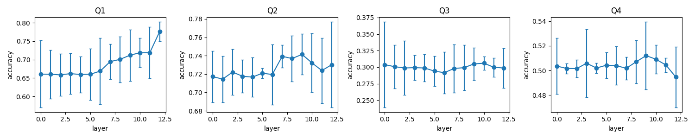

# M3 基线读取器

已完成。

B0/B1使用两层MLP骨架，分别置零z/同一步跨题打乱z；B2线性且Q3使用状态与选项数值特征的双线性打分；B3对状态、模板和选项联合做两层MLP，Q3逐选项共享评分器，保证选项置换等变。问题模板用确定性字节频率特征；不输入原题。B4仅用z训练Q1最终正误标量，原样用于Q2并单独校准。B5a使用fp32/batch8冻结CODI-GPT2，在占位token的输入embedding处注入原始观测z，随后仅输入类型化prompt/选项，取单token Yes/No或A–D logits；无映射训练，尺度/表示空间不匹配可能导致负面结果。B5b明确推迟至M6。

协议偏离：早期smoke入口对固定test子集也计算过指标，旧的未完成基线尝试也保存了部分test预测；这不符合test仅在最终评估使用的严格约定。没有据这些test指标选超参、修正模型结构、挑seed或改划分；结构修正依据Q4交互能力的代码检查，batch检查依据reader_val数值一致性与耗时。仍须将此前测试暴露作为审查限制，不能删除记录后声称从未触及。后续smoke须用val代理最终评估流程。

训练超参仅在reader_val选择；cal_A按qtype、各状态等权的平均Bernoulli NLL温度缩放，cal_B仅conformal；温度搜索范围为exp([-4,4])，不拟合偏置。训练seed11/22/33；表中均值±95% CI为三个seed的t区间（df=2），先对t等权平均。原始与校准、逐qtype×t×split×clean/traj×模板结果见[M3_metrics.csv](M3_metrics.csv)。B5a确定性，不制造三份重复seed的零方差区间；按题bootstrap补充于本报告run。

二分类Brier为E[(p-y)^2]，Q1对每个Bernoulli结果平均（不是对MC均值做平方误差）；Q3为多类Brier之和。ECE15定义为top-confidence对预测正确率的15个等宽箱差。单步score MAE对MC均值；reader_val的Bernoulli标签与test K16均值精度不同，MAE不可直接视为纯域偏移。

## 已见模板、干净状态主表

|baseline|qtype|split|accuracy|AUROC|NLL|Brier|MAE|ECE|
|---|---|---|---|---|---|---|---|---|
|B0|Q1|reader_val|0.7523 ± 0.0000|NA|0.6886 ± 0.0000|0.2478 ± 0.0000|0.4977 ± 0.0000|0.2478 ± 0.0000|
|B0|Q1|test|0.3598 ± 0.0000|NA|0.6957 ± 0.0000|0.2513 ± 0.0000|0.4481 ± 0.0000|0.1447 ± 0.0000|
|B0|Q2|reader_val|0.6829 ± 0.0000|0.4963 ± 0.0198|0.6906 ± 0.0001|0.2487 ± 0.0001|0.4987 ± 0.0001|0.1882 ± 0.0001|
|B0|Q2|test|0.3248 ± 0.0000|0.5082 ± 0.0227|0.6956 ± 0.0001|0.2512 ± 0.0001|0.5012 ± 0.0001|0.1787 ± 0.0002|
|B0|Q3|reader_val|0.3470 ± 0.0009|NA|1.3340 ± 0.0066|0.7251 ± 0.0019|NA|0.0395 ± 0.0107|
|B0|Q3|test|0.3594 ± 0.0079|NA|1.3225 ± 0.0029|0.7202 ± 0.0015|NA|0.0372 ± 0.0141|
|B0|Q4|reader_val|0.5014 ± 0.0036|0.5017 ± 0.0018|0.6933 ± 0.0003|0.2501 ± 0.0001|0.5000 ± 0.0000|0.0075 ± 0.0100|
|B0|Q4|test|0.4975 ± 0.0074|0.4987 ± 0.0050|0.6934 ± 0.0004|0.2501 ± 0.0002|0.5000 ± 0.0001|0.0111 ± 0.0130|
|B1|Q1|reader_val|0.7523 ± 0.0000|NA|0.6888 ± 0.0001|0.2478 ± 0.0001|0.4978 ± 0.0001|0.2480 ± 0.0002|
|B1|Q1|test|0.3598 ± 0.0000|NA|0.6955 ± 0.0001|0.2512 ± 0.0001|0.4480 ± 0.0001|0.1445 ± 0.0002|
|B1|Q2|reader_val|0.6858 ± 0.0021|0.4956 ± 0.0183|0.6893 ± 0.0001|0.2481 ± 0.0000|0.4981 ± 0.0000|0.1836 ± 0.0026|
|B1|Q2|test|0.3633 ± 0.0268|0.4944 ± 0.0338|0.6953 ± 0.0002|0.2511 ± 0.0001|0.5010 ± 0.0001|0.1441 ± 0.0173|
|B1|Q3|reader_val|0.3294 ± 0.0033|NA|1.3541 ± 0.0013|0.7349 ± 0.0009|NA|0.0283 ± 0.0075|
|B1|Q3|test|0.3518 ± 0.0030|NA|1.3421 ± 0.0016|0.7283 ± 0.0007|NA|0.0335 ± 0.0079|
|B1|Q4|reader_val|0.4997 ± 0.0090|0.4986 ± 0.0075|0.6932 ± 0.0000|0.2500 ± 0.0000|0.5000 ± 0.0000|0.0063 ± 0.0049|
|B1|Q4|test|0.4996 ± 0.0038|0.4992 ± 0.0087|0.6932 ± 0.0001|0.2500 ± 0.0000|0.5000 ± 0.0000|0.0083 ± 0.0089|
|B2|Q1|reader_val|0.8304 ± 0.0018|NA|0.3958 ± 0.0026|0.1240 ± 0.0008|0.2831 ± 0.0037|0.0654 ± 0.0053|
|B2|Q1|test|0.7169 ± 0.0031|NA|0.5532 ± 0.0056|0.1868 ± 0.0022|0.3273 ± 0.0053|0.0430 ± 0.0077|
|B2|Q2|reader_val|0.7955 ± 0.0016|0.8515 ± 0.0058|0.4298 ± 0.0065|0.1391 ± 0.0023|0.2953 ± 0.0028|0.0412 ± 0.0013|
|B2|Q2|test|0.7464 ± 0.0059|0.8362 ± 0.0056|0.5228 ± 0.0015|0.1734 ± 0.0004|0.3504 ± 0.0015|0.0418 ± 0.0045|
|B2|Q3|reader_val|0.5840 ± 0.0033|NA|0.9518 ± 0.0014|0.5306 ± 0.0011|NA|0.0648 ± 0.0051|
|B2|Q3|test|0.5335 ± 0.0036|NA|1.0155 ± 0.0051|0.5684 ± 0.0021|NA|0.0524 ± 0.0086|
|B2|Q4|reader_val|0.5005 ± 0.0055|0.4994 ± 0.0046|0.6931 ± 0.0000|0.2500 ± 0.0000|0.5000 ± 0.0000|0.0036 ± 0.0019|
|B2|Q4|test|0.5010 ± 0.0085|0.5002 ± 0.0064|0.6931 ± 0.0000|0.2500 ± 0.0000|0.5000 ± 0.0000|0.0035 ± 0.0028|
|B3|Q1|reader_val|0.8375 ± 0.0041|NA|0.3752 ± 0.0009|0.1182 ± 0.0004|0.2626 ± 0.0015|0.0494 ± 0.0037|
|B3|Q1|test|0.7520 ± 0.0046|NA|0.5228 ± 0.0073|0.1733 ± 0.0029|0.3026 ± 0.0065|0.0345 ± 0.0049|
|B3|Q2|reader_val|0.8093 ± 0.0067|0.8674 ± 0.0014|0.3976 ± 0.0036|0.1291 ± 0.0011|0.2723 ± 0.0081|0.0308 ± 0.0057|
|B3|Q2|test|0.7603 ± 0.0133|0.8460 ± 0.0056|0.5183 ± 0.0167|0.1698 ± 0.0074|0.3453 ± 0.0157|0.0484 ± 0.0053|
|B3|Q3|reader_val|0.6565 ± 0.0054|NA|0.7718 ± 0.0081|0.4374 ± 0.0036|NA|0.0553 ± 0.0126|
|B3|Q3|test|0.5859 ± 0.0019|NA|0.8860 ± 0.0035|0.5048 ± 0.0004|NA|0.0412 ± 0.0039|
|B3|Q4|reader_val|0.7142 ± 0.0050|0.7797 ± 0.0052|0.5568 ± 0.0021|0.1891 ± 0.0013|0.3854 ± 0.0027|0.0227 ± 0.0081|
|B3|Q4|test|0.6826 ± 0.0109|0.7451 ± 0.0053|0.5889 ± 0.0044|0.2027 ± 0.0018|0.4055 ± 0.0005|0.0187 ± 0.0058|
|B4|Q1|reader_val|0.8299 ± 0.0017|NA|0.3955 ± 0.0016|0.1237 ± 0.0008|0.2768 ± 0.0022|0.0531 ± 0.0035|
|B4|Q1|test|0.7526 ± 0.0032|NA|0.5067 ± 0.0025|0.1676 ± 0.0009|0.2910 ± 0.0010|0.0323 ± 0.0035|
|B4|Q2|reader_val|0.7793 ± 0.0015|0.8479 ± 0.0003|0.4550 ± 0.0052|0.1486 ± 0.0015|0.3095 ± 0.0036|0.0710 ± 0.0044|
|B4|Q2|test|0.7272 ± 0.0028|0.8450 ± 0.0028|0.5340 ± 0.0010|0.1794 ± 0.0003|0.3595 ± 0.0004|0.0469 ± 0.0028|
|B5a|Q1|reader_val|0.2770 (deterministic)|NA|0.8096 (deterministic)|0.3065 (deterministic)|0.5438 (deterministic)|0.3224 (deterministic)|
|B5a|Q1|test|0.6282 (deterministic)|NA|0.6580 (deterministic)|0.2327 (deterministic)|0.4176 (deterministic)|0.0487 (deterministic)|
|B5a|Q2|reader_val|0.3716 (deterministic)|0.5185 (deterministic)|0.7906 (deterministic)|0.2965 (deterministic)|0.5314 (deterministic)|0.2336 (deterministic)|
|B5a|Q2|test|0.6360 (deterministic)|0.4495 (deterministic)|0.6612 (deterministic)|0.2340 (deterministic)|0.4686 (deterministic)|0.0826 (deterministic)|
|B5a|Q3|reader_val|0.2534 (deterministic)|NA|1.3861 (deterministic)|0.7499 (deterministic)|NA|0.0098 (deterministic)|
|B5a|Q3|test|0.2455 (deterministic)|NA|1.3867 (deterministic)|0.7502 (deterministic)|NA|0.0180 (deterministic)|
|B5a|Q4|reader_val|0.5035 (deterministic)|0.5014 (deterministic)|0.6933 (deterministic)|0.2501 (deterministic)|0.5000 (deterministic)|0.0057 (deterministic)|
|B5a|Q4|test|0.5037 (deterministic)|0.5010 (deterministic)|0.6933 (deterministic)|0.2501 (deterministic)|0.5000 (deterministic)|0.0057 (deterministic)|

## 保留模板

|baseline|qtype|split|NLL|accuracy|ECE|
|---|---|---|---|---|---|
|B0|Q1|reader_val|0.6887 ± 0.0000|0.7523 ± 0.0000|0.2479 ± 0.0000|
|B0|Q1|test|0.6957 ± 0.0000|0.3598 ± 0.0000|0.1447 ± 0.0000|
|B0|Q2|reader_val|0.6907 ± 0.0002|0.6829 ± 0.0000|0.1883 ± 0.0002|
|B0|Q2|test|0.6956 ± 0.0002|0.3248 ± 0.0000|0.1786 ± 0.0002|
|B0|Q3|reader_val|1.3359 ± 0.0103|0.3456 ± 0.0013|0.0370 ± 0.0114|
|B0|Q3|test|1.3245 ± 0.0068|0.3585 ± 0.0085|0.0371 ± 0.0202|
|B0|Q4|reader_val|0.6933 ± 0.0004|0.5000 ± 0.0000|0.0054 ± 0.0121|
|B0|Q4|test|0.6933 ± 0.0004|0.5000 ± 0.0000|0.0056 ± 0.0131|
|B1|Q1|reader_val|0.6888 ± 0.0001|0.7523 ± 0.0000|0.2480 ± 0.0001|
|B1|Q1|test|0.6955 ± 0.0001|0.3598 ± 0.0000|0.1445 ± 0.0002|
|B1|Q2|reader_val|0.6893 ± 0.0001|0.6861 ± 0.0026|0.1825 ± 0.0018|
|B1|Q2|test|0.6952 ± 0.0002|0.3651 ± 0.0195|0.1422 ± 0.0100|
|B1|Q3|reader_val|1.3539 ± 0.0010|0.3289 ± 0.0008|0.0274 ± 0.0053|
|B1|Q3|test|1.3425 ± 0.0019|0.3513 ± 0.0022|0.0310 ± 0.0053|
|B1|Q4|reader_val|0.6932 ± 0.0000|0.4988 ± 0.0062|0.0058 ± 0.0009|
|B1|Q4|test|0.6931 ± 0.0000|0.5026 ± 0.0044|0.0047 ± 0.0009|
|B2|Q1|reader_val|0.3964 ± 0.0023|0.8307 ± 0.0010|0.0663 ± 0.0032|
|B2|Q1|test|0.5510 ± 0.0096|0.7191 ± 0.0087|0.0424 ± 0.0062|
|B2|Q2|reader_val|0.4311 ± 0.0059|0.7961 ± 0.0038|0.0429 ± 0.0006|
|B2|Q2|test|0.5160 ± 0.0024|0.7512 ± 0.0063|0.0402 ± 0.0044|
|B2|Q3|reader_val|0.9518 ± 0.0014|0.5840 ± 0.0033|0.0648 ± 0.0051|
|B2|Q3|test|1.0155 ± 0.0051|0.5335 ± 0.0036|0.0524 ± 0.0086|
|B2|Q4|reader_val|0.6931 ± 0.0000|0.5006 ± 0.0048|0.0022 ± 0.0002|
|B2|Q4|test|0.6931 ± 0.0000|0.5015 ± 0.0063|0.0024 ± 0.0025|
|B3|Q1|reader_val|0.3753 ± 0.0009|0.8374 ± 0.0037|0.0493 ± 0.0038|
|B3|Q1|test|0.5224 ± 0.0072|0.7523 ± 0.0036|0.0345 ± 0.0046|
|B3|Q2|reader_val|0.3977 ± 0.0035|0.8095 ± 0.0072|0.0308 ± 0.0064|
|B3|Q2|test|0.5168 ± 0.0160|0.7609 ± 0.0135|0.0491 ± 0.0044|
|B3|Q3|reader_val|0.7710 ± 0.0080|0.6559 ± 0.0053|0.0537 ± 0.0114|
|B3|Q3|test|0.8851 ± 0.0031|0.5870 ± 0.0010|0.0401 ± 0.0115|
|B3|Q4|reader_val|0.5568 ± 0.0022|0.7140 ± 0.0059|0.0222 ± 0.0084|
|B3|Q4|test|0.5890 ± 0.0044|0.6828 ± 0.0115|0.0174 ± 0.0079|
|B4|Q1|reader_val|0.3955 ± 0.0016|0.8299 ± 0.0017|0.0531 ± 0.0035|
|B4|Q1|test|0.5067 ± 0.0025|0.7526 ± 0.0032|0.0323 ± 0.0035|
|B4|Q2|reader_val|0.4550 ± 0.0052|0.7793 ± 0.0015|0.0710 ± 0.0044|
|B4|Q2|test|0.5340 ± 0.0010|0.7272 ± 0.0028|0.0469 ± 0.0028|
|B5a|Q1|reader_val|0.8255 (deterministic)|0.3144 (deterministic)|0.2892 (deterministic)|
|B5a|Q1|test|0.6703 (deterministic)|0.6068 (deterministic)|0.0516 (deterministic)|
|B5a|Q2|reader_val|0.7925 (deterministic)|0.3707 (deterministic)|0.2347 (deterministic)|
|B5a|Q2|test|0.6594 (deterministic)|0.6435 (deterministic)|0.0834 (deterministic)|
|B5a|Q3|reader_val|1.3862 (deterministic)|0.2549 (deterministic)|0.0085 (deterministic)|
|B5a|Q3|test|1.3866 (deterministic)|0.2492 (deterministic)|0.0148 (deterministic)|
|B5a|Q4|reader_val|0.6934 (deterministic)|0.5035 (deterministic)|0.0050 (deterministic)|
|B5a|Q4|test|0.6932 (deterministic)|0.5056 (deterministic)|0.0031 (deterministic)|

## Q1 reader_val干净与扰动状态

逐步分开报告；同一clean起点的多条轨迹保留独立Bernoulli标签。test仅使用clean状态，不把traj指标混入域偏移主表。

|baseline|t|kind|NLL|Brier|MAE|ECE|
|---|---|---|---|---|---|---|
|B0|0|clean|0.6901 ± 0.0000|0.2485 ± 0.0000|0.4985 ± 0.0000|0.1664 ± 0.0000|
|B0|1|clean|0.6896 ± 0.0000|0.2482 ± 0.0000|0.4982 ± 0.0000|0.1936 ± 0.0000|
|B0|1|traj|0.6901 ± 0.0000|0.2485 ± 0.0000|0.4985 ± 0.0000|0.1664 ± 0.0000|
|B0|2|clean|0.6891 ± 0.0000|0.2480 ± 0.0000|0.4980 ± 0.0000|0.2211 ± 0.0000|
|B0|2|traj|0.6899 ± 0.0000|0.2484 ± 0.0000|0.4983 ± 0.0000|0.1802 ± 0.0000|
|B0|3|clean|0.6885 ± 0.0000|0.2477 ± 0.0000|0.4976 ± 0.0000|0.2580 ± 0.0000|
|B0|3|traj|0.6896 ± 0.0000|0.2482 ± 0.0000|0.4982 ± 0.0000|0.1939 ± 0.0000|
|B0|4|clean|0.6882 ± 0.0001|0.2475 ± 0.0000|0.4975 ± 0.0000|0.2752 ± 0.0000|
|B0|4|traj|0.6893 ± 0.0000|0.2481 ± 0.0000|0.4981 ± 0.0000|0.2099 ± 0.0000|
|B0|5|clean|0.6875 ± 0.0001|0.2472 ± 0.0000|0.4972 ± 0.0000|0.3092 ± 0.0000|
|B0|5|traj|0.6891 ± 0.0000|0.2480 ± 0.0000|0.4980 ± 0.0000|0.2227 ± 0.0000|
|B0|6|clean|0.6875 ± 0.0001|0.2472 ± 0.0000|0.4972 ± 0.0000|0.3115 ± 0.0000|
|B0|6|traj|0.6888 ± 0.0000|0.2478 ± 0.0000|0.4978 ± 0.0000|0.2371 ± 0.0000|
|B1|0|clean|0.6908 ± 0.0001|0.2488 ± 0.0001|0.4988 ± 0.0001|0.1674 ± 0.0002|
|B1|1|clean|0.6903 ± 0.0003|0.2486 ± 0.0002|0.4985 ± 0.0002|0.1945 ± 0.0004|
|B1|1|traj|0.6907 ± 0.0003|0.2488 ± 0.0002|0.4988 ± 0.0002|0.1672 ± 0.0004|
|B1|2|clean|0.6893 ± 0.0002|0.2481 ± 0.0001|0.4981 ± 0.0001|0.2213 ± 0.0002|
|B1|2|traj|0.6900 ± 0.0002|0.2484 ± 0.0001|0.4984 ± 0.0001|0.1805 ± 0.0002|
|B1|3|clean|0.6885 ± 0.0002|0.2477 ± 0.0001|0.4976 ± 0.0001|0.2580 ± 0.0002|
|B1|3|traj|0.6896 ± 0.0002|0.2482 ± 0.0001|0.4982 ± 0.0001|0.1939 ± 0.0002|
|B1|4|clean|0.6881 ± 0.0002|0.2475 ± 0.0001|0.4974 ± 0.0001|0.2751 ± 0.0002|
|B1|4|traj|0.6893 ± 0.0001|0.2481 ± 0.0001|0.4980 ± 0.0001|0.2098 ± 0.0002|
|B1|5|clean|0.6872 ± 0.0002|0.2470 ± 0.0001|0.4970 ± 0.0001|0.3089 ± 0.0002|
|B1|5|traj|0.6888 ± 0.0001|0.2478 ± 0.0001|0.4978 ± 0.0001|0.2225 ± 0.0001|
|B1|6|clean|0.6872 ± 0.0001|0.2470 ± 0.0001|0.4970 ± 0.0001|0.3112 ± 0.0001|
|B1|6|traj|0.6886 ± 0.0001|0.2477 ± 0.0000|0.4977 ± 0.0000|0.2369 ± 0.0001|
|B2|0|clean|0.5264 ± 0.0005|0.1753 ± 0.0006|0.3685 ± 0.0064|0.0375 ± 0.0017|
|B2|1|clean|0.4350 ± 0.0017|0.1402 ± 0.0003|0.3106 ± 0.0028|0.0735 ± 0.0075|
|B2|1|traj|0.4508 ± 0.0030|0.1470 ± 0.0011|0.3179 ± 0.0026|0.0442 ± 0.0066|
|B2|2|clean|0.4366 ± 0.0035|0.1394 ± 0.0012|0.3085 ± 0.0048|0.0523 ± 0.0107|
|B2|2|traj|0.4431 ± 0.0030|0.1429 ± 0.0009|0.3106 ± 0.0045|0.0406 ± 0.0038|
|B2|3|clean|0.3589 ± 0.0019|0.1115 ± 0.0005|0.2531 ± 0.0024|0.0506 ± 0.0054|
|B2|3|traj|0.4131 ± 0.0022|0.1320 ± 0.0006|0.2867 ± 0.0030|0.0374 ± 0.0020|
|B2|4|clean|0.3612 ± 0.0051|0.1087 ± 0.0015|0.2627 ± 0.0053|0.0825 ± 0.0105|
|B2|4|traj|0.4073 ± 0.0038|0.1278 ± 0.0013|0.2888 ± 0.0047|0.0537 ± 0.0053|
|B2|5|clean|0.3149 ± 0.0014|0.0937 ± 0.0007|0.2281 ± 0.0016|0.0674 ± 0.0054|
|B2|5|traj|0.3865 ± 0.0015|0.1213 ± 0.0005|0.2734 ± 0.0024|0.0502 ± 0.0037|
|B2|6|clean|0.3377 ± 0.0065|0.0990 ± 0.0021|0.2504 ± 0.0058|0.0939 ± 0.0089|
|B2|6|traj|0.3923 ± 0.0024|0.1216 ± 0.0007|0.2813 ± 0.0036|0.0663 ± 0.0042|
|B3|0|clean|0.4984 ± 0.0068|0.1645 ± 0.0026|0.3493 ± 0.0054|0.0428 ± 0.0059|
|B3|1|clean|0.4154 ± 0.0022|0.1334 ± 0.0010|0.2936 ± 0.0013|0.0640 ± 0.0075|
|B3|1|traj|0.4298 ± 0.0028|0.1399 ± 0.0012|0.3021 ± 0.0006|0.0429 ± 0.0016|
|B3|2|clean|0.4200 ± 0.0044|0.1347 ± 0.0020|0.2891 ± 0.0020|0.0396 ± 0.0108|
|B3|2|traj|0.4248 ± 0.0044|0.1377 ± 0.0015|0.2931 ± 0.0022|0.0315 ± 0.0041|
|B3|3|clean|0.3435 ± 0.0042|0.1082 ± 0.0015|0.2337 ± 0.0009|0.0295 ± 0.0057|
|B3|3|traj|0.3951 ± 0.0015|0.1265 ± 0.0004|0.2698 ± 0.0008|0.0305 ± 0.0037|
|B3|4|clean|0.3403 ± 0.0006|0.1035 ± 0.0002|0.2401 ± 0.0011|0.0588 ± 0.0041|
|B3|4|traj|0.3891 ± 0.0049|0.1230 ± 0.0016|0.2702 ± 0.0026|0.0407 ± 0.0026|
|B3|5|clean|0.2929 ± 0.0008|0.0886 ± 0.0004|0.2055 ± 0.0020|0.0462 ± 0.0062|
|B3|5|traj|0.3694 ± 0.0014|0.1168 ± 0.0004|0.2568 ± 0.0015|0.0399 ± 0.0008|
|B3|6|clean|0.3163 ± 0.0017|0.0943 ± 0.0006|0.2267 ± 0.0027|0.0648 ± 0.0037|
|B3|6|traj|0.3752 ± 0.0029|0.1177 ± 0.0008|0.2627 ± 0.0017|0.0488 ± 0.0020|
|B4|0|clean|0.5236 ± 0.0016|0.1732 ± 0.0005|0.3673 ± 0.0031|0.0447 ± 0.0085|
|B4|1|clean|0.4385 ± 0.0029|0.1421 ± 0.0015|0.3041 ± 0.0027|0.0389 ± 0.0051|
|B4|1|traj|0.4570 ± 0.0062|0.1494 ± 0.0021|0.3096 ± 0.0025|0.0298 ± 0.0167|
|B4|2|clean|0.4335 ± 0.0034|0.1375 ± 0.0015|0.3006 ± 0.0029|0.0513 ± 0.0080|
|B4|2|traj|0.4389 ± 0.0005|0.1408 ± 0.0001|0.2992 ± 0.0010|0.0302 ± 0.0030|
|B4|3|clean|0.3604 ± 0.0042|0.1120 ± 0.0012|0.2461 ± 0.0056|0.0383 ± 0.0073|
|B4|3|traj|0.4141 ± 0.0033|0.1321 ± 0.0010|0.2754 ± 0.0039|0.0206 ± 0.0068|
|B4|4|clean|0.3594 ± 0.0032|0.1079 ± 0.0014|0.2545 ± 0.0030|0.0673 ± 0.0057|
|B4|4|traj|0.4051 ± 0.0009|0.1268 ± 0.0003|0.2766 ± 0.0011|0.0375 ± 0.0048|
|B4|5|clean|0.3134 ± 0.0063|0.0932 ± 0.0018|0.2211 ± 0.0070|0.0576 ± 0.0123|
|B4|5|traj|0.3852 ± 0.0044|0.1208 ± 0.0009|0.2622 ± 0.0048|0.0321 ± 0.0050|
|B4|6|clean|0.3400 ± 0.0051|0.1003 ± 0.0020|0.2436 ± 0.0036|0.0737 ± 0.0023|
|B4|6|traj|0.3944 ± 0.0010|0.1224 ± 0.0003|0.2710 ± 0.0009|0.0431 ± 0.0004|
|B5a|0|clean|0.7796 (deterministic)|0.2919 (deterministic)|0.5287 (deterministic)|0.2513 (deterministic)|
|B5a|1|clean|0.7750 (deterministic)|0.2899 (deterministic)|0.5279 (deterministic)|0.2673 (deterministic)|
|B5a|1|traj|0.7680 (deterministic)|0.2865 (deterministic)|0.5241 (deterministic)|0.2384 (deterministic)|
|B5a|2|clean|0.7999 (deterministic)|0.3018 (deterministic)|0.5395 (deterministic)|0.2973 (deterministic)|
|B5a|2|traj|0.7861 (deterministic)|0.2951 (deterministic)|0.5316 (deterministic)|0.2697 (deterministic)|
|B5a|3|clean|0.8155 (deterministic)|0.3092 (deterministic)|0.5452 (deterministic)|0.3366 (deterministic)|
|B5a|3|traj|0.7875 (deterministic)|0.2957 (deterministic)|0.5315 (deterministic)|0.2794 (deterministic)|
|B5a|4|clean|0.8187 (deterministic)|0.3110 (deterministic)|0.5491 (deterministic)|0.3446 (deterministic)|
|B5a|4|traj|0.7975 (deterministic)|0.3006 (deterministic)|0.5373 (deterministic)|0.2918 (deterministic)|
|B5a|5|clean|0.8456 (deterministic)|0.3238 (deterministic)|0.5595 (deterministic)|0.3908 (deterministic)|
|B5a|5|traj|0.8000 (deterministic)|0.3018 (deterministic)|0.5379 (deterministic)|0.3049 (deterministic)|
|B5a|6|clean|0.8329 (deterministic)|0.3179 (deterministic)|0.5565 (deterministic)|0.3687 (deterministic)|
|B5a|6|traj|0.8102 (deterministic)|0.3067 (deterministic)|0.5434 (deterministic)|0.3156 (deterministic)|

## 运行与成本

|stage|run|GPU hours|source forwards|
|---|---|---|---|
|question_run|runs/20261103T042241646739Z_d327b6a2b4fa_428508|0|0|
|baseline_run|runs/20261103T045628621237Z_2964c31f2153_11a348|0.5343011922869442|0|
|patchscope_run|runs/20261103T043008727615Z_3d1392832851_85503d|1.364403531752222|88010|
|layers_run|runs/20261103T045629556778Z_c1273b972f55_418497|0.04864521111444143|0|
|quant_run|runs/20261103T042503115213Z_b650da2692e8_d82a89|0.009226457894441814|1400|
|official_run|runs/20261103T043032691526Z_7213a3d8ae2c_852e9d|0.005168258419726044|61|
|svamp_run|runs/20261103T043414920503Z_0ffa8eb65906_5d11c6|0.19991807649610968|54668|
|asdiv_run|runs/20261103T043815088245Z_a0358d220af9_70e23b|0.21054489036000126|56360|

所有M2–M3已记录运行（含smoke、重复运行）的成本下界：2.6075 GPU小时、202641次源前向；逐run记录及缺失项：`/home/me/PaperField/CalReader/runs/20261103T055223163924Z_faee26776ad3_cea0d0/cost_ledger.json`。缺失计数的失败/中断run意味着这不是精确总成本。

B5a额外检查batch64：固定reader_val50题、四类各128实例，答案一致100%，max概率差2.27094e-5，低于预设1e-4；但smoke为78.7秒，原batch8为55.7秒。不同共享GPU上的时间受资源竞争影响，未观察到加速，因此完整结果保留原batch8，不采用v2。额外gate/smoke及启动前两次入口错误均留存，未据test指标选择batch。

GPU为NVIDIA GeForce RTX 4090，设备及环境快照见各run；GPU小时按设备占用墙钟计，包含CPU预处理等待。上表为选用的完整run，不能当作包含所有smoke/失败/被替代运行的总成本。部分早期中断未写出最终计数，成本缺口保留，不按零处理。

QA在提交代码后完整重建，五个split parquet逐字节SHA一致，见data/M23_v1a/qa_reproduction.json。初期未提交脚本的运行另有明确标注为事后保存的m23_source_audit；不冒充启动时快照。基线首版的Q4加性结构不能表达状态与数值交互，已在完整评估完成前中止，旧运行已写出部分测试预测但未据此选择结构；按结构检查改用联合两层MLP v2并重新smoke；没有据test结果选模型。

命令：`PYTHONPATH=. OMP_NUM_THREADS=2 .venv/bin/python scripts/m23_baselines.py configs/M23_baseline_v2.yaml mode=full smoke_run=runs/20261103T045443038876Z_eb5c2140141e_437383`；其余入口及配置快照见本表各run。测试记录：reports/M23_tests.log。

## Mondrian conformal

在每个(qtype,t)层按题独立取一个实例。Q1校准每题固定随机选一个MC Bernoulli结果；test覆盖率对该题K16结果平均。阈值使用ceil((n+1)(1−α))；极小层返回全集合。有限样本保证依赖层内可交换性。cal_B/test问题来自同一原池，但原cohort上下文、Q3各split的其他题干扰池、Q4跨题数值配对引入依赖，不能据此宣称无条件有限样本保证；held-out模板还改变模板分布。这里报告经验覆盖率。reader_val源训练分布不享有跨域保证。

|baseline|qtype|split|t|heldout|alpha|coverage|set size|
|---|---|---|---|---|---|---|---|
|B2|Q1|reader_val|0|False|0.05|0.9626 ± 0.0201|1.6517 ± 0.0865|
|B2|Q1|reader_val|0|False|0.1|0.9285 ± 0.0088|1.5087 ± 0.0429|
|B2|Q1|reader_val|0|False|0.2|0.8583 ± 0.0050|1.2832 ± 0.0170|
|B2|Q1|reader_val|0|True|0.05|0.9639 ± 0.0175|1.6591 ± 0.0785|
|B2|Q1|reader_val|0|True|0.1|0.9287 ± 0.0108|1.5134 ± 0.0434|
|B2|Q1|reader_val|0|True|0.2|0.8583 ± 0.0017|1.2879 ± 0.0179|
|B2|Q1|reader_val|1|False|0.05|0.9565 ± 0.0091|1.4554 ± 0.0529|
|B2|Q1|reader_val|1|False|0.1|0.9073 ± 0.0296|1.2578 ± 0.1215|
|B2|Q1|reader_val|1|False|0.2|0.8307 ± 0.0217|1.0358 ± 0.0412|
|B2|Q1|reader_val|1|True|0.05|0.9559 ± 0.0160|1.4577 ± 0.0605|
|B2|Q1|reader_val|1|True|0.1|0.9067 ± 0.0281|1.2584 ± 0.1247|
|B2|Q1|reader_val|1|True|0.2|0.8326 ± 0.0202|1.0351 ± 0.0439|
|B2|Q1|reader_val|2|False|0.05|0.9716 ± 0.0080|1.5091 ± 0.0653|
|B2|Q1|reader_val|2|False|0.1|0.9396 ± 0.0193|1.3464 ± 0.0747|
|B2|Q1|reader_val|2|False|0.2|0.8876 ± 0.0160|1.1762 ± 0.0578|
|B2|Q1|reader_val|2|True|0.05|0.9721 ± 0.0120|1.5106 ± 0.0729|
|B2|Q1|reader_val|2|True|0.1|0.9403 ± 0.0240|1.3495 ± 0.0834|
|B2|Q1|reader_val|2|True|0.2|0.8874 ± 0.0200|1.1769 ± 0.0572|
|B2|Q1|reader_val|3|False|0.05|0.9676 ± 0.0228|1.4029 ± 0.1282|
|B2|Q1|reader_val|3|False|0.1|0.9315 ± 0.0019|1.2325 ± 0.0163|
|B2|Q1|reader_val|3|False|0.2|0.8681 ± 0.0049|1.0512 ± 0.0102|
|B2|Q1|reader_val|3|True|0.05|0.9696 ± 0.0210|1.4044 ± 0.1258|
|B2|Q1|reader_val|3|True|0.1|0.9344 ± 0.0056|1.2323 ± 0.0240|
|B2|Q1|reader_val|3|True|0.2|0.8688 ± 0.0028|1.0510 ± 0.0082|
|B2|Q1|reader_val|4|False|0.05|0.9835 ± 0.0115|1.4942 ± 0.0732|
|B2|Q1|reader_val|4|False|0.1|0.9586 ± 0.0083|1.3021 ± 0.0573|
|B2|Q1|reader_val|4|False|0.2|0.9012 ± 0.0180|1.0957 ± 0.0360|
|B2|Q1|reader_val|4|True|0.05|0.9833 ± 0.0083|1.4953 ± 0.0787|
|B2|Q1|reader_val|4|True|0.1|0.9597 ± 0.0114|1.3043 ± 0.0579|
|B2|Q1|reader_val|4|True|0.2|0.9036 ± 0.0118|1.0959 ± 0.0303|
|B2|Q1|reader_val|5|False|0.05|0.9826 ± 0.0081|1.4053 ± 0.0586|
|B2|Q1|reader_val|5|False|0.1|0.9529 ± 0.0041|1.2089 ± 0.0247|
|B2|Q1|reader_val|5|False|0.2|0.8956 ± 0.0115|1.0522 ± 0.0304|
|B2|Q1|reader_val|5|True|0.05|0.9830 ± 0.0090|1.4086 ± 0.0655|
|B2|Q1|reader_val|5|True|0.1|0.9524 ± 0.0043|1.2087 ± 0.0292|
|B2|Q1|reader_val|5|True|0.2|0.8954 ± 0.0196|1.0520 ± 0.0369|
|B2|Q1|reader_val|6|False|0.05|0.9830 ± 0.0057|1.4208 ± 0.0429|
|B2|Q1|reader_val|6|False|0.1|0.9573 ± 0.0007|1.2388 ± 0.0186|
|B2|Q1|reader_val|6|False|0.2|0.9087 ± 0.0073|1.0758 ± 0.0208|
|B2|Q1|reader_val|6|True|0.05|0.9833 ± 0.0080|1.4265 ± 0.0573|
|B2|Q1|reader_val|6|True|0.1|0.9573 ± 0.0014|1.2390 ± 0.0156|
|B2|Q1|reader_val|6|True|0.2|0.9090 ± 0.0078|1.0750 ± 0.0194|
|B2|Q1|test|0|False|0.05|0.9499 ± 0.0172|1.8196 ± 0.0498|
|B2|Q1|test|0|False|0.1|0.9014 ± 0.0151|1.6723 ± 0.0497|
|B2|Q1|test|0|False|0.2|0.7931 ± 0.0138|1.4212 ± 0.0337|
|B2|Q1|test|0|True|0.05|0.9525 ± 0.0183|1.8229 ± 0.0528|
|B2|Q1|test|0|True|0.1|0.9023 ± 0.0115|1.6733 ± 0.0519|
|B2|Q1|test|0|True|0.2|0.7961 ± 0.0137|1.4252 ± 0.0445|
|B2|Q1|test|1|False|0.05|0.9492 ± 0.0185|1.5539 ± 0.0610|
|B2|Q1|test|1|False|0.1|0.8830 ± 0.0458|1.2769 ± 0.1201|
|B2|Q1|test|1|False|0.2|0.7923 ± 0.0307|1.0368 ± 0.0428|
|B2|Q1|test|1|True|0.05|0.9505 ± 0.0174|1.5542 ± 0.0622|
|B2|Q1|test|1|True|0.1|0.8855 ± 0.0477|1.2756 ± 0.1144|
|B2|Q1|test|1|True|0.2|0.7933 ± 0.0387|1.0368 ± 0.0471|
|B2|Q1|test|2|False|0.05|0.9511 ± 0.0167|1.6992 ± 0.0748|
|B2|Q1|test|2|False|0.1|0.8927 ± 0.0328|1.4915 ± 0.0982|
|B2|Q1|test|2|False|0.2|0.8134 ± 0.0409|1.2829 ± 0.0767|
|B2|Q1|test|2|True|0.05|0.9525 ± 0.0176|1.7012 ± 0.0828|
|B2|Q1|test|2|True|0.1|0.8961 ± 0.0271|1.4949 ± 0.0922|
|B2|Q1|test|2|True|0.2|0.8161 ± 0.0349|1.2836 ± 0.0878|
|B2|Q1|test|3|False|0.05|0.9545 ± 0.0235|1.6060 ± 0.1612|
|B2|Q1|test|3|False|0.1|0.8925 ± 0.0094|1.3589 ± 0.0201|
|B2|Q1|test|3|False|0.2|0.7774 ± 0.0120|1.0627 ± 0.0150|
|B2|Q1|test|3|True|0.05|0.9555 ± 0.0184|1.6073 ± 0.1561|
|B2|Q1|test|3|True|0.1|0.8910 ± 0.0082|1.3562 ± 0.0238|
|B2|Q1|test|3|True|0.2|0.7787 ± 0.0209|1.0630 ± 0.0174|
|B2|Q1|test|4|False|0.05|0.9650 ± 0.0098|1.6962 ± 0.0622|
|B2|Q1|test|4|False|0.1|0.9139 ± 0.0203|1.4620 ± 0.0890|
|B2|Q1|test|4|False|0.2|0.7942 ± 0.0136|1.1280 ± 0.0501|
|B2|Q1|test|4|True|0.05|0.9640 ± 0.0148|1.6952 ± 0.0715|
|B2|Q1|test|4|True|0.1|0.9153 ± 0.0237|1.4620 ± 0.0893|
|B2|Q1|test|4|True|0.2|0.7963 ± 0.0236|1.1257 ± 0.0459|
|B2|Q1|test|5|False|0.05|0.9667 ± 0.0140|1.6561 ± 0.0543|
|B2|Q1|test|5|False|0.1|0.8895 ± 0.0179|1.3778 ± 0.0468|
|B2|Q1|test|5|False|0.2|0.7787 ± 0.0229|1.0935 ± 0.0559|
|B2|Q1|test|5|True|0.05|0.9674 ± 0.0153|1.6551 ± 0.0565|
|B2|Q1|test|5|True|0.1|0.8915 ± 0.0234|1.3781 ± 0.0451|
|B2|Q1|test|5|True|0.2|0.7798 ± 0.0180|1.0925 ± 0.0519|
|B2|Q1|test|6|False|0.05|0.9582 ± 0.0089|1.6471 ± 0.0442|
|B2|Q1|test|6|False|0.1|0.8968 ± 0.0117|1.3814 ± 0.0248|
|B2|Q1|test|6|False|0.2|0.8053 ± 0.0127|1.1244 ± 0.0388|
|B2|Q1|test|6|True|0.05|0.9599 ± 0.0076|1.6481 ± 0.0569|
|B2|Q1|test|6|True|0.1|0.9005 ± 0.0086|1.3834 ± 0.0297|
|B2|Q1|test|6|True|0.2|0.8056 ± 0.0149|1.1237 ± 0.0370|
|B2|Q2|reader_val|0|False|0.05|0.9510 ± 0.0081|1.7128 ± 0.0503|
|B2|Q2|reader_val|0|False|0.1|0.8838 ± 0.0164|1.5113 ± 0.0426|
|B2|Q2|reader_val|0|False|0.2|0.7635 ± 0.0435|1.2077 ± 0.0911|
|B2|Q2|reader_val|0|True|0.05|0.9510 ± 0.0102|1.7102 ± 0.0542|
|B2|Q2|reader_val|0|True|0.1|0.8837 ± 0.0190|1.5077 ± 0.0491|
|B2|Q2|reader_val|0|True|0.2|0.7665 ± 0.0431|1.2110 ± 0.0866|
|B2|Q2|reader_val|1|False|0.05|0.9428 ± 0.0170|1.4973 ± 0.0674|
|B2|Q2|reader_val|1|False|0.1|0.8705 ± 0.0151|1.2903 ± 0.0376|
|B2|Q2|reader_val|1|False|0.2|0.7535 ± 0.0172|1.0047 ± 0.0341|
|B2|Q2|reader_val|1|True|0.05|0.9407 ± 0.0220|1.4942 ± 0.0738|
|B2|Q2|reader_val|1|True|0.1|0.8702 ± 0.0186|1.2862 ± 0.0339|
|B2|Q2|reader_val|1|True|0.2|0.7572 ± 0.0240|1.0070 ± 0.0453|
|B2|Q2|reader_val|2|False|0.05|0.9488 ± 0.0148|1.5038 ± 0.0249|
|B2|Q2|reader_val|2|False|0.1|0.8885 ± 0.0197|1.3283 ± 0.0362|
|B2|Q2|reader_val|2|False|0.2|0.7957 ± 0.0309|1.1092 ± 0.0767|
|B2|Q2|reader_val|2|True|0.05|0.9510 ± 0.0153|1.5123 ± 0.0268|
|B2|Q2|reader_val|2|True|0.1|0.8938 ± 0.0157|1.3310 ± 0.0289|
|B2|Q2|reader_val|2|True|0.2|0.7985 ± 0.0325|1.1083 ± 0.0811|
|B2|Q2|reader_val|3|False|0.05|0.9618 ± 0.0038|1.3267 ± 0.0369|
|B2|Q2|reader_val|3|False|0.1|0.9353 ± 0.0038|1.2158 ± 0.0129|
|B2|Q2|reader_val|3|False|0.2|0.8493 ± 0.0226|1.0110 ± 0.0415|
|B2|Q2|reader_val|3|True|0.05|0.9617 ± 0.0031|1.3293 ± 0.0379|
|B2|Q2|reader_val|3|True|0.1|0.9347 ± 0.0075|1.2158 ± 0.0191|
|B2|Q2|reader_val|3|True|0.2|0.8493 ± 0.0205|1.0132 ± 0.0404|
|B2|Q2|reader_val|4|False|0.05|0.9672 ± 0.0095|1.4743 ± 0.1356|
|B2|Q2|reader_val|4|False|0.1|0.9307 ± 0.0103|1.2712 ± 0.0286|
|B2|Q2|reader_val|4|False|0.2|0.8535 ± 0.0078|1.0510 ± 0.0076|
|B2|Q2|reader_val|4|True|0.05|0.9668 ± 0.0094|1.4848 ± 0.1310|
|B2|Q2|reader_val|4|True|0.1|0.9307 ± 0.0075|1.2770 ± 0.0277|
|B2|Q2|reader_val|4|True|0.2|0.8530 ± 0.0102|1.0522 ± 0.0044|
|B2|Q2|reader_val|5|False|0.05|0.9810 ± 0.0025|1.3937 ± 0.0190|
|B2|Q2|reader_val|5|False|0.1|0.9623 ± 0.0038|1.2640 ± 0.0151|
|B2|Q2|reader_val|5|False|0.2|0.9105 ± 0.0081|1.0783 ± 0.0162|
|B2|Q2|reader_val|5|True|0.05|0.9803 ± 0.0019|1.3990 ± 0.0174|
|B2|Q2|reader_val|5|True|0.1|0.9628 ± 0.0059|1.2698 ± 0.0145|
|B2|Q2|reader_val|5|True|0.2|0.9117 ± 0.0096|1.0805 ± 0.0232|
|B2|Q2|reader_val|6|False|0.05|0.9792 ± 0.0014|1.5162 ± 0.0360|
|B2|Q2|reader_val|6|False|0.1|0.9530 ± 0.0043|1.2968 ± 0.0233|
|B2|Q2|reader_val|6|False|0.2|0.8977 ± 0.0068|1.0767 ± 0.0284|
|B2|Q2|reader_val|6|True|0.05|0.9800 ± 0.0012|1.5305 ± 0.0338|
|B2|Q2|reader_val|6|True|0.1|0.9532 ± 0.0040|1.3070 ± 0.0343|
|B2|Q2|reader_val|6|True|0.2|0.8953 ± 0.0100|1.0788 ± 0.0250|
|B2|Q2|test|0|False|0.05|0.9546 ± 0.0157|1.6514 ± 0.0653|
|B2|Q2|test|0|False|0.1|0.8975 ± 0.0202|1.4561 ± 0.0507|
|B2|Q2|test|0|False|0.2|0.7940 ± 0.0193|1.1721 ± 0.0734|
|B2|Q2|test|0|True|0.05|0.9546 ± 0.0157|1.6411 ± 0.0717|
|B2|Q2|test|0|True|0.1|0.8992 ± 0.0111|1.4491 ± 0.0531|
|B2|Q2|test|0|True|0.2|0.7957 ± 0.0264|1.1632 ± 0.0713|
|B2|Q2|test|1|False|0.05|0.9529 ± 0.0151|1.5201 ± 0.0721|
|B2|Q2|test|1|False|0.1|0.8968 ± 0.0087|1.2796 ± 0.0346|
|B2|Q2|test|1|False|0.2|0.7881 ± 0.0065|1.0060 ± 0.0281|
|B2|Q2|test|1|True|0.05|0.9536 ± 0.0141|1.5065 ± 0.0728|
|B2|Q2|test|1|True|0.1|0.8968 ± 0.0100|1.2766 ± 0.0371|
|B2|Q2|test|1|True|0.2|0.7944 ± 0.0114|1.0093 ± 0.0271|
|B2|Q2|test|2|False|0.05|0.9353 ± 0.0065|1.5841 ± 0.0128|
|B2|Q2|test|2|False|0.1|0.8806 ± 0.0193|1.3731 ± 0.0373|
|B2|Q2|test|2|False|0.2|0.7947 ± 0.0332|1.1287 ± 0.0764|
|B2|Q2|test|2|True|0.05|0.9383 ± 0.0086|1.5811 ± 0.0113|
|B2|Q2|test|2|True|0.1|0.8852 ± 0.0182|1.3708 ± 0.0260|
|B2|Q2|test|2|True|0.2|0.7997 ± 0.0286|1.1270 ± 0.0717|
|B2|Q2|test|3|False|0.05|0.9416 ± 0.0103|1.4786 ± 0.0386|
|B2|Q2|test|3|False|0.1|0.8932 ± 0.0230|1.3284 ± 0.0236|
|B2|Q2|test|3|False|0.2|0.7698 ± 0.0271|1.0176 ± 0.0622|
|B2|Q2|test|3|True|0.05|0.9436 ± 0.0103|1.4756 ± 0.0334|
|B2|Q2|test|3|True|0.1|0.8962 ± 0.0127|1.3290 ± 0.0145|
|B2|Q2|test|3|True|0.2|0.7731 ± 0.0285|1.0182 ± 0.0614|
|B2|Q2|test|4|False|0.05|0.9569 ± 0.0228|1.6030 ± 0.1248|
|B2|Q2|test|4|False|0.1|0.8988 ± 0.0161|1.3592 ± 0.0601|
|B2|Q2|test|4|False|0.2|0.7907 ± 0.0076|1.0617 ± 0.0202|
|B2|Q2|test|4|True|0.05|0.9599 ± 0.0165|1.6027 ± 0.1125|
|B2|Q2|test|4|True|0.1|0.9035 ± 0.0202|1.3592 ± 0.0685|
|B2|Q2|test|4|True|0.2|0.7924 ± 0.0051|1.0594 ± 0.0117|
|B2|Q2|test|5|False|0.05|0.9566 ± 0.0062|1.6325 ± 0.0281|
|B2|Q2|test|5|False|0.1|0.9108 ± 0.0051|1.4521 ± 0.0299|
|B2|Q2|test|5|False|0.2|0.7828 ± 0.0222|1.1479 ± 0.0437|
|B2|Q2|test|5|True|0.05|0.9582 ± 0.0043|1.6355 ± 0.0329|
|B2|Q2|test|5|True|0.1|0.9128 ± 0.0038|1.4511 ± 0.0336|
|B2|Q2|test|5|True|0.2|0.7871 ± 0.0220|1.1476 ± 0.0426|
|B2|Q2|test|6|False|0.05|0.9635 ± 0.0038|1.6769 ± 0.0168|
|B2|Q2|test|6|False|0.1|0.9114 ± 0.0108|1.4318 ± 0.0089|
|B2|Q2|test|6|False|0.2|0.8119 ± 0.0187|1.1134 ± 0.0454|
|B2|Q2|test|6|True|0.05|0.9642 ± 0.0089|1.6823 ± 0.0201|
|B2|Q2|test|6|True|0.1|0.9151 ± 0.0100|1.4318 ± 0.0065|
|B2|Q2|test|6|True|0.2|0.8139 ± 0.0162|1.1171 ± 0.0509|
|B2|Q3|reader_val|0|False|0.05|0.9422 ± 0.0064|2.7812 ± 0.1256|
|B2|Q3|reader_val|0|False|0.1|0.9073 ± 0.0073|2.4463 ± 0.0292|
|B2|Q3|reader_val|0|False|0.2|0.8242 ± 0.0209|1.9975 ± 0.0932|
|B2|Q3|reader_val|0|True|0.05|0.9422 ± 0.0064|2.7812 ± 0.1256|
|B2|Q3|reader_val|0|True|0.1|0.9073 ± 0.0073|2.4463 ± 0.0292|
|B2|Q3|reader_val|0|True|0.2|0.8242 ± 0.0209|1.9975 ± 0.0932|
|B2|Q3|reader_val|1|False|0.05|0.9570 ± 0.0143|2.4087 ± 0.1027|
|B2|Q3|reader_val|1|False|0.1|0.9112 ± 0.0219|2.0588 ± 0.1244|
|B2|Q3|reader_val|1|False|0.2|0.8213 ± 0.0242|1.6015 ± 0.0721|
|B2|Q3|reader_val|1|True|0.05|0.9570 ± 0.0143|2.4087 ± 0.1027|
|B2|Q3|reader_val|1|True|0.1|0.9112 ± 0.0219|2.0588 ± 0.1244|
|B2|Q3|reader_val|1|True|0.2|0.8213 ± 0.0242|1.6015 ± 0.0721|
|B2|Q3|reader_val|2|False|0.05|0.9667 ± 0.0019|3.0375 ± 0.0292|
|B2|Q3|reader_val|2|False|0.1|0.9412 ± 0.0026|2.7163 ± 0.0458|
|B2|Q3|reader_val|2|False|0.2|0.8700 ± 0.0045|2.1853 ± 0.0266|
|B2|Q3|reader_val|2|True|0.05|0.9667 ± 0.0019|3.0375 ± 0.0292|
|B2|Q3|reader_val|2|True|0.1|0.9412 ± 0.0026|2.7163 ± 0.0458|
|B2|Q3|reader_val|2|True|0.2|0.8700 ± 0.0045|2.1853 ± 0.0266|
|B2|Q3|reader_val|3|False|0.05|0.9798 ± 0.0073|2.5718 ± 0.0767|
|B2|Q3|reader_val|3|False|0.1|0.9477 ± 0.0111|2.1817 ± 0.0660|
|B2|Q3|reader_val|3|False|0.2|0.8667 ± 0.0170|1.7013 ± 0.0679|
|B2|Q3|reader_val|3|True|0.05|0.9798 ± 0.0073|2.5718 ± 0.0767|
|B2|Q3|reader_val|3|True|0.1|0.9477 ± 0.0111|2.1817 ± 0.0660|
|B2|Q3|reader_val|3|True|0.2|0.8667 ± 0.0170|1.7013 ± 0.0679|
|B2|Q3|reader_val|4|False|0.05|0.9702 ± 0.0076|2.9133 ± 0.0766|
|B2|Q3|reader_val|4|False|0.1|0.9228 ± 0.0094|2.4347 ± 0.0930|
|B2|Q3|reader_val|4|False|0.2|0.8600 ± 0.0050|2.0365 ± 0.0281|
|B2|Q3|reader_val|4|True|0.05|0.9702 ± 0.0076|2.9133 ± 0.0766|
|B2|Q3|reader_val|4|True|0.1|0.9228 ± 0.0094|2.4347 ± 0.0930|
|B2|Q3|reader_val|4|True|0.2|0.8600 ± 0.0050|2.0365 ± 0.0281|
|B2|Q3|reader_val|5|False|0.05|0.9653 ± 0.0019|2.2495 ± 0.0346|
|B2|Q3|reader_val|5|False|0.1|0.9362 ± 0.0056|1.9882 ± 0.0729|
|B2|Q3|reader_val|5|False|0.2|0.8643 ± 0.0088|1.6163 ± 0.0305|
|B2|Q3|reader_val|5|True|0.05|0.9653 ± 0.0019|2.2495 ± 0.0346|
|B2|Q3|reader_val|5|True|0.1|0.9362 ± 0.0056|1.9882 ± 0.0729|
|B2|Q3|reader_val|5|True|0.2|0.8643 ± 0.0088|1.6163 ± 0.0305|
|B2|Q3|reader_val|6|False|0.05|0.9560 ± 0.0037|2.7577 ± 0.0168|
|B2|Q3|reader_val|6|False|0.1|0.9042 ± 0.0118|2.2888 ± 0.0718|
|B2|Q3|reader_val|6|False|0.2|0.8298 ± 0.0398|1.8845 ± 0.1748|
|B2|Q3|reader_val|6|True|0.05|0.9560 ± 0.0037|2.7577 ± 0.0168|
|B2|Q3|reader_val|6|True|0.1|0.9042 ± 0.0118|2.2888 ± 0.0718|
|B2|Q3|reader_val|6|True|0.2|0.8298 ± 0.0398|1.8845 ± 0.1748|
|B2|Q3|test|0|False|0.05|0.9436 ± 0.0079|2.8328 ± 0.1135|
|B2|Q3|test|0|False|0.1|0.8985 ± 0.0049|2.4992 ± 0.0388|
|B2|Q3|test|0|False|0.2|0.8090 ± 0.0342|2.0245 ± 0.1236|
|B2|Q3|test|0|True|0.05|0.9436 ± 0.0079|2.8328 ± 0.1135|
|B2|Q3|test|0|True|0.1|0.8985 ± 0.0049|2.4992 ± 0.0388|
|B2|Q3|test|0|True|0.2|0.8090 ± 0.0342|2.0245 ± 0.1236|
|B2|Q3|test|1|False|0.05|0.9257 ± 0.0210|2.4149 ± 0.1374|
|B2|Q3|test|1|False|0.1|0.8637 ± 0.0211|2.0561 ± 0.1233|
|B2|Q3|test|1|False|0.2|0.7489 ± 0.0262|1.5788 ± 0.0822|
|B2|Q3|test|1|True|0.05|0.9257 ± 0.0210|2.4149 ± 0.1374|
|B2|Q3|test|1|True|0.1|0.8637 ± 0.0211|2.0561 ± 0.1233|
|B2|Q3|test|1|True|0.2|0.7489 ± 0.0262|1.5788 ± 0.0822|
|B2|Q3|test|2|False|0.05|0.9672 ± 0.0025|3.0793 ± 0.0309|
|B2|Q3|test|2|False|0.1|0.9400 ± 0.0029|2.7828 ± 0.0314|
|B2|Q3|test|2|False|0.2|0.8574 ± 0.0111|2.2143 ± 0.0467|
|B2|Q3|test|2|True|0.05|0.9672 ± 0.0025|3.0793 ± 0.0309|
|B2|Q3|test|2|True|0.1|0.9400 ± 0.0029|2.7828 ± 0.0314|
|B2|Q3|test|2|True|0.2|0.8574 ± 0.0111|2.2143 ± 0.0467|
|B2|Q3|test|3|False|0.05|0.9648 ± 0.0038|2.5340 ± 0.0783|
|B2|Q3|test|3|False|0.1|0.9290 ± 0.0079|2.1390 ± 0.0553|
|B2|Q3|test|3|False|0.2|0.8202 ± 0.0157|1.6882 ± 0.0595|
|B2|Q3|test|3|True|0.05|0.9648 ± 0.0038|2.5340 ± 0.0783|
|B2|Q3|test|3|True|0.1|0.9290 ± 0.0079|2.1390 ± 0.0553|
|B2|Q3|test|3|True|0.2|0.8202 ± 0.0157|1.6882 ± 0.0595|
|B2|Q3|test|4|False|0.05|0.9566 ± 0.0100|2.9648 ± 0.0775|
|B2|Q3|test|4|False|0.1|0.9071 ± 0.0161|2.4799 ± 0.0747|
|B2|Q3|test|4|False|0.2|0.8179 ± 0.0150|2.0391 ± 0.0599|
|B2|Q3|test|4|True|0.05|0.9566 ± 0.0100|2.9648 ± 0.0775|
|B2|Q3|test|4|True|0.1|0.9071 ± 0.0161|2.4799 ± 0.0747|
|B2|Q3|test|4|True|0.2|0.8179 ± 0.0150|2.0391 ± 0.0599|
|B2|Q3|test|5|False|0.05|0.9483 ± 0.0065|2.2202 ± 0.0267|
|B2|Q3|test|5|False|0.1|0.9085 ± 0.0243|1.9715 ± 0.0821|
|B2|Q3|test|5|False|0.2|0.8153 ± 0.0079|1.5914 ± 0.0295|
|B2|Q3|test|5|True|0.05|0.9483 ± 0.0065|2.2202 ± 0.0267|
|B2|Q3|test|5|True|0.1|0.9085 ± 0.0243|1.9715 ± 0.0821|
|B2|Q3|test|5|True|0.2|0.8153 ± 0.0079|1.5914 ± 0.0295|
|B2|Q3|test|6|False|0.05|0.9519 ± 0.0014|2.7867 ± 0.0264|
|B2|Q3|test|6|False|0.1|0.8839 ± 0.0149|2.3171 ± 0.0875|
|B2|Q3|test|6|False|0.2|0.8007 ± 0.0580|1.8886 ± 0.1634|
|B2|Q3|test|6|True|0.05|0.9519 ± 0.0014|2.7867 ± 0.0264|
|B2|Q3|test|6|True|0.1|0.8839 ± 0.0149|2.3171 ± 0.0875|
|B2|Q3|test|6|True|0.2|0.8007 ± 0.0580|1.8886 ± 0.1634|
|B2|Q4|reader_val|0|False|0.05|0.9392 ± 0.0132|1.8769 ± 0.0546|
|B2|Q4|reader_val|0|False|0.1|0.8909 ± 0.0191|1.7864 ± 0.0672|
|B2|Q4|reader_val|0|False|0.2|0.7812 ± 0.0687|1.5615 ± 0.0928|
|B2|Q4|reader_val|0|True|0.05|0.9397 ± 0.0159|1.8739 ± 0.0435|
|B2|Q4|reader_val|0|True|0.1|0.8931 ± 0.0299|1.7812 ± 0.0658|
|B2|Q4|reader_val|0|True|0.2|0.7776 ± 0.0761|1.5481 ± 0.1428|
|B2|Q4|reader_val|1|False|0.05|0.9399 ± 0.1214|1.8749 ± 0.2214|
|B2|Q4|reader_val|1|False|0.1|0.9011 ± 0.1313|1.8004 ± 0.2464|
|B2|Q4|reader_val|1|False|0.2|0.8175 ± 0.1427|1.6384 ± 0.2260|
|B2|Q4|reader_val|1|True|0.05|0.9360 ± 0.1151|1.8666 ± 0.2363|
|B2|Q4|reader_val|1|True|0.1|0.8978 ± 0.1247|1.7923 ± 0.2499|
|B2|Q4|reader_val|1|True|0.2|0.8180 ± 0.0892|1.6339 ± 0.2129|
|B2|Q4|reader_val|2|False|0.05|0.9421 ± 0.0273|1.8884 ± 0.0424|
|B2|Q4|reader_val|2|False|0.1|0.8756 ± 0.0209|1.7572 ± 0.0118|
|B2|Q4|reader_val|2|False|0.2|0.7961 ± 0.0507|1.6007 ± 0.0884|
|B2|Q4|reader_val|2|True|0.05|0.9375 ± 0.0388|1.8783 ± 0.0664|
|B2|Q4|reader_val|2|True|0.1|0.8682 ± 0.0151|1.7413 ± 0.0346|
|B2|Q4|reader_val|2|True|0.2|0.7864 ± 0.0230|1.5753 ± 0.0516|
|B2|Q4|reader_val|3|False|0.05|0.9359 ± 0.0467|1.8731 ± 0.1033|
|B2|Q4|reader_val|3|False|0.1|0.8707 ± 0.0200|1.7430 ± 0.0388|
|B2|Q4|reader_val|3|False|0.2|0.7602 ± 0.1184|1.5271 ± 0.2429|
|B2|Q4|reader_val|3|True|0.05|0.9294 ± 0.0703|1.8599 ± 0.1312|
|B2|Q4|reader_val|3|True|0.1|0.8617 ± 0.0465|1.7286 ± 0.0809|
|B2|Q4|reader_val|3|True|0.2|0.7490 ± 0.1546|1.5114 ± 0.2741|
|B2|Q4|reader_val|4|False|0.05|0.9260 ± 0.0487|1.8542 ± 0.0877|
|B2|Q4|reader_val|4|False|0.1|0.8626 ± 0.0828|1.7310 ± 0.1506|
|B2|Q4|reader_val|4|False|0.2|0.7515 ± 0.0631|1.5104 ± 0.1059|
|B2|Q4|reader_val|4|True|0.05|0.9237 ± 0.0333|1.8434 ± 0.0646|
|B2|Q4|reader_val|4|True|0.1|0.8631 ± 0.0687|1.7204 ± 0.1220|
|B2|Q4|reader_val|4|True|0.2|0.7488 ± 0.0708|1.4997 ± 0.1133|
|B2|Q4|reader_val|5|False|0.05|0.9365 ± 0.0866|1.8672 ± 0.1684|
|B2|Q4|reader_val|5|False|0.1|0.8903 ± 0.1162|1.7789 ± 0.2210|
|B2|Q4|reader_val|5|False|0.2|0.7984 ± 0.1174|1.5957 ± 0.1992|
|B2|Q4|reader_val|5|True|0.05|0.9340 ± 0.0834|1.8604 ± 0.1782|
|B2|Q4|reader_val|5|True|0.1|0.8866 ± 0.1182|1.7672 ± 0.2467|
|B2|Q4|reader_val|5|True|0.2|0.7994 ± 0.1035|1.5872 ± 0.2129|
|B2|Q4|reader_val|6|False|0.05|0.9108 ± 0.1241|1.8278 ± 0.2385|
|B2|Q4|reader_val|6|False|0.1|0.8717 ± 0.1024|1.7535 ± 0.1920|
|B2|Q4|reader_val|6|False|0.2|0.7657 ± 0.0503|1.5424 ± 0.0849|
|B2|Q4|reader_val|6|True|0.05|0.9142 ± 0.0872|1.8302 ± 0.1875|
|B2|Q4|reader_val|6|True|0.1|0.8773 ± 0.0598|1.7530 ± 0.1510|
|B2|Q4|reader_val|6|True|0.2|0.7714 ± 0.0340|1.5404 ± 0.0742|
|B2|Q4|test|0|False|0.05|0.9459 ± 0.0595|1.8915 ± 0.0681|
|B2|Q4|test|0|False|0.1|0.9052 ± 0.0533|1.8098 ± 0.0815|
|B2|Q4|test|0|False|0.2|0.7913 ± 0.0264|1.5712 ± 0.0827|
|B2|Q4|test|0|True|0.05|0.9392 ± 0.0563|1.8831 ± 0.0703|
|B2|Q4|test|0|True|0.1|0.8999 ± 0.0609|1.7967 ± 0.1027|
|B2|Q4|test|0|True|0.2|0.7742 ± 0.0617|1.5554 ± 0.1185|
|B2|Q4|test|1|False|0.05|0.9476 ± 0.0523|1.8938 ± 0.1012|
|B2|Q4|test|1|False|0.1|0.9066 ± 0.0428|1.8085 ± 0.0861|
|B2|Q4|test|1|False|0.2|0.8179 ± 0.0637|1.6374 ± 0.1381|
|B2|Q4|test|1|True|0.05|0.9351 ± 0.0606|1.8800 ± 0.1046|
|B2|Q4|test|1|True|0.1|0.8952 ± 0.0664|1.8007 ± 0.0954|
|B2|Q4|test|1|True|0.2|0.7994 ± 0.0295|1.6190 ± 0.1074|
|B2|Q4|test|2|False|0.05|0.9546 ± 0.0284|1.9042 ± 0.0289|
|B2|Q4|test|2|False|0.1|0.8972 ± 0.0265|1.7843 ± 0.0558|
|B2|Q4|test|2|False|0.2|0.8118 ± 0.0809|1.6082 ± 0.1493|
|B2|Q4|test|2|True|0.05|0.9476 ± 0.0469|1.8945 ± 0.0831|
|B2|Q4|test|2|True|0.1|0.8737 ± 0.0390|1.7584 ± 0.0643|
|B2|Q4|test|2|True|0.2|0.7883 ± 0.0445|1.5867 ± 0.0812|
|B2|Q4|test|3|False|0.05|0.9509 ± 0.0292|1.9066 ± 0.0435|
|B2|Q4|test|3|False|0.1|0.8884 ± 0.0241|1.7705 ± 0.0604|
|B2|Q4|test|3|False|0.2|0.7883 ± 0.1184|1.5675 ± 0.2358|
|B2|Q4|test|3|True|0.05|0.9503 ± 0.0178|1.9022 ± 0.0327|
|B2|Q4|test|3|True|0.1|0.8804 ± 0.0470|1.7577 ± 0.0932|
|B2|Q4|test|3|True|0.2|0.7752 ± 0.1398|1.5481 ± 0.2870|
|B2|Q4|test|4|False|0.05|0.9351 ± 0.0241|1.8774 ± 0.0637|
|B2|Q4|test|4|False|0.1|0.8827 ± 0.0506|1.7611 ± 0.1254|
|B2|Q4|test|4|False|0.2|0.7728 ± 0.0052|1.5460 ± 0.0701|
|B2|Q4|test|4|True|0.05|0.9264 ± 0.0378|1.8569 ± 0.0731|
|B2|Q4|test|4|True|0.1|0.8730 ± 0.0672|1.7450 ± 0.1279|
|B2|Q4|test|4|True|0.2|0.7644 ± 0.0398|1.5205 ± 0.0659|
|B2|Q4|test|5|False|0.05|0.9580 ± 0.0336|1.9150 ± 0.0513|
|B2|Q4|test|5|False|0.1|0.9110 ± 0.0673|1.8202 ± 0.1103|
|B2|Q4|test|5|False|0.2|0.8051 ± 0.0452|1.6183 ± 0.0959|
|B2|Q4|test|5|True|0.05|0.9439 ± 0.0746|1.8817 ± 0.1294|
|B2|Q4|test|5|True|0.1|0.8982 ± 0.1137|1.7900 ± 0.1860|
|B2|Q4|test|5|True|0.2|0.8011 ± 0.1040|1.5941 ± 0.1854|
|B2|Q4|test|6|False|0.05|0.9355 ± 0.0970|1.8653 ± 0.1891|
|B2|Q4|test|6|False|0.1|0.8945 ± 0.0834|1.7880 ± 0.1649|
|B2|Q4|test|6|False|0.2|0.7863 ± 0.0175|1.5756 ± 0.0867|
|B2|Q4|test|6|True|0.05|0.9224 ± 0.0916|1.8518 ± 0.1829|
|B2|Q4|test|6|True|0.1|0.8844 ± 0.0648|1.7702 ± 0.1402|
|B2|Q4|test|6|True|0.2|0.7823 ± 0.0275|1.5501 ± 0.0204|
|B3|Q1|reader_val|0|False|0.05|0.9652 ± 0.0017|1.6321 ± 0.0486|
|B3|Q1|reader_val|0|False|0.1|0.9229 ± 0.0118|1.4450 ± 0.0406|
|B3|Q1|reader_val|0|False|0.2|0.8445 ± 0.0325|1.1869 ± 0.0698|
|B3|Q1|reader_val|0|True|0.05|0.9639 ± 0.0033|1.6324 ± 0.0511|
|B3|Q1|reader_val|0|True|0.1|0.9207 ± 0.0125|1.4454 ± 0.0417|
|B3|Q1|reader_val|0|True|0.2|0.8409 ± 0.0332|1.1881 ± 0.0705|
|B3|Q1|reader_val|1|False|0.05|0.9544 ± 0.0115|1.4119 ± 0.0469|
|B3|Q1|reader_val|1|False|0.1|0.9103 ± 0.0443|1.2445 ± 0.1403|
|B3|Q1|reader_val|1|False|0.2|0.8313 ± 0.0360|1.0272 ± 0.0736|
|B3|Q1|reader_val|1|True|0.05|0.9533 ± 0.0106|1.4119 ± 0.0469|
|B3|Q1|reader_val|1|True|0.1|0.9109 ± 0.0424|1.2443 ± 0.1410|
|B3|Q1|reader_val|1|True|0.2|0.8313 ± 0.0317|1.0274 ± 0.0724|
|B3|Q1|reader_val|2|False|0.05|0.9686 ± 0.0092|1.4915 ± 0.0644|
|B3|Q1|reader_val|2|False|0.1|0.9342 ± 0.0297|1.3219 ± 0.1080|
|B3|Q1|reader_val|2|False|0.2|0.8861 ± 0.0429|1.1610 ± 0.1166|
|B3|Q1|reader_val|2|True|0.05|0.9695 ± 0.0065|1.4917 ± 0.0620|
|B3|Q1|reader_val|2|True|0.1|0.9368 ± 0.0247|1.3222 ± 0.1086|
|B3|Q1|reader_val|2|True|0.2|0.8872 ± 0.0420|1.1608 ± 0.1158|
|B3|Q1|reader_val|3|False|0.05|0.9707 ± 0.0066|1.3983 ± 0.0496|
|B3|Q1|reader_val|3|False|0.1|0.9412 ± 0.0066|1.2509 ± 0.0207|
|B3|Q1|reader_val|3|False|0.2|0.8613 ± 0.0074|1.0330 ± 0.0025|
|B3|Q1|reader_val|3|True|0.05|0.9724 ± 0.0085|1.3981 ± 0.0501|
|B3|Q1|reader_val|3|True|0.1|0.9444 ± 0.0109|1.2513 ± 0.0213|
|B3|Q1|reader_val|3|True|0.2|0.8633 ± 0.0009|1.0332 ± 0.0019|
|B3|Q1|reader_val|4|False|0.05|0.9820 ± 0.0009|1.4519 ± 0.0468|
|B3|Q1|reader_val|4|False|0.1|0.9556 ± 0.0224|1.2893 ± 0.0862|
|B3|Q1|reader_val|4|False|0.2|0.8986 ± 0.0066|1.0746 ± 0.0213|
|B3|Q1|reader_val|4|True|0.05|0.9820 ± 0.0009|1.4517 ± 0.0477|
|B3|Q1|reader_val|4|True|0.1|0.9562 ± 0.0194|1.2898 ± 0.0835|
|B3|Q1|reader_val|4|True|0.2|0.8994 ± 0.0084|1.0748 ± 0.0218|
|B3|Q1|reader_val|5|False|0.05|0.9800 ± 0.0062|1.3534 ± 0.0768|
|B3|Q1|reader_val|5|False|0.1|0.9557 ± 0.0043|1.2151 ± 0.0239|
|B3|Q1|reader_val|5|False|0.2|0.8956 ± 0.0140|1.0405 ± 0.0081|
|B3|Q1|reader_val|5|True|0.05|0.9802 ± 0.0072|1.3536 ± 0.0778|
|B3|Q1|reader_val|5|True|0.1|0.9568 ± 0.0034|1.2147 ± 0.0233|
|B3|Q1|reader_val|5|True|0.2|0.8965 ± 0.0084|1.0396 ± 0.0087|
|B3|Q1|reader_val|6|False|0.05|0.9802 ± 0.0026|1.4023 ± 0.0387|
|B3|Q1|reader_val|6|False|0.1|0.9563 ± 0.0125|1.2397 ± 0.0462|
|B3|Q1|reader_val|6|False|0.2|0.8973 ± 0.0080|1.0442 ± 0.0171|
|B3|Q1|reader_val|6|True|0.05|0.9802 ± 0.0026|1.4023 ± 0.0398|
|B3|Q1|reader_val|6|True|0.1|0.9563 ± 0.0125|1.2395 ± 0.0458|
|B3|Q1|reader_val|6|True|0.2|0.8975 ± 0.0087|1.0443 ± 0.0178|
|B3|Q1|test|0|False|0.05|0.9500 ± 0.0084|1.7323 ± 0.0565|
|B3|Q1|test|0|False|0.1|0.8997 ± 0.0094|1.5313 ± 0.0388|
|B3|Q1|test|0|False|0.2|0.7825 ± 0.0221|1.2272 ± 0.0581|
|B3|Q1|test|0|True|0.05|0.9502 ± 0.0086|1.7337 ± 0.0579|
|B3|Q1|test|0|True|0.1|0.8997 ± 0.0065|1.5300 ± 0.0329|
|B3|Q1|test|0|True|0.2|0.7828 ± 0.0231|1.2269 ± 0.0593|
|B3|Q1|test|1|False|0.05|0.9469 ± 0.0073|1.5101 ± 0.0435|
|B3|Q1|test|1|False|0.1|0.8975 ± 0.0516|1.3038 ± 0.1714|
|B3|Q1|test|1|False|0.2|0.7961 ± 0.0524|1.0348 ± 0.0850|
|B3|Q1|test|1|True|0.05|0.9466 ± 0.0064|1.5095 ± 0.0413|
|B3|Q1|test|1|True|0.1|0.8975 ± 0.0516|1.3035 ± 0.1724|
|B3|Q1|test|1|True|0.2|0.7966 ± 0.0522|1.0355 ± 0.0848|
|B3|Q1|test|2|False|0.05|0.9477 ± 0.0264|1.6537 ± 0.1277|
|B3|Q1|test|2|False|0.1|0.8975 ± 0.0476|1.4428 ± 0.1498|
|B3|Q1|test|2|False|0.2|0.8230 ± 0.0669|1.2219 ± 0.1817|
|B3|Q1|test|2|True|0.05|0.9476 ± 0.0263|1.6534 ± 0.1275|
|B3|Q1|test|2|True|0.1|0.8981 ± 0.0466|1.4431 ± 0.1485|
|B3|Q1|test|2|True|0.2|0.8228 ± 0.0662|1.2212 ± 0.1804|
|B3|Q1|test|3|False|0.05|0.9584 ± 0.0110|1.6046 ± 0.0776|
|B3|Q1|test|3|False|0.1|0.9049 ± 0.0119|1.3692 ± 0.0729|
|B3|Q1|test|3|False|0.2|0.7937 ± 0.0030|1.0468 ± 0.0108|
|B3|Q1|test|3|True|0.05|0.9584 ± 0.0110|1.6046 ± 0.0776|
|B3|Q1|test|3|True|0.1|0.9054 ± 0.0105|1.3695 ± 0.0681|
|B3|Q1|test|3|True|0.2|0.7937 ± 0.0030|1.0461 ± 0.0117|
|B3|Q1|test|4|False|0.05|0.9527 ± 0.0111|1.6441 ± 0.0640|
|B3|Q1|test|4|False|0.1|0.9204 ± 0.0303|1.4501 ± 0.1334|
|B3|Q1|test|4|False|0.2|0.8046 ± 0.0181|1.1018 ± 0.0334|
|B3|Q1|test|4|True|0.05|0.9527 ± 0.0111|1.6444 ± 0.0649|
|B3|Q1|test|4|True|0.1|0.9214 ± 0.0280|1.4507 ± 0.1327|
|B3|Q1|test|4|True|0.2|0.8057 ± 0.0156|1.1025 ± 0.0310|
|B3|Q1|test|5|False|0.05|0.9593 ± 0.0189|1.6123 ± 0.0806|
|B3|Q1|test|5|False|0.1|0.9047 ± 0.0106|1.3887 ± 0.0238|
|B3|Q1|test|5|False|0.2|0.8050 ± 0.0074|1.0826 ± 0.0173|
|B3|Q1|test|5|True|0.05|0.9595 ± 0.0185|1.6133 ± 0.0785|
|B3|Q1|test|5|True|0.1|0.9047 ± 0.0106|1.3891 ± 0.0251|
|B3|Q1|test|5|True|0.2|0.8047 ± 0.0087|1.0826 ± 0.0198|
|B3|Q1|test|6|False|0.05|0.9493 ± 0.0124|1.6159 ± 0.0761|
|B3|Q1|test|6|False|0.1|0.9095 ± 0.0131|1.3877 ± 0.0904|
|B3|Q1|test|6|False|0.2|0.8000 ± 0.0043|1.0710 ± 0.0161|
|B3|Q1|test|6|True|0.05|0.9493 ± 0.0124|1.6159 ± 0.0737|
|B3|Q1|test|6|True|0.1|0.9098 ± 0.0122|1.3877 ± 0.0824|
|B3|Q1|test|6|True|0.2|0.8000 ± 0.0043|1.0706 ± 0.0162|
|B3|Q2|reader_val|0|False|0.05|0.9448 ± 0.0212|1.6808 ± 0.0459|
|B3|Q2|reader_val|0|False|0.1|0.8872 ± 0.0255|1.4970 ± 0.0474|
|B3|Q2|reader_val|0|False|0.2|0.7765 ± 0.0302|1.2093 ± 0.0540|
|B3|Q2|reader_val|0|True|0.05|0.9442 ± 0.0198|1.6788 ± 0.0481|
|B3|Q2|reader_val|0|True|0.1|0.8870 ± 0.0215|1.4947 ± 0.0467|
|B3|Q2|reader_val|0|True|0.2|0.7772 ± 0.0295|1.2095 ± 0.0523|
|B3|Q2|reader_val|1|False|0.05|0.9347 ± 0.0019|1.4548 ± 0.0144|
|B3|Q2|reader_val|1|False|0.1|0.8427 ± 0.0362|1.1853 ± 0.0660|
|B3|Q2|reader_val|1|False|0.2|0.7510 ± 0.0215|0.9783 ± 0.0153|
|B3|Q2|reader_val|1|True|0.05|0.9340 ± 0.0012|1.4538 ± 0.0134|
|B3|Q2|reader_val|1|True|0.1|0.8425 ± 0.0326|1.1838 ± 0.0608|
|B3|Q2|reader_val|1|True|0.2|0.7517 ± 0.0178|0.9792 ± 0.0157|
|B3|Q2|reader_val|2|False|0.05|0.9510 ± 0.0294|1.4318 ± 0.1292|
|B3|Q2|reader_val|2|False|0.1|0.8870 ± 0.0195|1.2390 ± 0.0594|
|B3|Q2|reader_val|2|False|0.2|0.7862 ± 0.0546|1.0215 ± 0.1366|
|B3|Q2|reader_val|2|True|0.05|0.9515 ± 0.0312|1.4320 ± 0.1335|
|B3|Q2|reader_val|2|True|0.1|0.8880 ± 0.0194|1.2392 ± 0.0596|
|B3|Q2|reader_val|2|True|0.2|0.7860 ± 0.0491|1.0192 ± 0.1342|
|B3|Q2|reader_val|3|False|0.05|0.9553 ± 0.0076|1.2780 ± 0.0171|
|B3|Q2|reader_val|3|False|0.1|0.9192 ± 0.0165|1.1520 ± 0.0432|
|B3|Q2|reader_val|3|False|0.2|0.8438 ± 0.0165|0.9688 ± 0.0234|
|B3|Q2|reader_val|3|True|0.05|0.9550 ± 0.0081|1.2787 ± 0.0191|
|B3|Q2|reader_val|3|True|0.1|0.9185 ± 0.0161|1.1522 ± 0.0436|
|B3|Q2|reader_val|3|True|0.2|0.8438 ± 0.0162|0.9683 ± 0.0222|
|B3|Q2|reader_val|4|False|0.05|0.9742 ± 0.0059|1.4443 ± 0.0617|
|B3|Q2|reader_val|4|False|0.1|0.9358 ± 0.0171|1.2512 ± 0.0350|
|B3|Q2|reader_val|4|False|0.2|0.8615 ± 0.0129|1.0465 ± 0.0118|
|B3|Q2|reader_val|4|True|0.05|0.9743 ± 0.0052|1.4463 ± 0.0662|
|B3|Q2|reader_val|4|True|0.1|0.9360 ± 0.0167|1.2523 ± 0.0332|
|B3|Q2|reader_val|4|True|0.2|0.8617 ± 0.0104|1.0463 ± 0.0076|
|B3|Q2|reader_val|5|False|0.05|0.9848 ± 0.0044|1.3598 ± 0.0201|
|B3|Q2|reader_val|5|False|0.1|0.9623 ± 0.0158|1.2272 ± 0.0521|
|B3|Q2|reader_val|5|False|0.2|0.9072 ± 0.0127|1.0567 ± 0.0223|
|B3|Q2|reader_val|5|True|0.05|0.9848 ± 0.0038|1.3607 ± 0.0230|
|B3|Q2|reader_val|5|True|0.1|0.9620 ± 0.0151|1.2268 ± 0.0506|
|B3|Q2|reader_val|5|True|0.2|0.9077 ± 0.0126|1.0578 ± 0.0229|
|B3|Q2|reader_val|6|False|0.05|0.9830 ± 0.0086|1.4215 ± 0.0965|
|B3|Q2|reader_val|6|False|0.1|0.9550 ± 0.0156|1.2603 ± 0.0275|
|B3|Q2|reader_val|6|False|0.2|0.8893 ± 0.0040|1.0527 ± 0.0298|
|B3|Q2|reader_val|6|True|0.05|0.9833 ± 0.0083|1.4245 ± 0.0967|
|B3|Q2|reader_val|6|True|0.1|0.9548 ± 0.0143|1.2620 ± 0.0249|
|B3|Q2|reader_val|6|True|0.2|0.8893 ± 0.0040|1.0527 ± 0.0320|
|B3|Q2|test|0|False|0.05|0.9519 ± 0.0100|1.6206 ± 0.0721|
|B3|Q2|test|0|False|0.1|0.9091 ± 0.0213|1.4289 ± 0.0128|
|B3|Q2|test|0|False|0.2|0.8090 ± 0.0113|1.1721 ± 0.0364|
|B3|Q2|test|0|True|0.05|0.9516 ± 0.0094|1.6166 ± 0.0721|
|B3|Q2|test|0|True|0.1|0.9095 ± 0.0202|1.4242 ± 0.0111|
|B3|Q2|test|0|True|0.2|0.8096 ± 0.0175|1.1685 ± 0.0421|
|B3|Q2|test|1|False|0.05|0.9449 ± 0.0189|1.5224 ± 0.0251|
|B3|Q2|test|1|False|0.1|0.8607 ± 0.0301|1.1851 ± 0.0561|
|B3|Q2|test|1|False|0.2|0.7818 ± 0.0210|0.9798 ± 0.0175|
|B3|Q2|test|1|True|0.05|0.9446 ± 0.0200|1.5177 ± 0.0262|
|B3|Q2|test|1|True|0.1|0.8617 ± 0.0301|1.1851 ± 0.0542|
|B3|Q2|test|1|True|0.2|0.7824 ± 0.0272|0.9808 ± 0.0234|
|B3|Q2|test|2|False|0.05|0.9303 ± 0.0187|1.5012 ± 0.1906|
|B3|Q2|test|2|False|0.1|0.8700 ± 0.0216|1.2776 ± 0.0511|
|B3|Q2|test|2|False|0.2|0.7695 ± 0.0426|1.0226 ± 0.1548|
|B3|Q2|test|2|True|0.05|0.9303 ± 0.0162|1.4988 ± 0.1918|
|B3|Q2|test|2|True|0.1|0.8716 ± 0.0173|1.2776 ± 0.0575|
|B3|Q2|test|2|True|0.2|0.7715 ± 0.0426|1.0232 ± 0.1534|
|B3|Q2|test|3|False|0.05|0.9250 ± 0.0145|1.4471 ± 0.0630|
|B3|Q2|test|3|False|0.1|0.8773 ± 0.0210|1.2408 ± 0.0581|
|B3|Q2|test|3|False|0.2|0.7556 ± 0.0127|0.9539 ± 0.0210|
|B3|Q2|test|3|True|0.05|0.9250 ± 0.0168|1.4454 ± 0.0643|
|B3|Q2|test|3|True|0.1|0.8779 ± 0.0201|1.2395 ± 0.0595|
|B3|Q2|test|3|True|0.2|0.7566 ± 0.0100|0.9546 ± 0.0210|
|B3|Q2|test|4|False|0.05|0.9519 ± 0.0111|1.6133 ± 0.0244|
|B3|Q2|test|4|False|0.1|0.8978 ± 0.0076|1.3479 ± 0.0569|
|B3|Q2|test|4|False|0.2|0.7917 ± 0.0182|1.0561 ± 0.0038|
|B3|Q2|test|4|True|0.05|0.9526 ± 0.0124|1.6133 ± 0.0286|
|B3|Q2|test|4|True|0.1|0.8985 ± 0.0089|1.3489 ± 0.0569|
|B3|Q2|test|4|True|0.2|0.7934 ± 0.0149|1.0567 ± 0.0025|
|B3|Q2|test|5|False|0.05|0.9572 ± 0.0043|1.6488 ± 0.0108|
|B3|Q2|test|5|False|0.1|0.9068 ± 0.0238|1.4335 ± 0.0882|
|B3|Q2|test|5|False|0.2|0.7997 ± 0.0260|1.1128 ± 0.0378|
|B3|Q2|test|5|True|0.05|0.9579 ± 0.0051|1.6498 ± 0.0089|
|B3|Q2|test|5|True|0.1|0.9078 ± 0.0260|1.4342 ± 0.0941|
|B3|Q2|test|5|True|0.2|0.7997 ± 0.0260|1.1098 ± 0.0336|
|B3|Q2|test|6|False|0.05|0.9496 ± 0.0161|1.6415 ± 0.0788|
|B3|Q2|test|6|False|0.1|0.9061 ± 0.0076|1.4245 ± 0.0569|
|B3|Q2|test|6|False|0.2|0.7828 ± 0.0415|1.0743 ± 0.0622|
|B3|Q2|test|6|True|0.05|0.9493 ± 0.0173|1.6418 ± 0.0866|
|B3|Q2|test|6|True|0.1|0.9075 ± 0.0065|1.4249 ± 0.0526|
|B3|Q2|test|6|True|0.2|0.7834 ± 0.0386|1.0740 ± 0.0590|
|B3|Q3|reader_val|0|False|0.05|0.9717 ± 0.0068|2.8343 ± 0.1493|
|B3|Q3|reader_val|0|False|0.1|0.9423 ± 0.0199|2.4563 ± 0.1501|
|B3|Q3|reader_val|0|False|0.2|0.8782 ± 0.0106|2.0408 ± 0.1004|
|B3|Q3|reader_val|0|True|0.05|0.9710 ± 0.0054|2.8263 ± 0.1510|
|B3|Q3|reader_val|0|True|0.1|0.9423 ± 0.0186|2.4543 ± 0.1429|
|B3|Q3|reader_val|0|True|0.2|0.8780 ± 0.0099|2.0307 ± 0.0983|
|B3|Q3|reader_val|1|False|0.05|0.9763 ± 0.0057|2.1235 ± 0.0721|
|B3|Q3|reader_val|1|False|0.1|0.9493 ± 0.0219|1.8762 ± 0.1158|
|B3|Q3|reader_val|1|False|0.2|0.8740 ± 0.0228|1.5122 ± 0.0491|
|B3|Q3|reader_val|1|True|0.05|0.9758 ± 0.0075|2.1183 ± 0.0704|
|B3|Q3|reader_val|1|True|0.1|0.9485 ± 0.0200|1.8695 ± 0.1199|
|B3|Q3|reader_val|1|True|0.2|0.8735 ± 0.0212|1.5105 ± 0.0444|
|B3|Q3|reader_val|2|False|0.05|0.9793 ± 0.0050|2.7665 ± 0.1181|
|B3|Q3|reader_val|2|False|0.1|0.9468 ± 0.0225|2.4042 ± 0.1288|
|B3|Q3|reader_val|2|False|0.2|0.8858 ± 0.0410|2.0085 ± 0.2160|
|B3|Q3|reader_val|2|True|0.05|0.9793 ± 0.0040|2.7605 ± 0.1130|
|B3|Q3|reader_val|2|True|0.1|0.9455 ± 0.0249|2.4043 ± 0.1361|
|B3|Q3|reader_val|2|True|0.2|0.8852 ± 0.0410|2.0085 ± 0.2203|
|B3|Q3|reader_val|3|False|0.05|0.9848 ± 0.0050|2.1017 ± 0.0941|
|B3|Q3|reader_val|3|False|0.1|0.9685 ± 0.0062|1.8450 ± 0.0390|
|B3|Q3|reader_val|3|False|0.2|0.9158 ± 0.0197|1.5352 ± 0.0804|
|B3|Q3|reader_val|3|True|0.05|0.9852 ± 0.0057|2.0998 ± 0.0966|
|B3|Q3|reader_val|3|True|0.1|0.9680 ± 0.0057|1.8423 ± 0.0386|
|B3|Q3|reader_val|3|True|0.2|0.9167 ± 0.0145|1.5322 ± 0.0714|
|B3|Q3|reader_val|4|False|0.05|0.9548 ± 0.0106|2.3937 ± 0.0460|
|B3|Q3|reader_val|4|False|0.1|0.9287 ± 0.0129|2.1638 ± 0.0876|
|B3|Q3|reader_val|4|False|0.2|0.8743 ± 0.0210|1.8388 ± 0.1065|
|B3|Q3|reader_val|4|True|0.05|0.9528 ± 0.0104|2.3932 ± 0.0450|
|B3|Q3|reader_val|4|True|0.1|0.9282 ± 0.0115|2.1602 ± 0.0782|
|B3|Q3|reader_val|4|True|0.2|0.8738 ± 0.0204|1.8355 ± 0.1135|
|B3|Q3|reader_val|5|False|0.05|0.9780 ± 0.0087|1.8888 ± 0.0703|
|B3|Q3|reader_val|5|False|0.1|0.9540 ± 0.0143|1.6782 ± 0.0700|
|B3|Q3|reader_val|5|False|0.2|0.9025 ± 0.0162|1.4325 ± 0.0225|
|B3|Q3|reader_val|5|True|0.05|0.9782 ± 0.0075|1.8867 ± 0.0688|
|B3|Q3|reader_val|5|True|0.1|0.9537 ± 0.0136|1.6792 ± 0.0618|
|B3|Q3|reader_val|5|True|0.2|0.9017 ± 0.0181|1.4312 ± 0.0282|
|B3|Q3|reader_val|6|False|0.05|0.9670 ± 0.0155|2.5125 ± 0.1111|
|B3|Q3|reader_val|6|False|0.1|0.9313 ± 0.0081|2.1728 ± 0.0616|
|B3|Q3|reader_val|6|False|0.2|0.8655 ± 0.0489|1.7965 ± 0.2220|
|B3|Q3|reader_val|6|True|0.05|0.9667 ± 0.0198|2.5090 ± 0.1157|
|B3|Q3|reader_val|6|True|0.1|0.9310 ± 0.0110|2.1683 ± 0.0770|
|B3|Q3|reader_val|6|True|0.2|0.8645 ± 0.0499|1.7927 ± 0.2214|
|B3|Q3|test|0|False|0.05|0.9625 ± 0.0100|2.9128 ± 0.1564|
|B3|Q3|test|0|False|0.1|0.9297 ± 0.0322|2.5493 ± 0.1771|
|B3|Q3|test|0|False|0.2|0.8474 ± 0.0235|2.0789 ± 0.1088|
|B3|Q3|test|0|True|0.05|0.9629 ± 0.0087|2.9025 ± 0.1552|
|B3|Q3|test|0|True|0.1|0.9274 ± 0.0316|2.5423 ± 0.1694|
|B3|Q3|test|0|True|0.2|0.8441 ± 0.0248|2.0670 ± 0.1063|
|B3|Q3|test|1|False|0.05|0.9456 ± 0.0260|2.2109 ± 0.1113|
|B3|Q3|test|1|False|0.1|0.9025 ± 0.0220|1.9360 ± 0.1508|
|B3|Q3|test|1|False|0.2|0.8126 ± 0.0151|1.5300 ± 0.0501|
|B3|Q3|test|1|True|0.05|0.9439 ± 0.0198|2.2066 ± 0.1127|
|B3|Q3|test|1|True|0.1|0.9002 ± 0.0248|1.9300 ± 0.1470|
|B3|Q3|test|1|True|0.2|0.8109 ± 0.0113|1.5227 ± 0.0449|
|B3|Q3|test|2|False|0.05|0.9672 ± 0.0049|2.8866 ± 0.1496|
|B3|Q3|test|2|False|0.1|0.9217 ± 0.0216|2.4939 ± 0.1949|
|B3|Q3|test|2|False|0.2|0.8511 ± 0.0315|2.0587 ± 0.2146|
|B3|Q3|test|2|True|0.05|0.9658 ± 0.0029|2.8829 ± 0.1472|
|B3|Q3|test|2|True|0.1|0.9217 ± 0.0175|2.4902 ± 0.1720|
|B3|Q3|test|2|True|0.2|0.8517 ± 0.0262|2.0570 ± 0.2049|
|B3|Q3|test|3|False|0.05|0.9784 ± 0.0151|2.1794 ± 0.0990|
|B3|Q3|test|3|False|0.1|0.9446 ± 0.0051|1.9035 ± 0.0559|
|B3|Q3|test|3|False|0.2|0.8577 ± 0.0356|1.5446 ± 0.1164|
|B3|Q3|test|3|True|0.05|0.9784 ± 0.0151|2.1774 ± 0.1008|
|B3|Q3|test|3|True|0.1|0.9443 ± 0.0113|1.9018 ± 0.0655|
|B3|Q3|test|3|True|0.2|0.8577 ± 0.0398|1.5426 ± 0.1109|
|B3|Q3|test|4|False|0.05|0.9403 ± 0.0128|2.5101 ± 0.0593|
|B3|Q3|test|4|False|0.1|0.9051 ± 0.0057|2.2474 ± 0.0319|
|B3|Q3|test|4|False|0.2|0.8308 ± 0.0258|1.8633 ± 0.1245|
|B3|Q3|test|4|True|0.05|0.9403 ± 0.0162|2.5078 ± 0.0662|
|B3|Q3|test|4|True|0.1|0.9048 ± 0.0062|2.2365 ± 0.0451|
|B3|Q3|test|4|True|0.2|0.8318 ± 0.0243|1.8617 ± 0.1166|
|B3|Q3|test|5|False|0.05|0.9542 ± 0.0211|1.9665 ± 0.1016|
|B3|Q3|test|5|False|0.1|0.9161 ± 0.0299|1.7323 ± 0.1088|
|B3|Q3|test|5|False|0.2|0.8527 ± 0.0222|1.4514 ± 0.0284|
|B3|Q3|test|5|True|0.05|0.9536 ± 0.0223|1.9632 ± 0.1019|
|B3|Q3|test|5|True|0.1|0.9177 ± 0.0248|1.7330 ± 0.1010|
|B3|Q3|test|5|True|0.2|0.8534 ± 0.0284|1.4567 ± 0.0349|
|B3|Q3|test|6|False|0.05|0.9605 ± 0.0079|2.6226 ± 0.1350|
|B3|Q3|test|6|False|0.1|0.9174 ± 0.0251|2.2534 ± 0.0799|
|B3|Q3|test|6|False|0.2|0.8398 ± 0.0701|1.8444 ± 0.2465|
|B3|Q3|test|6|True|0.05|0.9605 ± 0.0029|2.6169 ± 0.1416|
|B3|Q3|test|6|True|0.1|0.9197 ± 0.0235|2.2554 ± 0.0809|
|B3|Q3|test|6|True|0.2|0.8375 ± 0.0752|1.8395 ± 0.2379|
|B3|Q4|reader_val|0|False|0.05|0.9541 ± 0.0181|1.6967 ± 0.1041|
|B3|Q4|reader_val|0|False|0.1|0.8976 ± 0.0667|1.4823 ± 0.2399|
|B3|Q4|reader_val|0|False|0.2|0.8270 ± 0.0230|1.2737 ± 0.1505|
|B3|Q4|reader_val|0|True|0.05|0.9532 ± 0.0267|1.6992 ± 0.1005|
|B3|Q4|reader_val|0|True|0.1|0.8988 ± 0.0894|1.4813 ± 0.2496|
|B3|Q4|reader_val|0|True|0.2|0.8288 ± 0.0629|1.2744 ± 0.1530|
|B3|Q4|reader_val|1|False|0.05|0.9506 ± 0.0376|1.6050 ± 0.1798|
|B3|Q4|reader_val|1|False|0.1|0.9207 ± 0.0426|1.4868 ± 0.1628|
|B3|Q4|reader_val|1|False|0.2|0.8257 ± 0.0401|1.1987 ± 0.1573|
|B3|Q4|reader_val|1|True|0.05|0.9487 ± 0.0354|1.6184 ± 0.1564|
|B3|Q4|reader_val|1|True|0.1|0.9180 ± 0.0378|1.4968 ± 0.1564|
|B3|Q4|reader_val|1|True|0.2|0.8257 ± 0.0380|1.1979 ± 0.1428|
|B3|Q4|reader_val|2|False|0.05|0.9439 ± 0.0119|1.6703 ± 0.0466|
|B3|Q4|reader_val|2|False|0.1|0.8848 ± 0.0329|1.4694 ± 0.0896|
|B3|Q4|reader_val|2|False|0.2|0.7907 ± 0.0357|1.1907 ± 0.0474|
|B3|Q4|reader_val|2|True|0.05|0.9471 ± 0.0057|1.6743 ± 0.0421|
|B3|Q4|reader_val|2|True|0.1|0.8876 ± 0.0063|1.4668 ± 0.0967|
|B3|Q4|reader_val|2|True|0.2|0.7884 ± 0.0295|1.1964 ± 0.0380|
|B3|Q4|reader_val|3|False|0.05|0.9415 ± 0.0047|1.5833 ± 0.0524|
|B3|Q4|reader_val|3|False|0.1|0.9016 ± 0.0209|1.4344 ± 0.1103|
|B3|Q4|reader_val|3|False|0.2|0.8243 ± 0.0401|1.2166 ± 0.0859|
|B3|Q4|reader_val|3|True|0.05|0.9407 ± 0.0202|1.5862 ± 0.0601|
|B3|Q4|reader_val|3|True|0.1|0.8973 ± 0.0371|1.4369 ± 0.1219|
|B3|Q4|reader_val|3|True|0.2|0.8203 ± 0.0390|1.2141 ± 0.0936|
|B3|Q4|reader_val|4|False|0.05|0.9442 ± 0.0050|1.6757 ± 0.0203|
|B3|Q4|reader_val|4|False|0.1|0.9085 ± 0.0417|1.5274 ± 0.0830|
|B3|Q4|reader_val|4|False|0.2|0.8201 ± 0.0261|1.2662 ± 0.0880|
|B3|Q4|reader_val|4|True|0.05|0.9486 ± 0.0038|1.6732 ± 0.0386|
|B3|Q4|reader_val|4|True|0.1|0.9056 ± 0.0231|1.5202 ± 0.1089|
|B3|Q4|reader_val|4|True|0.2|0.8165 ± 0.0093|1.2655 ± 0.0804|
|B3|Q4|reader_val|5|False|0.05|0.9494 ± 0.0551|1.6211 ± 0.1878|
|B3|Q4|reader_val|5|False|0.1|0.8913 ± 0.0803|1.4140 ± 0.2185|
|B3|Q4|reader_val|5|False|0.2|0.8133 ± 0.0403|1.1849 ± 0.1092|
|B3|Q4|reader_val|5|True|0.05|0.9492 ± 0.0408|1.6222 ± 0.1918|
|B3|Q4|reader_val|5|True|0.1|0.8925 ± 0.0856|1.4215 ± 0.2337|
|B3|Q4|reader_val|5|True|0.2|0.8161 ± 0.0593|1.1954 ± 0.1241|
|B3|Q4|reader_val|6|False|0.05|0.9349 ± 0.0106|1.6217 ± 0.0403|
|B3|Q4|reader_val|6|False|0.1|0.8938 ± 0.0181|1.4781 ± 0.0655|
|B3|Q4|reader_val|6|False|0.2|0.8046 ± 0.0449|1.2310 ± 0.1092|
|B3|Q4|reader_val|6|True|0.05|0.9337 ± 0.0106|1.6216 ± 0.0778|
|B3|Q4|reader_val|6|True|0.1|0.8935 ± 0.0164|1.4770 ± 0.0795|
|B3|Q4|reader_val|6|True|0.2|0.8074 ± 0.0386|1.2356 ± 0.1144|
|B3|Q4|test|0|False|0.05|0.9617 ± 0.0284|1.7480 ± 0.0977|
|B3|Q4|test|0|False|0.1|0.9032 ± 0.0893|1.5397 ± 0.2707|
|B3|Q4|test|0|False|0.2|0.8239 ± 0.0730|1.3128 ± 0.1476|
|B3|Q4|test|0|True|0.05|0.9587 ± 0.0181|1.7349 ± 0.0639|
|B3|Q4|test|0|True|0.1|0.9019 ± 0.0802|1.5376 ± 0.2385|
|B3|Q4|test|0|True|0.2|0.8206 ± 0.0653|1.3216 ± 0.1467|
|B3|Q4|test|1|False|0.05|0.9489 ± 0.0293|1.6657 ± 0.1160|
|B3|Q4|test|1|False|0.1|0.9170 ± 0.0413|1.5517 ± 0.1498|
|B3|Q4|test|1|False|0.2|0.8007 ± 0.0497|1.2255 ± 0.1678|
|B3|Q4|test|1|True|0.05|0.9449 ± 0.0385|1.6673 ± 0.1102|
|B3|Q4|test|1|True|0.1|0.9147 ± 0.0293|1.5645 ± 0.1209|
|B3|Q4|test|1|True|0.2|0.8041 ± 0.0880|1.2403 ± 0.1626|
|B3|Q4|test|2|False|0.05|0.9533 ± 0.0142|1.7140 ± 0.0426|
|B3|Q4|test|2|False|0.1|0.9026 ± 0.0463|1.5433 ± 0.0873|
|B3|Q4|test|2|False|0.2|0.7967 ± 0.0309|1.2594 ± 0.0644|
|B3|Q4|test|2|True|0.05|0.9530 ± 0.0201|1.7261 ± 0.0256|
|B3|Q4|test|2|True|0.1|0.8921 ± 0.0260|1.5427 ± 0.0811|
|B3|Q4|test|2|True|0.2|0.7782 ± 0.0651|1.2493 ± 0.0595|
|B3|Q4|test|3|False|0.05|0.9456 ± 0.0282|1.6364 ± 0.0816|
|B3|Q4|test|3|False|0.1|0.9059 ± 0.0432|1.4953 ± 0.1219|
|B3|Q4|test|3|False|0.2|0.8155 ± 0.0125|1.2537 ± 0.0864|
|B3|Q4|test|3|True|0.05|0.9422 ± 0.0327|1.6391 ± 0.1236|
|B3|Q4|test|3|True|0.1|0.8978 ± 0.0466|1.4913 ± 0.1311|
|B3|Q4|test|3|True|0.2|0.8017 ± 0.0276|1.2500 ± 0.0952|
|B3|Q4|test|4|False|0.05|0.9526 ± 0.0100|1.7228 ± 0.0682|
|B3|Q4|test|4|False|0.1|0.9056 ± 0.0451|1.5729 ± 0.1553|
|B3|Q4|test|4|False|0.2|0.8152 ± 0.0463|1.3051 ± 0.0991|
|B3|Q4|test|4|True|0.05|0.9489 ± 0.0213|1.7241 ± 0.0817|
|B3|Q4|test|4|True|0.1|0.9056 ± 0.0507|1.5753 ± 0.1728|
|B3|Q4|test|4|True|0.2|0.8155 ± 0.0439|1.3125 ± 0.1134|
|B3|Q4|test|5|False|0.05|0.9509 ± 0.0492|1.6788 ± 0.1830|
|B3|Q4|test|5|False|0.1|0.8878 ± 0.1089|1.4782 ± 0.2596|
|B3|Q4|test|5|False|0.2|0.7930 ± 0.0825|1.2288 ± 0.1341|
|B3|Q4|test|5|True|0.05|0.9550 ± 0.0377|1.6821 ± 0.2075|
|B3|Q4|test|5|True|0.1|0.8989 ± 0.0883|1.4886 ± 0.2690|
|B3|Q4|test|5|True|0.2|0.8088 ± 0.0637|1.2288 ± 0.1193|
|B3|Q4|test|6|False|0.05|0.9328 ± 0.0463|1.6858 ± 0.0621|
|B3|Q4|test|6|False|0.1|0.8864 ± 0.0484|1.5457 ± 0.0948|
|B3|Q4|test|6|False|0.2|0.7870 ± 0.0842|1.2698 ± 0.1473|
|B3|Q4|test|6|True|0.05|0.9351 ± 0.0188|1.6828 ± 0.0450|
|B3|Q4|test|6|True|0.1|0.8908 ± 0.0333|1.5413 ± 0.0964|
|B3|Q4|test|6|True|0.2|0.7994 ± 0.0608|1.2688 ± 0.1546|

## 层分析

仅1000题源训练分布面板，800 reader_train / 200 reader_val，不是未见test上的层选择结论。所有层同一训练设置，不据test挑层。

## B5a确定性按题bootstrap补充

以下先在题内平均clean实例，再按题bootstrap10k，区别于主表各t等权平均；不把同题模板/rollout当独立问题。ECE/AUROC在逐层表给点估计，不提供伪造的seed区间。

|qtype|split|accuracy [95% CI]|NLL [95% CI]|Brier [95% CI]|
|---|---|---|---|---|
|Q1|reader_val|0.279 [0.2639444444444445, 0.2941125]|0.8086740325533621 [0.8015576805389049, 0.8158546462813983]|0.30605938027466445 [0.30262878361321394, 0.3095488065131398]|
|Q1|test|0.6281805259417199 [0.6035534381663112, 0.6521413024164889]|0.6579892351325545 [0.6464994648754053, 0.6697293464873645]|0.2327162432218205 [0.22714552462688956, 0.23840867072163133]|
|Q2|reader_val|0.37157142857142855 [0.3575, 0.3853571428571429]|0.7906209465167963 [0.783377105633701, 0.7977559173646068]|0.29652771691623014 [0.29308039052173207, 0.2999334348593087]|
|Q2|test|0.6359630419331912 [0.6140724946695095, 0.6568585643212509]|0.6612059190203206 [0.6502464622617943, 0.6727317442910696]|0.23404990237218973 [0.22877698343443964, 0.2395899578626373]|
|Q3|reader_val|0.2533571428571428 [0.24578571428571425, 0.26078571428571423]|1.3860890917875561 [1.385792076006321, 1.3863829249657134]|0.7498978419695652 [0.7497484783380661, 0.7500454085448987]|
|Q3|test|0.24548685145700067 [0.23539445628997863, 0.25586353944562895]|1.3867215771573826 [1.3863044624100687, 1.3871296181463049]|0.7502144608960425 [0.7500051543936025, 0.7504194674939527]|
|Q4|reader_val|0.5035427998854852 [0.49899799599198397, 0.5080160320641283]|0.6933463265271865 [0.693104745215509, 0.6935872356297418]|0.250099491792484 [0.24997870094673694, 0.25021988937314504]|
|Q4|test|0.5037442396313365 [0.4992799539170506, 0.508352534562212]|0.6933406032182229 [0.6930439168259901, 0.6936414579033331]|0.25009664826659217 [0.2499483489472188, 0.25024699934585465]|

## 负面结果与解释边界

B0在test的Q3准确率为0.3594，因此Q3收益必须相对question-only先验评估。B2的Q4准确率为0.5010，接近随机；该线性结构不包含z与数值的非线性交互，不能据此断言状态完全不含中间量信息。B3的对应准确率为0.6826。

reader_val采用源训练分布，test采用未见分布；Q1还存在Bernoulli与K16目标精度差异。报告保留全部seed与固定划分，不选择性展示较好的步或模板。温度缩放只能调整置信度，不能保证消除分布偏移或改善排序。

## (1) B0 比随机猜测高多少？

|qtype|split|accuracy minus uniform guess|NLL reduction vs uniform|
|---|---|---|---|
|Q1|reader_val|0.2523401720183237|0.004498627438287661|
|Q1|test|-0.14024520346096586|-0.002563393317661866|
|Q2|reader_val|0.18285714302744183|0.002549158189834033|
|Q2|test|-0.1751954512936728|-0.0024902328736745583|
|Q3|reader_val|0.09702380782081965|0.05231250654486952|
|Q3|test|0.10944089151564101|0.06379891196290233|
|Q4|reader_val|0.0014195059026991252|-0.0001906033670638907|
|Q4|test|-0.002496160212017262|-0.0002776176334867708|

Q1随机基准为p=0.5（NLL=ln2、Brier=.25）；其accuracy仅为附加二元判别统计。B0偏离随机反映标签/选项先验，不自动证明源状态有信息。

## (2) B2/B3 在test距离完美且已校准多远？

|baseline|qtype|1-accuracy|NLL|Brier|MAE|ECE|
|---|---|---|---|---|---|---|
|B2|Q1|0.2830727355820791|0.5532376085008893|0.18680568748996373|0.3273418361232394|0.04302591192894597|
|B2|Q2|0.2536365758805048|0.5228227816876911|0.1733879830156054|0.3504213875248319|0.04180851244892562|
|B2|Q3|0.466477130140577|1.01547342255002|0.5684441413198198|NA|0.05238887514513948|
|B2|Q4|0.4989919321877615|0.6931476621400744|0.250000244095212|0.5000000695387522|0.003538023857843308|
|B3|Q1|0.24802179847444794|0.5227520778065636|0.1732836216688156|0.3026257625647954|0.03445445631273943|
|B3|Q2|0.23970622675759456|0.5182760655879974|0.16976470464751833|0.34532880215417777|0.04844041139106281|
|B3|Q3|0.41411987088975455|0.8859686312221345|0.5048234576270694|NA|0.04121727682747171|
|B3|Q4|0.31744431314014265|0.588905584244501|0.20266028316248033|0.405490035102481|0.01867144682034049|

Q2/Q3/Q4完美确定分类的理想NLL/Brier/ECE为0、accuracy为1。Q1随机未来结果即使概率完全正确也有不可约熵和Brier V(1−V)，所以不能把其全部NLL/Brier称为模型距完美的差距；MAE/ECE的理想值为0，但K16评估有抽样误差。

## (3) reader_val → test 落差有多大？

|baseline|qtype|metric|reader_val|test|test−reader_val|
|---|---|---|---|---|---|
|B0|Q1|accuracy|0.7523401720183237|0.35975479653903414|-0.39258537547928957|
|B0|Q1|nll|0.6886485531216576|0.6957105738776072|0.007062020755949527|
|B0|Q1|brier|0.24775073925654092|0.25128164887428284|0.003530909617741912|
|B0|Q1|mae|0.4977305389585949|0.44806336930819923|-0.04966716965039569|
|B0|Q1|ece15|0.2478440205256144|0.14474216103553772|-0.10310185949007669|
|B0|Q2|accuracy|0.6828571430274418|0.3248045487063272|-0.35805259432111464|
|B0|Q2|nll|0.6905980223701113|0.6956374134336198|0.0050393910635085915|
|B0|Q2|brier|0.24872543059644245|0.2512450899396624|0.002519659343219932|
|B0|Q2|mae|0.49871303070159184|0.5012327148800805|0.002519684178488635|
|B0|Q2|ece15|0.18820064266522726|0.1787144442399343|-0.009486198425292969|
|B0|Q3|accuracy|0.34702380782081965|0.359440891515641|0.012417083694821363|
|B0|Q3|nll|1.333981854575021|1.3224954491569882|-0.011486405418032808|
|B0|Q3|brier|0.7250554164250692|0.7202370110012236|-0.004818405423845595|
|B0|Q3|ece15|0.039488997382422286|0.03722591686096273|-0.0022630805214595567|
|B0|Q4|accuracy|0.5014195059026991|0.49750383978798274|-0.003915666114716387|
|B0|Q4|nll|0.6933377839270092|0.6934247981934321|8.701426642288013e-05|
|B0|Q4|brier|0.25009522480624063|0.2501387191670282|4.349436078754376e-05|
|B0|Q4|mae|0.499982034876233|0.5000175436337789|3.55087575459323e-05|
|B0|Q4|ece15|0.007490400757108416|0.011118761130741665|0.003628360373633249|
|B1|Q1|accuracy|0.7523401720183237|0.35975479653903414|-0.39258537547928957|
|B1|Q1|nll|0.6887551091966175|0.6955098027274721|0.006754693530854561|
|B1|Q1|brier|0.24780402793770748|0.25118127607163926|0.0033772481339317817|
|B1|Q1|mae|0.4977849466460092|0.4479530652364095|-0.04983188140959971|
|B1|Q1|ece15|0.24804672740754627|0.14452338076773144|-0.10352334663981483|
|B1|Q2|accuracy|0.6858333377611069|0.3632788459459941|-0.3225544918151128|
|B1|Q2|nll|0.689313584849948|0.6952566078730992|0.005943023023151195|
|B1|Q2|brier|0.24808329130922044|0.25105467580613633|0.002971384496915891|
|B1|Q2|mae|0.4980619478793371|0.5010350233032589|0.0029730754239217783|
|B1|Q2|ece15|0.18362929423650107|0.14405441284179688|-0.03957488139470419|
|B1|Q3|accuracy|0.32940475997470675|0.35176498549325125|0.022360225518544496|
|B1|Q3|nll|1.3541047686622256|1.342075853120713|-0.01202891554151253|
|B1|Q3|brier|0.734939918631599|0.7282999186288742|-0.0066400000027248|
|B1|Q3|ece15|0.028303721204754856|0.03349594021332092|0.0051922190085660624|
|B1|Q4|accuracy|0.49974950154622394|0.49959197356587365|-0.00015752798035029159|
|B1|Q4|nll|0.6931520899136862|0.6931674792653038|1.538935161760069e-05|
|B1|Q4|brier|0.25000245514370145|0.2500101526578267|7.697514125271088e-06|
|B1|Q4|mae|0.49999610015324186|0.5000041581335523|8.057980310394175e-06|
|B1|Q4|ece15|0.0063445766766866045|0.008339965627306984|0.001995388950620379|
|B2|Q1|accuracy|0.8303978102547781|0.7169272644179209|-0.11347054583685723|
|B2|Q1|nll|0.395823264405841|0.5532376085008893|0.15741434409504834|
|B2|Q1|brier|0.12396627771002906|0.18680568748996373|0.06283940977993467|
|B2|Q1|mae|0.28311377125126974|0.3273418361232394|0.044228064871969675|
|B2|Q1|ece15|0.06537897704337077|0.04302591192894597|-0.0223530651144248|
|B2|Q2|accuracy|0.7954761868431456|0.7463634241194952|-0.049112762723650394|
|B2|Q2|nll|0.4297896339779808|0.5228227816876911|0.09303314770971033|
|B2|Q2|brier|0.1390696873977071|0.1733879830156054|0.034318295617898315|
|B2|Q2|mae|0.2952586100215004|0.3504213875248319|0.055162777503331484|
|B2|Q2|ece15|0.04121371147036553|0.04180851244892562|0.0005948009785600866|
|B2|Q3|accuracy|0.5840476155281067|0.533522869859423|-0.0505247456686837|
|B2|Q3|nll|0.9518048138845535|1.01547342255002|0.06366860866546642|
|B2|Q3|brier|0.5306171036901928|0.5684441413198198|0.037827037629627025|
|B2|Q3|ece15|0.06479962914117744|0.05238887514513948|-0.012410753996037964|
|B2|Q4|accuracy|0.5005487203598022|0.5010080678122385|0.00045934745243625397|
|B2|Q4|nll|0.6931473385720026|0.6931476621400744|3.235680717805778e-07|
|B2|Q4|brier|0.25000007095791044|0.250000244095212|1.7313730155121831e-07|
|B2|Q4|mae|0.4999998935631343|0.5000000695387522|1.7597561791093952e-07|
|B2|Q4|ece15|0.003559458823431106|0.003538023857843308|-2.143496558779795e-05|
|B3|Q1|accuracy|0.8375155528386434|0.7519782015255521|-0.08553735131309137|
|B3|Q1|nll|0.37524901543344774|0.5227520778065636|0.1475030623731159|
|B3|Q1|brier|0.11816694800342832|0.1732836216688156|0.05511667366538729|
|B3|Q1|mae|0.2625759740670522|0.3026257625647954|0.04004978849774321|
|B3|Q1|ece15|0.049400098908167885|0.03445445631273943|-0.014945642595428452|
|B3|Q2|accuracy|0.809285717351096|0.7602937732424054|-0.048991944108690566|
|B3|Q2|nll|0.39764105705987834|0.5182760655879974|0.12063500852811909|
|B3|Q2|brier|0.12912449737389883|0.16976470464751833|0.0406402072736195|
|B3|Q2|mae|0.27226566700708305|0.34532880215417777|0.07306313514709473|
|B3|Q2|ece15|0.03077251655431021|0.04844041139106281|0.0176678948367526|
|B3|Q3|accuracy|0.6564523861521766|0.5858801291102455|-0.07057225704193115|
|B3|Q3|nll|0.7717745360873994|0.8859686312221345|0.11419409513473511|
|B3|Q3|brier|0.4374320578007471|0.5048234576270694|0.06739139982632225|
|B3|Q3|ece15|0.05526228321130786|0.04121727682747171|-0.01404500638383615|
|B3|Q4|accuracy|0.7141783549672082|0.6825556868598573|-0.031622668107350815|
|B3|Q4|nll|0.556837973140535|0.588905584244501|0.032067611103966054|
|B3|Q4|brier|0.1891445645264217|0.20266028316248033|0.013515718636058632|
|B3|Q4|mae|0.3854037480694907|0.405490035102481|0.020086287032990313|
|B3|Q4|ece15|0.022659004894942426|0.01867144682034049|-0.003987558074601934|
|B4|Q1|accuracy|0.8299129775592259|0.7526297115144276|-0.0772832660447983|
|B4|Q1|nll|0.39554006854693097|0.5067117200011299|0.11117165145419888|
|B4|Q1|brier|0.12374290717499598|0.16760716197036563|0.04386425479536965|
|B4|Q1|mae|0.27675921505405787|0.29099966230846586|0.014240447254407984|
|B4|Q1|ece15|0.05311641662901755|0.032329845278784436|-0.020786571350233117|
|B4|Q2|accuracy|0.779261901265099|0.7272210376603262|-0.05204086360477278|
|B4|Q2|nll|0.4549634768849327|0.5339501060190655|0.07898662913413274|
|B4|Q2|brier|0.14860717952251432|0.17944427402246566|0.03083709449995134|
|B4|Q2|mae|0.30951680952594396|0.3594568073749542|0.049939997849010265|
|B4|Q2|ece15|0.07104761044468198|0.046942118008649066|-0.024105492436032917|
|B5a|Q1|accuracy|0.2769760165768526|0.6281805259417199|0.3512045093648673|
|B5a|Q1|nll|0.8096158537297136|0.657989237337309|-0.1516266163924046|
|B5a|Q1|brier|0.30652001700198817|0.2327162433642028|-0.07380377363778537|
|B5a|Q1|mae|0.5437719326949565|0.41762220114999066|-0.12614973154496584|
|B5a|Q1|ece15|0.32236175094190883|0.04873707334285267|-0.2736246775990562|
|B5a|Q2|accuracy|0.3715714285714285|0.6359630419331913|0.2643916133617628|
|B5a|Q2|nll|0.7906209446181144|0.6612059201460064|-0.12941502447210795|
|B5a|Q2|brier|0.2965277152045497|0.23404990140012413|-0.06247781380442555|
|B5a|Q2|mae|0.5314116132211473|0.4685727893840191|-0.06283882383712819|
|B5a|Q2|ece15|0.2336226598918438|0.08257877267499977|-0.15104388721684403|
|B5a|Q3|accuracy|0.25335714285714284|0.2454868514570007|-0.007870291400142143|
|B5a|Q3|nll|1.386089096171515|1.3867215816230747|0.0006324854515595835|
|B5a|Q3|brier|0.7498978422944036|0.7502144609094089|0.0003166186150053152|
|B5a|Q3|ece15|0.00976002391534192|0.017956513649365034|0.008196489734023114|
|B5a|Q4|accuracy|0.5035427998854852|0.5037442396313364|0.00020143974585118407|
|B5a|Q4|nll|0.6933463282185673|0.6933406055368448|-5.722681722497569e-06|
|B5a|Q4|brier|0.2500994918436546|0.25009664843794527|-2.843405709329616e-06|
|B5a|Q4|mae|0.4999870271324651|0.49998352456460216|-3.5025678629674317e-06|
|B5a|Q4|ece15|0.0057487590603728725|0.005654706108954672|-9.405295141820015e-05|

这些是固定M1数据上的诊断，不代表CLR改善已获证明；未训练CLR。
