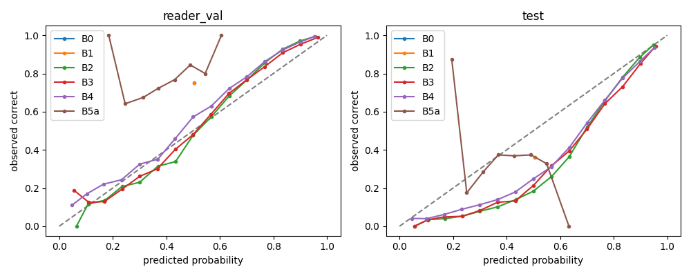
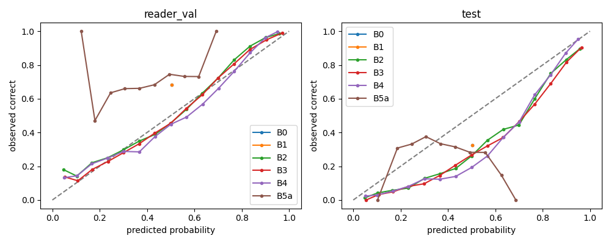

# M3 分布偏移诊断

已完成。

## 官方500题健全性检查

官方test.py bf16/batch128：{'mean': 0.798, 'ci95': [0.762, 0.832], 'n_questions': 500, 'bootstrap_resamples': 10000, 'bootstrap_rng_seed': 20261028}；相同500题M1 fp32生产结果：{'mean': 0.794, 'ci95': [0.758, 0.828], 'n_questions': 500, 'bootstrap_resamples': 10000, 'bootstrap_rng_seed': 20261028}。两协议仅差0.4pp；源训练分布高准确率在官方实现下仍存在，不能将训练/未见差距解释为CLR接口独有的协议错误。官方500题按新batch128成组，M1保留原cohort；这里只作准确率健全性检查，不是逐题一致性验收。此检查不证明没有其他混杂因素。

官方run `runs/20261103T043032691526Z_7213a3d8ae2c_852e9d`；数据固定在 `data/M23_v1a/official500.json`。

## reader_val → test

表为已见模板clean、各t等权平均；差值定义test−reader_val。NLL/Brier越低越好，accuracy越高越好；MAE标签噪声差异见基线报告。

|baseline|qtype|metric|reader_val|test|delta|
|---|---|---|---|---|---|
|B0|Q1|accuracy|0.7523401720183237|0.35975479653903414|-0.39258537547928957|
|B0|Q1|nll|0.6886485531216576|0.6957105738776072|0.007062020755949527|
|B0|Q1|brier|0.24775073925654092|0.25128164887428284|0.003530909617741912|
|B0|Q1|mae|0.4977305389585949|0.44806336930819923|-0.04966716965039569|
|B0|Q1|ece15|0.2478440205256144|0.14474216103553772|-0.10310185949007669|
|B0|Q2|accuracy|0.6828571430274418|0.3248045487063272|-0.35805259432111464|
|B0|Q2|nll|0.6905980223701113|0.6956374134336198|0.0050393910635085915|
|B0|Q2|brier|0.24872543059644245|0.2512450899396624|0.002519659343219932|
|B0|Q2|mae|0.49871303070159184|0.5012327148800805|0.002519684178488635|
|B0|Q2|ece15|0.18820064266522726|0.1787144442399343|-0.009486198425292969|
|B0|Q3|accuracy|0.34702380782081965|0.359440891515641|0.012417083694821363|
|B0|Q3|nll|1.333981854575021|1.3224954491569882|-0.011486405418032808|
|B0|Q3|brier|0.7250554164250692|0.7202370110012236|-0.004818405423845595|
|B0|Q3|ece15|0.039488997382422286|0.03722591686096273|-0.0022630805214595567|
|B0|Q4|accuracy|0.5014195059026991|0.49750383978798274|-0.003915666114716387|
|B0|Q4|nll|0.6933377839270092|0.6934247981934321|8.701426642288013e-05|
|B0|Q4|brier|0.25009522480624063|0.2501387191670282|4.349436078754376e-05|
|B0|Q4|mae|0.499982034876233|0.5000175436337789|3.55087575459323e-05|
|B0|Q4|ece15|0.007490400757108416|0.011118761130741665|0.003628360373633249|
|B1|Q1|accuracy|0.7523401720183237|0.35975479653903414|-0.39258537547928957|
|B1|Q1|nll|0.6887551091966175|0.6955098027274721|0.006754693530854561|
|B1|Q1|brier|0.24780402793770748|0.25118127607163926|0.0033772481339317817|
|B1|Q1|mae|0.4977849466460092|0.4479530652364095|-0.04983188140959971|
|B1|Q1|ece15|0.24804672740754627|0.14452338076773144|-0.10352334663981483|
|B1|Q2|accuracy|0.6858333377611069|0.3632788459459941|-0.3225544918151128|
|B1|Q2|nll|0.689313584849948|0.6952566078730992|0.005943023023151195|
|B1|Q2|brier|0.24808329130922044|0.25105467580613633|0.002971384496915891|
|B1|Q2|mae|0.4980619478793371|0.5010350233032589|0.0029730754239217783|
|B1|Q2|ece15|0.18362929423650107|0.14405441284179688|-0.03957488139470419|
|B1|Q3|accuracy|0.32940475997470675|0.35176498549325125|0.022360225518544496|
|B1|Q3|nll|1.3541047686622256|1.342075853120713|-0.01202891554151253|
|B1|Q3|brier|0.734939918631599|0.7282999186288742|-0.0066400000027248|
|B1|Q3|ece15|0.028303721204754856|0.03349594021332092|0.0051922190085660624|
|B1|Q4|accuracy|0.49974950154622394|0.49959197356587365|-0.00015752798035029159|
|B1|Q4|nll|0.6931520899136862|0.6931674792653038|1.538935161760069e-05|
|B1|Q4|brier|0.25000245514370145|0.2500101526578267|7.697514125271088e-06|
|B1|Q4|mae|0.49999610015324186|0.5000041581335523|8.057980310394175e-06|
|B1|Q4|ece15|0.0063445766766866045|0.008339965627306984|0.001995388950620379|
|B2|Q1|accuracy|0.8303978102547781|0.7169272644179209|-0.11347054583685723|
|B2|Q1|nll|0.395823264405841|0.5532376085008893|0.15741434409504834|
|B2|Q1|brier|0.12396627771002906|0.18680568748996373|0.06283940977993467|
|B2|Q1|mae|0.28311377125126974|0.3273418361232394|0.044228064871969675|
|B2|Q1|ece15|0.06537897704337077|0.04302591192894597|-0.0223530651144248|
|B2|Q2|accuracy|0.7954761868431456|0.7463634241194952|-0.049112762723650394|
|B2|Q2|nll|0.4297896339779808|0.5228227816876911|0.09303314770971033|
|B2|Q2|brier|0.1390696873977071|0.1733879830156054|0.034318295617898315|
|B2|Q2|mae|0.2952586100215004|0.3504213875248319|0.055162777503331484|
|B2|Q2|ece15|0.04121371147036553|0.04180851244892562|0.0005948009785600866|
|B2|Q3|accuracy|0.5840476155281067|0.533522869859423|-0.0505247456686837|
|B2|Q3|nll|0.9518048138845535|1.01547342255002|0.06366860866546642|
|B2|Q3|brier|0.5306171036901928|0.5684441413198198|0.037827037629627025|
|B2|Q3|ece15|0.06479962914117744|0.05238887514513948|-0.012410753996037964|
|B2|Q4|accuracy|0.5005487203598022|0.5010080678122385|0.00045934745243625397|
|B2|Q4|nll|0.6931473385720026|0.6931476621400744|3.235680717805778e-07|
|B2|Q4|brier|0.25000007095791044|0.250000244095212|1.7313730155121831e-07|
|B2|Q4|mae|0.4999998935631343|0.5000000695387522|1.7597561791093952e-07|
|B2|Q4|ece15|0.003559458823431106|0.003538023857843308|-2.143496558779795e-05|
|B3|Q1|accuracy|0.8375155528386434|0.7519782015255521|-0.08553735131309137|
|B3|Q1|nll|0.37524901543344774|0.5227520778065636|0.1475030623731159|
|B3|Q1|brier|0.11816694800342832|0.1732836216688156|0.05511667366538729|
|B3|Q1|mae|0.2625759740670522|0.3026257625647954|0.04004978849774321|
|B3|Q1|ece15|0.049400098908167885|0.03445445631273943|-0.014945642595428452|
|B3|Q2|accuracy|0.809285717351096|0.7602937732424054|-0.048991944108690566|
|B3|Q2|nll|0.39764105705987834|0.5182760655879974|0.12063500852811909|
|B3|Q2|brier|0.12912449737389883|0.16976470464751833|0.0406402072736195|
|B3|Q2|mae|0.27226566700708305|0.34532880215417777|0.07306313514709473|
|B3|Q2|ece15|0.03077251655431021|0.04844041139106281|0.0176678948367526|
|B3|Q3|accuracy|0.6564523861521766|0.5858801291102455|-0.07057225704193115|
|B3|Q3|nll|0.7717745360873994|0.8859686312221345|0.11419409513473511|
|B3|Q3|brier|0.4374320578007471|0.5048234576270694|0.06739139982632225|
|B3|Q3|ece15|0.05526228321130786|0.04121727682747171|-0.01404500638383615|
|B3|Q4|accuracy|0.7141783549672082|0.6825556868598573|-0.031622668107350815|
|B3|Q4|nll|0.556837973140535|0.588905584244501|0.032067611103966054|
|B3|Q4|brier|0.1891445645264217|0.20266028316248033|0.013515718636058632|
|B3|Q4|mae|0.3854037480694907|0.405490035102481|0.020086287032990313|
|B3|Q4|ece15|0.022659004894942426|0.01867144682034049|-0.003987558074601934|
|B4|Q1|accuracy|0.8299129775592259|0.7526297115144276|-0.0772832660447983|
|B4|Q1|nll|0.39554006854693097|0.5067117200011299|0.11117165145419888|
|B4|Q1|brier|0.12374290717499598|0.16760716197036563|0.04386425479536965|
|B4|Q1|mae|0.27675921505405787|0.29099966230846586|0.014240447254407984|
|B4|Q1|ece15|0.05311641662901755|0.032329845278784436|-0.020786571350233117|
|B4|Q2|accuracy|0.779261901265099|0.7272210376603262|-0.05204086360477278|
|B4|Q2|nll|0.4549634768849327|0.5339501060190655|0.07898662913413274|
|B4|Q2|brier|0.14860717952251432|0.17944427402246566|0.03083709449995134|
|B4|Q2|mae|0.30951680952594396|0.3594568073749542|0.049939997849010265|
|B4|Q2|ece15|0.07104761044468198|0.046942118008649066|-0.024105492436032917|
|B5a|Q1|accuracy|0.2769760165768526|0.6281805259417199|0.3512045093648673|
|B5a|Q1|nll|0.8096158537297136|0.657989237337309|-0.1516266163924046|
|B5a|Q1|brier|0.30652001700198817|0.2327162433642028|-0.07380377363778537|
|B5a|Q1|mae|0.5437719326949565|0.41762220114999066|-0.12614973154496584|
|B5a|Q1|ece15|0.32236175094190883|0.04873707334285267|-0.2736246775990562|
|B5a|Q2|accuracy|0.3715714285714285|0.6359630419331913|0.2643916133617628|
|B5a|Q2|nll|0.7906209446181144|0.6612059201460064|-0.12941502447210795|
|B5a|Q2|brier|0.2965277152045497|0.23404990140012413|-0.06247781380442555|
|B5a|Q2|mae|0.5314116132211473|0.4685727893840191|-0.06283882383712819|
|B5a|Q2|ece15|0.2336226598918438|0.08257877267499977|-0.15104388721684403|
|B5a|Q3|accuracy|0.25335714285714284|0.2454868514570007|-0.007870291400142143|
|B5a|Q3|nll|1.386089096171515|1.3867215816230747|0.0006324854515595835|
|B5a|Q3|brier|0.7498978422944036|0.7502144609094089|0.0003166186150053152|
|B5a|Q3|ece15|0.00976002391534192|0.017956513649365034|0.008196489734023114|
|B5a|Q4|accuracy|0.5035427998854852|0.5037442396313364|0.00020143974585118407|
|B5a|Q4|nll|0.6933463282185673|0.6933406055368448|-5.722681722497569e-06|
|B5a|Q4|brier|0.2500994918436546|0.25009664843794527|-2.843405709329616e-06|
|B5a|Q4|mae|0.4999870271324651|0.49998352456460216|-3.5025678629674317e-06|
|B5a|Q4|ece15|0.0057487590603728725|0.005654706108954672|-9.405295141820015e-05|

## 潜状态域分类器

|t|held-out domain AUROC|
|---|---|
|0|0.7396 ± 0.0064|
|1|0.7678 ± 0.0055|
|2|0.7294 ± 0.0113|
|3|0.7828 ± 0.0041|
|4|0.7284 ± 0.0061|
|5|0.7829 ± 0.0122|
|6|0.7369 ± 0.0046|

域诊断独立按problem ID做60/20/20划分；每域最多1005题，训练/验证/评估问题不交叉。这里test题只用于用户指定的域识别诊断；域分类器或其参数不反馈给基线选择。AUROC可包含题长、cohort/padding、题目难度等混杂因素，不能单独解释为记忆化证据。

