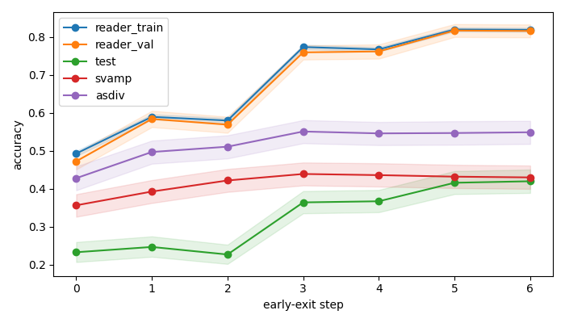

# M3 未见题池侦察

已完成。

|候选|官方许可/格式|处理|
|---|---|---|
|[SVAMP](https://github.com/arkilpatel/SVAMP)|MIT；Body/Question/Answer JSON|去重后993题，clean+早退|
|[ASDiv](https://github.com/chaochun/nlu-asdiv-dataset)|README声明CC BY-NC4.0；XML，答案含单位|严格数值+可选括号单位正则；221条格式未匹配（不一概断言均非标量），12条重叠，剩余2071题中固定抽1000题|
|[Orca-Math](https://huggingface.co/datasets/microsoft/orca-math-word-problems-200k)|MIT；question/answer两列，答案是生成的长解答|暂不作为已核实未见池：种子经Lila重划分，GSM8K原始test谱系尚未逐题排除；单一数值gold还需核验|
|[MAWPS](https://github.com/sroy9/mawps)|作者仓库主要是服务器代码，未核实所选数据文件的许可，原数据站本次不可访问|未调用源模型，不冒用第三方许可声明|

Orca-Math论文描述从Lila train/validation取包含GSM8K的种子再扩写，不能把Lila split名称当作原始GSM8K split证明。[作者论文](https://arxiv.org/html/2402.14830v1)。ASDiv仅按README允许的非商业研究使用。GSM-Plus/GSM-Hard/GSM-Symbolic全部排除。

对入选池以同一13-gram规则与完整GSM8K train/test及GSM8k-Aug检查；任何重叠剔除，记录逐题证据。此规则不能证明基础GPT2预训练从未见过，也不能排除不共享13-gram的语义改写。每池GPU预算2.5小时，合计≤5小时；只clean dump和7步早退，不生成轨迹。

## svamp_run

运行 `runs/20261103T043414920503Z_0ffa8eb65906_5d11c6`；GPU小时=0.1999，源前向=54668。

|t|accuracy|95% CI|
|---|---|---|
|0|0.3564954682779456|[0.32628398791540786, 0.3856998992950655]|
|1|0.39274924471299094|[0.36253776435045315, 0.4229607250755287]|
|2|0.4219536757301108|[0.391742195367573, 0.4521651560926485]|
|3|0.4390735146022155|[0.40886203423967776, 0.4692849949647533]|
|4|0.43605236656596175|[0.40584088620342396, 0.46727089627391744]|
|5|0.43202416918429004|[0.40181268882175225, 0.46324269889224573]|
|6|0.4300100704934542|[0.3997985901309164, 0.4612286002014099]|

## asdiv_run

运行 `runs/20261103T043815088245Z_a0358d220af9_70e23b`；GPU小时=0.2105，源前向=56360。

|t|accuracy|95% CI|
|---|---|---|
|0|0.428|[0.396, 0.459]|
|1|0.497|[0.466, 0.527]|
|2|0.511|[0.48, 0.541]|
|3|0.551|[0.52, 0.5810249999999996]|
|4|0.546|[0.515, 0.576]|
|5|0.547|[0.516, 0.578]|
|6|0.549|[0.518, 0.579]|

## M1固定参考与早退曲线

|split|t|accuracy|95% CI|
|---|---|---|---|
|reader_train|0|0.4929|[0.48605, 0.49985]|
|reader_train|1|0.5896|[0.58285, 0.5963]|
|reader_train|2|0.5799|[0.57295, 0.58675]|
|reader_train|3|0.7736|[0.7678487500000001, 0.77945]|
|reader_train|4|0.76735|[0.76145, 0.77325]|
|reader_train|5|0.8198|[0.8145, 0.82515]|
|reader_train|6|0.819|[0.8137, 0.82435]|
|reader_val|0|0.4725|[0.451, 0.4945]|
|reader_val|1|0.584|[0.5625, 0.6055]|
|reader_val|2|0.569|[0.5475, 0.59]|
|reader_val|3|0.7595|[0.7405, 0.778]|
|reader_val|4|0.762|[0.743, 0.7805]|
|reader_val|5|0.817|[0.8, 0.834]|
|reader_val|6|0.816|[0.7989875000000001, 0.833]|
|test|0|0.23283582089552238|[0.20696517412935322, 0.25970149253731345]|
|test|1|0.24676616915422886|[0.2208955223880597, 0.2746268656716418]|
|test|2|0.22686567164179106|[0.20196517412935328, 0.2527363184079602]|
|test|3|0.3641791044776119|[0.3353233830845771, 0.3940298507462687]|
|test|4|0.36716417910447763|[0.3383084577114428, 0.3970149253731343]|
|test|5|0.41592039800995023|[0.38606965174129354, 0.44676616915422884]|
|test|6|0.4199004975124378|[0.3890547263681592, 0.4507462686567164]|

