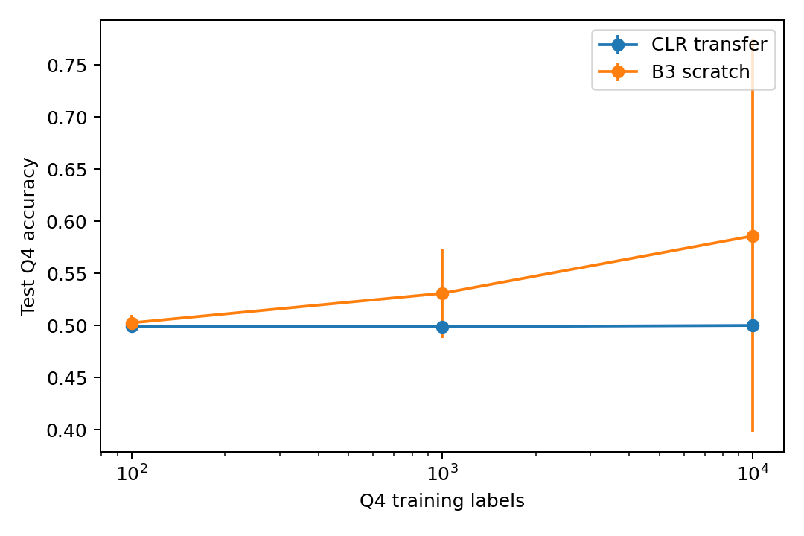
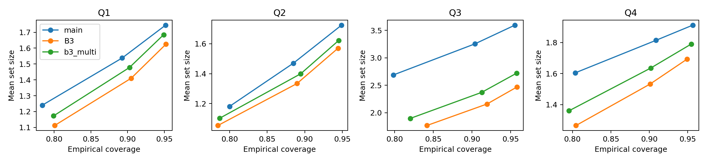

# M4 CLR v0：完整结果

仅CODI-GPT2。主表clean状态、seen模板、逐t等权平均；reader_val另有traj结果、held-out模板、逐t指标和仿射对照，全部保存在M4_metrics.csv。训练三seed11/22/33；±为三seed t区间（df2）；配对差异为按题10000次bootstrap，合并三seed均值。没有预设非劣界，不把不显著当作已证明不劣。

## 主结果

|model|split|Q1 NLL|Q2 AUROC|Q3 acc|Q4 acc|Q3−B0|
|---|---|---|---|---|---|---|
|B0|reader_val|0.689 ± 4.61e-05|0.496 ± 0.0198|0.347 ± 0.000911|0.501 ± 0.00358|0 ± 0|
|B0|test|0.696 ± 2.66e-05|0.508 ± 0.0227|0.359 ± 0.00795|0.498 ± 0.00735|0 ± 0|
|B4|reader_val|0.396 ± 0.00163|0.848 ± 0.000278|—|—|—|
|B4|test|0.507 ± 0.00254|0.845 ± 0.00285|—|—|—|
|B3|reader_val|0.375 ± 0.000922|0.867 ± 0.00137|0.656 ± 0.00544|0.714 ± 0.00504|0.309 ± 0.00501|
|B3|test|0.523 ± 0.00726|0.846 ± 0.00562|0.586 ± 0.00194|0.683 ± 0.0109|0.226 ± 0.00765|
|B3_matched|reader_val|0.412 ± 0.0134|0.854 ± 0.0146|0.573 ± 0.00706|0.526 ± 0.0908|0.226 ± 0.00716|
|B3_matched|test|0.574 ± 0.0422|0.841 ± 0.00355|0.526 ± 0.00194|0.523 ± 0.087|0.167 ± 0.00743|
|b3_multi|reader_val|0.401 ± 0.011|0.851 ± 0.00233|0.582 ± 0.00583|0.659 ± 0.0126|0.235 ± 0.00666|
|b3_multi|test|0.565 ± 0.0187|0.836 ± 0.00825|0.532 ± 0.00568|0.636 ± 0.012|0.173 ± 0.0129|
|main|reader_val|0.46 ± 0.0944|0.831 ± 0.00954|0.34 ± 0.0487|0.5 ± 0.00156|-0.00657 ± 0.0489|
|main|test|0.61 ± 0.144|0.821 ± 0.021|0.356 ± 0.0481|0.499 ± 0.00223|-0.00355 ± 0.0416|

|model|split|qtype|NLL|Brier|MAE|acc|AUROC|ECE15|
|---|---|---|---|---|---|---|---|---|
|B0|reader_val|Q1|0.689 ± 4.61e-05|0.248 ± 2.3e-05|0.498 ± 2.35e-05|0.752 ± 0|—|0.248 ± 4.59e-05|
|B0|reader_val|Q2|0.691 ± 0.000137|0.249 ± 6.84e-05|0.499 ± 6.98e-05|0.683 ± 0|0.496 ± 0.0198|0.188 ± 0.000138|
|B0|reader_val|Q3|1.33 ± 0.00655|0.725 ± 0.0019|—|0.347 ± 0.000911|—|0.0395 ± 0.0106|
|B0|reader_val|Q4|0.693 ± 0.000295|0.25 ± 0.000147|0.5 ± 3.44e-05|0.501 ± 0.00358|0.502 ± 0.00177|0.00753 ± 0.00996|
|B0|test|Q1|0.696 ± 2.66e-05|0.251 ± 1.33e-05|0.448 ± 1.35e-05|0.36 ± 0|—|0.145 ± 4.67e-05|
|B0|test|Q2|0.696 ± 0.000139|0.251 ± 6.97e-05|0.501 ± 6.84e-05|0.325 ± 0|0.508 ± 0.0227|0.179 ± 0.000193|
|B0|test|Q3|1.32 ± 0.0029|0.72 ± 0.00148|—|0.359 ± 0.00795|—|0.0372 ± 0.0139|
|B0|test|Q4|0.693 ± 0.000452|0.25 ± 0.000226|0.5 ± 7.65e-05|0.498 ± 0.00735|0.499 ± 0.00499|0.0112 ± 0.013|
|B4|reader_val|Q1|0.396 ± 0.00163|0.124 ± 0.000824|0.277 ± 0.00215|0.83 ± 0.0017|—|0.0531 ± 0.00352|
|B4|reader_val|Q2|0.455 ± 0.00521|0.149 ± 0.00155|0.31 ± 0.00358|0.779 ± 0.00149|0.848 ± 0.000278|0.0711 ± 0.00444|
|B4|test|Q1|0.507 ± 0.00254|0.168 ± 0.000888|0.291 ± 0.00102|0.753 ± 0.00324|—|0.0323 ± 0.00348|
|B4|test|Q2|0.534 ± 0.00104|0.179 ± 0.000333|0.359 ± 0.000437|0.727 ± 0.00282|0.845 ± 0.00285|0.047 ± 0.00276|
|B3|reader_val|Q1|0.375 ± 0.000922|0.118 ± 0.000356|0.263 ± 0.00147|0.838 ± 0.0041|—|0.0494 ± 0.0037|
|B3|reader_val|Q2|0.398 ± 0.00366|0.129 ± 0.00111|0.272 ± 0.00818|0.809 ± 0.00668|0.867 ± 0.00137|0.0308 ± 0.00587|
|B3|reader_val|Q3|0.772 ± 0.00814|0.437 ± 0.00365|—|0.656 ± 0.00544|—|0.0553 ± 0.0126|
|B3|reader_val|Q4|0.557 ± 0.00208|0.189 ± 0.00125|0.385 ± 0.00259|0.714 ± 0.00504|0.78 ± 0.00516|0.0226 ± 0.00817|
|B3|test|Q1|0.523 ± 0.00726|0.173 ± 0.00287|0.303 ± 0.00646|0.752 ± 0.00459|—|0.0345 ± 0.00488|
|B3|test|Q2|0.518 ± 0.0167|0.17 ± 0.00744|0.345 ± 0.0158|0.76 ± 0.0133|0.846 ± 0.00562|0.0486 ± 0.00554|
|B3|test|Q3|0.886 ± 0.00349|0.505 ± 0.000418|—|0.586 ± 0.00194|—|0.0412 ± 0.00401|
|B3|test|Q4|0.589 ± 0.00437|0.203 ± 0.00175|0.405 ± 0.000423|0.683 ± 0.0109|0.745 ± 0.00527|0.0187 ± 0.00611|
|B3_matched|reader_val|Q1|0.412 ± 0.0134|0.13 ± 0.00352|0.298 ± 0.0194|0.827 ± 0.00294|—|0.08 ± 0.0262|
|B3_matched|reader_val|Q2|0.419 ± 0.0265|0.137 ± 0.00783|0.285 ± 0.0298|0.799 ± 0.0115|0.854 ± 0.0146|0.0336 ± 0.02|
|B3_matched|reader_val|Q3|0.961 ± 0.0399|0.537 ± 0.0194|—|0.573 ± 0.00706|—|0.0669 ± 0.015|
|B3_matched|reader_val|Q4|0.689 ± 0.0178|0.248 ± 0.00887|0.495 ± 0.0212|0.526 ± 0.0908|0.537 ± 0.123|0.00905 ± 0.0262|
|B3_matched|test|Q1|0.574 ± 0.0422|0.195 ± 0.0185|0.346 ± 0.0372|0.71 ± 0.027|—|0.0566 ± 0.0121|
|B3_matched|test|Q2|0.52 ± 0.0177|0.171 ± 0.00905|0.35 ± 0.0195|0.759 ± 0.024|0.841 ± 0.00355|0.0506 ± 0.019|
|B3_matched|test|Q3|1.01 ± 0.0158|0.569 ± 0.00455|—|0.526 ± 0.00194|—|0.0483 ± 0.00917|
|B3_matched|test|Q4|0.688 ± 0.0209|0.248 ± 0.0103|0.495 ± 0.0204|0.523 ± 0.087|0.538 ± 0.124|0.0072 ± 0.0193|
|b3_multi|reader_val|Q1|0.401 ± 0.011|0.128 ± 0.00277|0.286 ± 0.0106|0.823 ± 0.00599|—|0.0618 ± 0.0109|
|b3_multi|reader_val|Q2|0.424 ± 0.0153|0.139 ± 0.00468|0.289 ± 0.0234|0.793 ± 0.013|0.851 ± 0.00233|0.0393 ± 0.0279|
|b3_multi|reader_val|Q3|0.924 ± 0.0158|0.517 ± 0.00803|—|0.582 ± 0.00583|—|0.0488 ± 0.0171|
|b3_multi|reader_val|Q4|0.614 ± 0.00358|0.214 ± 0.0019|0.43 ± 0.00717|0.659 ± 0.0126|0.716 ± 0.00346|0.0222 ± 0.0034|
|b3_multi|test|Q1|0.565 ± 0.0187|0.191 ± 0.00747|0.336 ± 0.017|0.721 ± 0.00418|—|0.0514 ± 0.0229|
|b3_multi|test|Q2|0.54 ± 0.043|0.179 ± 0.0184|0.362 ± 0.0411|0.74 ± 0.0252|0.836 ± 0.00825|0.0486 ± 0.013|
|b3_multi|test|Q3|0.997 ± 0.0119|0.56 ± 0.00369|—|0.532 ± 0.00568|—|0.0424 ± 0.0186|
|b3_multi|test|Q4|0.635 ± 0.00664|0.223 ± 0.00363|0.444 ± 0.00406|0.636 ± 0.012|0.687 ± 0.0115|0.0246 ± 0.00779|
|main|reader_val|Q1|0.46 ± 0.0944|0.148 ± 0.0297|0.335 ± 0.105|0.798 ± 0.0363|—|0.101 ± 0.151|
|main|reader_val|Q2|0.452 ± 0.038|0.149 ± 0.0165|0.321 ± 0.0351|0.777 ± 0.0183|0.831 ± 0.00954|0.0605 ± 0.045|
|main|reader_val|Q3|1.34 ± 0.0454|0.727 ± 0.0247|—|0.34 ± 0.0487|—|0.0469 ± 0.0507|
|main|reader_val|Q4|0.693 ± 5.32e-06|0.25 ± 2.66e-06|0.5 ± 3.13e-06|0.5 ± 0.00156|0.5 ± 0.000898|0.00153 ± 0.00158|
|main|test|Q1|0.61 ± 0.144|0.211 ± 0.0691|0.374 ± 0.122|0.649 ± 0.266|—|0.106 ± 0.097|
|main|test|Q2|0.595 ± 0.0603|0.203 ± 0.0272|0.411 ± 0.0511|0.722 ± 0.0613|0.821 ± 0.021|0.121 ± 0.0345|
|main|test|Q3|1.33 ± 0.0382|0.722 ± 0.0214|—|0.356 ± 0.0481|—|0.0337 ± 0.0179|
|main|test|Q4|0.693 ± 1.09e-05|0.25 ± 5.47e-06|0.5 ± 5.67e-06|0.499 ± 0.00223|0.5 ± 0.00135|0.00221 ± 0.0025|
|augmented|reader_val|Q1|0.414 ± 0.0371|0.132 ± 0.0105|0.297 ± 0.0479|0.82 ± 0.00581|—|0.071 ± 0.0608|
|augmented|reader_val|Q2|0.456 ± 0.134|0.15 ± 0.0435|0.309 ± 0.154|0.777 ± 0.0563|0.839 ± 0.0371|0.0602 ± 0.134|
|augmented|reader_val|Q3|1.21 ± 0.545|0.665 ± 0.263|—|0.422 ± 0.301|—|0.0562 ± 0.06|
|augmented|reader_val|Q4|0.684 ± 0.0409|0.245 ± 0.0212|0.49 ± 0.0417|0.534 ± 0.146|0.56 ± 0.258|0.0147 ± 0.0574|
|augmented|test|Q1|0.577 ± 0.118|0.197 ± 0.0506|0.343 ± 0.096|0.704 ± 0.107|—|0.072 ± 0.0738|
|augmented|test|Q2|0.555 ± 0.209|0.186 ± 0.0934|0.369 ± 0.199|0.715 ± 0.213|0.831 ± 0.0204|0.0672 ± 0.0949|
|augmented|test|Q3|1.22 ± 0.441|0.672 ± 0.206|—|0.416 ± 0.209|—|0.0465 ± 0.0235|
|augmented|test|Q4|0.685 ± 0.0357|0.246 ± 0.0174|0.492 ± 0.0329|0.53 ± 0.127|0.547 ± 0.205|0.00941 ± 0.0328|

## Mondrian α=0.1

|qtype|val B3 cov/size|val CLR cov/size|test B3 cov/size|test CLR cov/size|
|---|---|---|---|---|
|Q1|0.939 / 1.29|0.938 / 1.35|0.905 / 1.41|0.893 / 1.54|
|Q2|0.913 / 1.26|0.919 / 1.34|0.89 / 1.33|0.885 / 1.47|
|Q3|0.946 / 2.09|0.88 / 3.15|0.92 / 2.16|0.904 / 3.25|
|Q4|0.9 / 1.47|0.884 / 1.77|0.901 / 1.53|0.909 / 1.81|

所有α=.05/.1/.2及两种校准见M4_conformal.csv。Q1的reader_val MAE参照单条Bernoulli标签，test MAE参照K16均值，二者目标噪声不同；NLL/Brier均按Bernoulli样本定义。Q1预测未来Bernoulli正误而非V本身；校准每题固定抽一个MC结果，评估覆盖率对K16结果平均。每(qtype,t)每题仅一实例。依赖层内可交换性；cohort padding、Q4跨题匹配、选项干扰池造成依赖，报告经验覆盖率而非无条件理论保证。未见池有分布偏移，不主张GSM阈值保覆盖。

## 小样本Q4迁移

|N|val CLR|val B3|test CLR|test B3|
|---|---|---|---|---|
|100|0.501 ± 0.00123|0.503 ± 0.00172|0.499 ± 0.00285|0.503 ± 0.00791|
|1000|0.501 ± 0.00209|0.532 ± 0.0382|0.499 ± 0.00502|0.531 ± 0.043|
|10000|0.5 ± 0.000337|0.595 ± 0.205|0.5 ± 0.000575|0.586 ± 0.188|

## 架构与协议

官方ModernBERT-base固定revision8949b909ec900327062f0ebf497f51aef5e6f0c8，LFS SHA-256核验。22层双向encoder，冻结词嵌入、训练其余主体，2层768维adapter+步位置+source token；隔k层cross-attention读观测前缀。模板和选项只见祖先与自身，父块不读子块，兄弟共享逻辑位置；8维数值特征与B3相同。公开接口先规范排序再恢复选项顺序，另有不依赖排序的mask隔离测试。Q4从值选项标记读yes-no，Q1/Q2从CLS读；不输入原题、不读feedback噪声向量。

来源：[ModernBERT官方](https://huggingface.co/answerdotai/ModernBERT-base)、[NDM原文](https://arxiv.org/html/2610.25553)。采用ModernBERT是因本地Transformers支持自定义双向SDPA和逻辑RoPE位置，适合上述块掩码；没有更换到小模型。训练设置、吞吐与预算见M4_budget_v2.md；B3_matched为四个独立MLP，训练到同seed CLR最佳epoch，qtype采样/有效batch/样本数匹配，末轮检查点不另调参；原M3全池B3仍作为主参考；k选择和完整检查点锁见data/M4_v0/hyperparameters_lock.json及training_complete.json。

## 校准

按qtype在cal_A拟合温度，以及温度+二分类log-odds偏置。Q3共享选项偏置被softmax抵消，仿射等价温度；不引入位置偏置。B3完全相同校准流程。改善量见M4_affine_gains.csv；纯温度为主方案，未据test选择校准。

## D数据与限制

{"unseen_train": {"problems": 996, "rows": 98964, "counts": {"Q2": 6972, "Q4": 11984, "Q3": 42992, "Q1": 37016}, "q4_unpaired": ["asdiv:nluds-1847"], "q4_parse_failed": 139}, "unseen_eval": {"problems": 997, "rows": 99603, "counts": {"Q1": 6979, "Q2": 6979, "Q4": 12264, "Q3": 6979}, "q4_unpaired": ["asdiv:nluds-0325"], "q4_parse_failed": 120}}

SVAMP993按ID496/497、ASDiv1000按ID500/500冻结。复用M3干净/早退，train K8轨迹、eval每t K16π；原生产fp32/batch1/cohort上下文保持。原始方程式259题解析失败，仅跳过这些题Q4，其他类型保留；有解析成功题的池保留Q4。两个新半池之间172题13-gram重叠（精确0），保留用户指定划分并另报825无重叠eval子集；不把这172题称独立题族泛化证据。与GSM训练/测试/Aug去重复用M3证据。

源成本：{"status": "completed", "run_id": "20261103T063500842769Z_924ffcfc4ca2_e9f41f", "config_sha256": "924ffcfc4ca2215f9e8adb5c3299ad0f575603166e37fa597b39d8f8191f084d", "completed_questions": 1993, "gpu_hours": 0.4191445622558321, "source_forward_calls": 117130, "progress": "unseen_eval", "projected_full_gpu_hours": 0.4126567139654071}

总M4 GPU作业墙钟小时（含加载/失败/smoke）=53.81280269824139；GPU RTX4090，训练评估新source forward=0，D调用单列。CPU报告不记GPU。预算内优先四项必做；可选无cross、单步、无块、随机初始化实验未做；不能将任何整体优势单独归因于cross-attention、前缀、预训练或参数容量。

## 证据索引

runs见data/M4_v0/evaluation_suite.json、training_suite.json；逐实例预测在各评估run；M4_paired_bootstrap.csv、M4_shift_gaps.csv、M4_cp_paired_bootstrap.csv；冻结清单data/M4_v0/freeze.json。